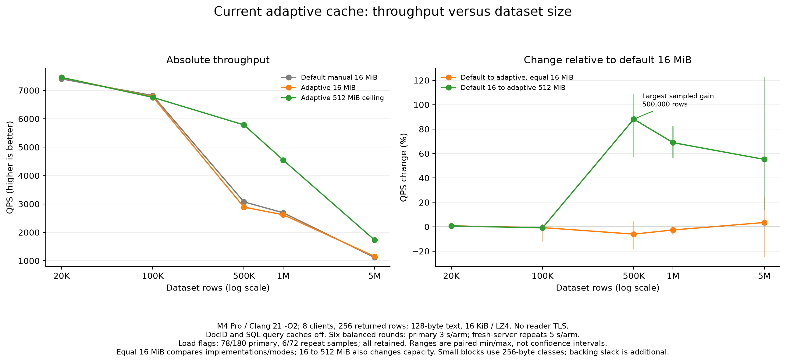
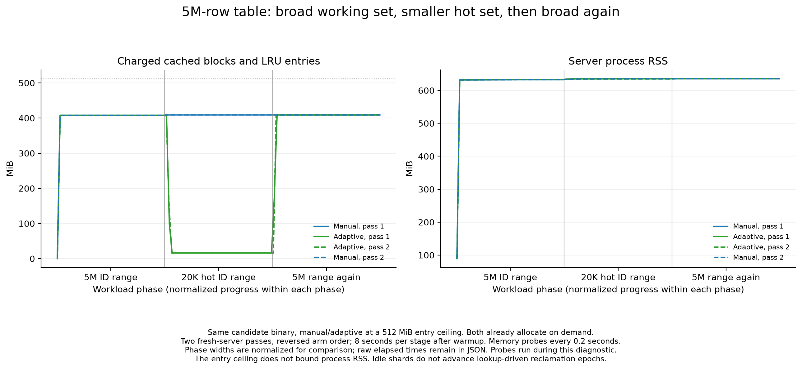

# Adaptive docstore cache: current implementation and process-memory return

Historical snapshot: the latest admission/pin-release implementation is now
included in #5042. Use the [2026-11-14 report](adaptive-docstore-2026-11-14/REPORT.md)
for the fresh capacity matrix and memory-return measurements. The original
measurements below are retained unchanged.

The current experimental adaptive cache stores decoded payloads in its own
system-mapped regions and releases fully empty regions to the OS. The tables
below compare the current implementation with the published #5042 default
configuration. It reports throughput, CPU per query and observed process
memory through a shrinking and expanding working set.

The throughput and memory results below are all newly measured with the same
validated source. Five data sizes cover QPS and CPU per query; two fresh-server
broad/hot/broad passes check process-memory return and refill. The 512 MiB
comparison also changes capacity. No universal throughput gain or precise
dataset-size optimum is claimed.

[Current source commit `f5cf080`](https://github.com/orca-zhang/manticoresearch/commit/f5cf080a497d2986336ab514a0fab78536198837),
[raw evidence and plans](evidence/2026-11-13/vm-cache/),
[QPS/CPU comparison CSV](evidence/2026-11-13/vm-cache/summary.csv),
[download evidence](attachments/adaptive-cache-evidence.zip).
The source is a separate opt-in experiment. Production [#5042](https://github.com/manticoresoftware/manticoresearch/pull/5042)
remains `376fbf9`, with no reader TLS; [#5045](https://github.com/manticoresoftware/manticoresearch/pull/5045)
remains TLS-only at `019868e9`. No adaptive-plus-TLS measurement exists.

## What the current implementation improves

- **Decoded payloads bypass heap retention.** POSIX uses anonymous mappings;
  Windows uses `VirtualAlloc`. Compressed blocks decode directly into their
  destination; uncompressed small/large fields are also supported. Metadata,
  temporary compressed input and query output still use the process heap.
- **Small blocks share mapped regions.** Payloads up to 31 KiB use 256-byte
  size classes packed into 64 KiB regions. This avoids rounding each slightly
  over-16-KiB block to 32 KiB on Apple hardware with 16 KiB memory pages.
  Larger payloads use dedicated page-rounded mappings.
- **Empty regions return to the OS.** The last live block frees its region via
  `munmap`/`VirtualFree`, apart from one reusable empty 64 KiB region per shard.
  Sixteen shards retain at most 1 MiB of completely empty spare regions.
  Dedicated large mappings are released immediately. Allocation reuses free
  slots and the empty spare before requesting more mappings.
- **Ownership covers all read paths.** Cache references protect active blocks;
  rejected or duplicate admissions release through the correct allocator.
  Oversized payloads and mapping failures fall back to the process heap.
- **Accounting separates entries, mappings and process memory.** The existing
  used-byte metric charges small slots or large mappings plus LRU nodes.
  New mapped/spare metrics expose backing-region overhead and empty retention.
  RSS and physical footprint are measured independently in the diagnostic.

The cache retains seeded XXH3-64, fixed shard mapping, no reader TLS and no
process-wide generation counter. Each shard observes 4096-lookup windows
under its existing lock. Four windows with >=99% hits and touched bytes below
one quarter of retained bytes permit cold-entry reclamation. It targets twice
recent touched bytes, with a floor totaling up to 16 MiB. At most 32 entries
are inspected per 64 lookups. Referenced or recently touched entries survive.
The floor is a target, not a minimum allocation or guaranteed final occupancy.
Idle shards do not advance this lookup-driven policy.

The experiment remains explicit opt-in:

```ini
docstore_cache_size = 512m
docstore_cache_adaptive = 1
```

Default settings remain 16 MiB/manual. Allocation is already on demand;
`512m` does not reserve 512 MiB at startup. The entry ceiling is not a process
RSS or mapped-address-space ceiling. Partially occupied regions retain unused
slots; these can keep a region mapped until its final live block is freed.
In-flight blocks, bounded empty spares, hash tables, metadata, heap fallbacks
and other engine memory are additional. Virtual mapped bytes are not resident
physical bytes.

## Default configuration versus current adaptive mode

Baseline: the published #5042 shared-cache binary `376fbf9`, manual 16 MiB,
with native DocID and SQL query caches off. Adaptive 16 MiB changes implementation and mode
at the same configured entry ceiling. Adaptive 512 MiB also raises capacity;
its gain must not be attributed solely to the adaptive policy.

Apple M4 Pro / Clang 21 `-O2 -DNDEBUG`; eight clients and eight server workers,
256 returned rows, 128-byte rowwise text, 16 KiB/LZ4, persistent HTTP and an
8 MiB reader-buffer budget. Both cache ceilings use 16 shards. Six balanced
Williams rounds ×5 seconds per arm; one queried arm at a time. Every returned
ID and text value is checked. Each client warms and cycles through 20 fixed
random 256-ID queries (seed 513). These finite pools are not a cold full-table
scan, even on the 5M-row table.

All six server instances remain alive during a matrix group. The transition
diagnostic uses one server at a time; its RSS snapshots and the primary memory
medians therefore describe different process/system states.

Values are medians of six arm samples; changes are ratios of medians. Lower
server CPU milliseconds per completed query is better. Ranges are min/max of
six within-round QPS changes, not confidence intervals. No control subtraction
is applied.



### Equal 16 MiB

| Rows | Default QPS | Adaptive QPS | QPS change | Default CPU ms/query | Adaptive CPU ms/query | CPU/query change |
| --- | --- | --- | --- | --- | --- | --- |
| 20,000 | 7,541.3 | 7,505.4 | -0.48% | 0.8666 | 0.8735 | +0.79% |
| 100,000 | 6,942.4 | 6,959.1 | +0.24% | 0.9654 | 0.9630 | -0.25% |
| 500,000 | 3,329.3 | 3,386.1 | +1.71% | 2.0680 | 2.0208 | -2.28% |
| 1,000,000 | 2,868.8 | 2,871.1 | +0.08% | 2.4927 | 2.4771 | -0.63% |
| 5,000,000 | 1,652.2 | 1,648.4 | -0.23% | 4.6148 | 4.6193 | +0.10% |

### Adaptive 512 MiB ceiling

| Rows | Default QPS | Adaptive QPS | QPS change | Default CPU ms/query | Adaptive CPU ms/query | CPU/query change |
| --- | --- | --- | --- | --- | --- | --- |
| 20,000 | 7,541.3 | 7,484.0 | -0.76% | 0.8666 | 0.8767 | +1.17% |
| 100,000 | 6,942.4 | 7,005.1 | +0.90% | 0.9654 | 0.9591 | -0.66% |
| 500,000 | 3,329.3 | 6,272.2 | +88.40% | 2.0680 | 1.0929 | -47.15% |
| 1,000,000 | 2,868.8 | 5,172.0 | +80.29% | 2.4927 | 1.3648 | -45.25% |
| 5,000,000 | 1,652.2 | 2,233.1 | +35.16% | 4.6148 | 3.4372 | -25.52% |

The 512 MiB comparison changes capacity as well as mode. Its sampled curve
locates useful operating points for this query pool, not a universal dataset
size optimum. Projection width, decoded-block reuse and concurrency determine
the working set. Internal equal-512 controls and the VM-16→512 comparison are
retained in the CSV for attribution. Gains from separate comparisons must not
be added or multiplied. All negative results remain.


### Measurement setup

The full measurement uses the validated binaries and the exact archived driver,
fresh servers at every size, and six balanced rounds ×5 seconds per arm.
The plans were saved before their respective results. All five sizes and
both memory passes are newly measured; no earlier measurement is pooled into
the current tables or figures.

### Cache disabled control: same current binary

| Rows | Cache-off QPS | Cache-off CPU ms/query | Adaptive 16 QPS change | CPU/query change | Adaptive 512 QPS change | CPU/query change |
| --- | --- | --- | --- | --- | --- | --- |
| 20,000 | 5,898.8 | 1.1338 | +27.24% | -22.96% | +26.87% | -22.68% |
| 100,000 | 5,276.7 | 1.2880 | +31.88% | -25.23% | +32.75% | -25.54% |
| 500,000 | 4,069.4 | 1.7451 | -16.79% | +15.80% | +54.13% | -37.37% |
| 1,000,000 | 3,430.5 | 2.1104 | -16.31% | +17.37% | +50.77% | -35.33% |
| 5,000,000 | 1,789.1 | 4.2561 | -7.87% | +8.53% | +24.82% | -19.24% |

At 20k/100k rows, both current cache ceilings outperform cache-off in this workload. At 500k/1M/5M, the 16 MiB ceiling lowers throughput relative to cache-off, while 512 MiB improves it. Cold-entry reclamation cannot remove miss/admission costs when the active working set exceeds the ceiling. The largest sampled gain relative to default occurs at 500k, not at the largest table. Equal-16 differences remain small; no universal policy-only speedup is established.

## Process memory returned to the OS

The diagnostic uses the same 5M-row table, first querying a broad 5M ID range,
then a 20k hot prefix, then the broad range again. Each stage warms its pool
and runs eight timed seconds. Two fresh-server passes reverse internal
control/current arm order. Status/RSS/footprint probes run every 0.2 seconds;
this is a memory diagnostic, not the primary QPS comparison. Phase widths in
the figure are normalized; raw timestamps remain in JSON.



| Pass | Stage | Charged entries MiB | Mapped regions MiB | Empty spares MiB | Process RSS MiB | Physical footprint MiB |
| --- | --- | --- | --- | --- | --- | --- |
| 1 | large | 411.21 | 529.62 | 0.00 | 631.30 | 553.75 |
| 1 | hot | 15.80 | 47.06 | 1.00 | 150.39 | 72.84 |
| 1 | large-again | 412.17 | 530.81 | 0.00 | 634.52 | 556.97 |
| 2 | large | 411.21 | 529.62 | 0.00 | 630.78 | 553.02 |
| 2 | hot | 15.80 | 51.62 | 1.00 | 153.77 | 76.00 |
| 2 | large-again | 412.17 | 530.81 | 0.00 | 633.42 | 555.66 |

Pass 1: broad→hot RSS changes by -480.91 MiB; mapped address space changes by -482.56 MiB. The final broad stage reaches 634.52 MiB RSS after refilling.

Pass 2: broad→hot RSS changes by -477.02 MiB; mapped address space changes by -478.00 MiB. The final broad stage reaches 633.42 MiB RSS after refilling.

These are observed process RSS/footprint values, separate from cache-entry
counters. The kernel release calls are checked, and no process-global heap
trim/purge is invoked. The pool cannot release a partially occupied region;
remaining fragmentation and unrelated heap allocations explain why entry bytes,
mapping bytes and RSS need not converge to the same value. The run does not
establish behavior under memory pressure, after a fully idle workload, or on
Linux/Windows allocators.

`docstore_cache_used_bytes` reports charged retained entries;
`docstore_cache_mapped_bytes` reports all pool virtual mappings, including
partially occupied regions and in-flight blocks; `docstore_cache_spare_bytes`
reports only completely empty retained regions. Snapshots use separate locks
and are not globally atomic. Heap-fallback storage is absent from mapped/spare
metrics. Monitoring overhead at production polling rates is unmeasured.

### Latest throughput-run memory medians

| Rows | Default RSS MiB | Adaptive 16: entry / mapped / RSS MiB | Adaptive 512: entry / mapped / RSS MiB |
| --- | --- | --- | --- |
| 20,000 | 34.65 | 2.53 / 3.62 / 33.09 | 2.53 / 3.62 / 33.09 |
| 100,000 | 47.23 | 12.65 / 16.75 / 47.70 | 12.65 / 16.75 / 47.13 |
| 500,000 | 81.44 | 15.80 / 22.00 / 58.48 | 63.24 / 81.69 / 116.22 |
| 1,000,000 | 91.05 | 15.80 / 22.00 / 67.48 | 126.01 / 162.81 / 207.12 |
| 5,000,000 | 129.01 | 15.80 / 22.00 / 124.05 | 411.21 / 529.62 / 631.65 |

## Load control, raw data and interpretation limits

Each group waits for a continuous 30-second idle gate: mean >=90%, minimum
interval >=80%. One-second CPU telemetry covers every timed interval fully.
External CPU is estimated for surviving processes outside benchmark process
trees; short-lived processes can be missed. A flag means sample-average
external CPU >10% of machine capacity or any overlapping interval >20%.
Flags are annotations, not exclusion rules or proof of causation. CPU placement,
frequency and desktop activity remain uncontrolled. No confidence interval or
universal no-regression guarantee is claimed.

| Run | Timed arm samples | Checked timed queries | Load-flagged samples | Diagnostic stage samples | Checked diagnostic queries | Diagnostic flags |
| --- | --- | --- | --- | --- | --- | --- |
| idle-repeat | 180 | 4,496,090 | 1 | 12 | 409,801 | 0 |

Per-arm/per-round external-CPU means, peaks, flags and telemetry coverage are retained in `summary.json` and the raw logs. No flagged sample is excluded. Idle gates and load logs do not establish frequency/CPU-placement control or a precise optimum.

All default/current/cache-off comparison samples and all new memory stages are unflagged. The single flag belongs to the internal manual-512 control at 20k, round 0; it is retained.

The primary table has six internal arms: published default 16 MiB; equal-512
manual/adaptive heap controls; current adaptive 16/512 MiB; and current cache
off. Those controls help separate capacity and allocator effects, and remain
in raw JSON/CSV. They are not presented as separate versions in the main
comparison. Every completed final sample is retained, including per-arm
journals that survive an interrupted case. The plan was written before final
results. The summarizer checks exact driver/source hashes, journals, medians,
ratios, paired ranges, ceiling bounds, lifecycle checks and full telemetry.

Development records and prior measurements remain in archived evidence. None
is pooled into the current default/adaptive comparisons.

## Validation and source scope

Current source is `f5cf080a497d2986336ab514a0fab78536198837`. The measured searchd SHA256 is
`96403c25079f46ea3cc1603a4e0f52aa1e542944589e0d69ef10e74f4bb87e50`. All six affected translation units were
recompiled with the recorded Clang 21 commands; changed archive objects replace
original objects and unchanged engine/dependencies are reused. Exact commands,
source snapshots, patch, hashes and calibration exports are in the evidence.

- Full native suite: **537/537 passed**.
- Focused native, ASan+UBSan and TSan: **19 tests ×20 each passed**.
- Tests cover packing above a page boundary, reuse, excess-region release,
  concurrent allocation/release, pinned cache references, stored-field
  reclamation, uncompressed small/large fields, tiny-budget fallback and the
  full 100k-row/128-byte working set fitting the default 16 MiB entry budget.
- API smoke passes with the mapped/spare metric golden. The pinned-Buddy exact
  metric exclusions are extended for metrics that Buddy does not yet export.
- Every timed response and post-timing REPLACE/flush/DROP/recreate check passes;
  native DocID used bytes are checked as zero.

Sanitizers instrument docstore, SkipCache, file I/O and focused tests; other
linked libraries are reused uninstrumented. This is not whole-engine sanitizer
coverage. Custom mapped slots do not acquire normal per-allocation heap redzones.
LeakSanitizer is unsupported on this macOS runtime; ASan uses `detect_leaks=0`.
Supported stack-calibration overrides are inherited from the earlier Clang 21
build; no fresh automatic calibration is claimed. Generic LRU epoch metadata
remains part of the experiment even in manual mode; SkipCache throughput is
unmeasured. Mapped-region fields add metadata to cached block values.

The experimental branch is separate from production #5042/#5045. Local test
success is not upstream CI success. [#5042 run 43408089087](https://github.com/manticoresoftware/manticoresearch/actions/runs/43408089087)
was rechecked during this review: `action_required`, zero jobs, awaiting
maintainer fork-workflow approval. No new Linux/Windows CI result,
adaptive-plus-TLS result or cold-storage/memory-pressure result is established.

[Reproduction guide](repro/2026-11-13/README.md#adaptive-cache-follow-up).
