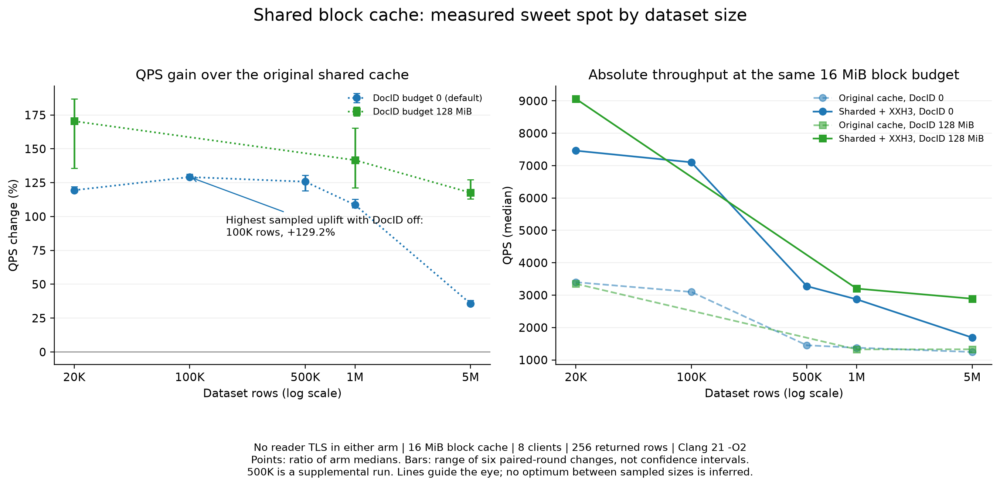
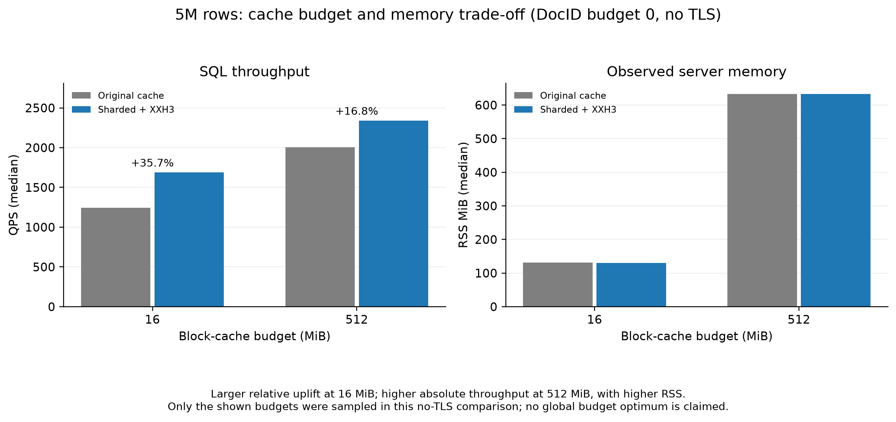

# Shared docstore block cache and #5042 CI repair (2026-11-13)

PR #5042 now contains its original opt-in native DocID→RowID cache plus an
independent shared docstore block-cache optimization: up to 16 locked LRU
shards using the project's existing XXH3-64 helper. The pushed production source
is `376fbf9988b2458ee196a5d92135c35a5121edc7`. **It contains no reader TLS and
no global reader-generation counter.** PR #5045 remains TLS-only and independent.

The results below compare the final #5042 implementation **without TLS in either
arm**, with the same DocID-cache budget in both arms. The older prototype's
TLS-present measurements are separately preserved and are not substituted here.

## Design, budgets and unchanged data format

The new native DocID cache remains disabled by default (`docid_lookup_cache_size=0`).
It stores immutable per-chunk u64 keys/u32 rows with a cache-line-aware directory,
uses point/interleaved batches for applicable sparse ID probes and falls back
to the existing compressed lookup when disabled, refused or inapplicable. Its
full allocation and alignment padding are charged to the process-wide budget;
allocator metadata/RSS are separate. There is no eviction or automatic retry.
Remap/destruction reclaim it. Existing disk formats, dense/range/UUID policies,
planner/hint behavior and original layout evidence remain documented in
[PERFORMANCE.md](PERFORMANCE.md) and [DESIGN_NOTES.md](DESIGN_NOTES.md).

The shared docstore cache holds decoded stored-field blocks, not DocID results
or SQL query results. The default `docstore_cache_size` stays 16 MiB:

- Select a power-of-two shard count, up to 16, with approximately at least
  1 MiB entry budget per shard. Budgets below 2 MiB keep one shard; 16 MiB uses
  16. The configured entry budgets sum exactly to the original global budget.
- Hash the 8-byte offset using existing `HashWithSeed` (seeded XXH3-64), with
  index ID as seed, then truncate to 32 bits. High four bits route the shard;
  low bits remain available for table buckets. Full index/offset equality is
  still checked, so hash collisions do not change result correctness.
- Each shard owns its locked LRU table. Find/Add/Release remain locked, including
  reference counts and eviction. No TLS copy of block data or borrowed block
  pointer is added. Index removal/clear visit all shards and retain existing
  valid-lifetime/quiescence preconditions; this is no new reclamation protocol.
- Preserve the original total-budget/64 admission threshold when a full shard
  needs eviction. A block must still fit its own shard. Hash-table, mutex and
  allocator metadata are extra; a fixed entry budget does not imply fixed RSS.
- Natural alignment is used for the LRU-specific hash entry, fixing references
  into 4-byte-packed key/pointer entries. Generic OpenHash's default packing is
  unchanged. Packed numeric/UUID lookup values use memcpy instead of binding
  potentially misaligned typed references. Both benchmark arms include these
  alignment repairs, so they are not counted as sharding gains.

Sharding reduces shared-lock contention; larger budgets reduce capacity misses.
Neither solves every workload. Skew may strand capacity, a hot single block
still serializes, and large blocks can be refused by the smaller shard even
when the aggregate cache has free space. The server-settings manual and original
DocID regression README now describe these costs and separate cache budgets.

## Final no-TLS comparison and method

Candidate: `376fbf9`. Baseline: parent `1514b3e` (the original DocID implementation
plus the same CI/alignment repairs and identical extra tests, using the old
single shared CRC32 block cache). The three baseline production files were
restored from that parent in the same configured build, then rebuilt before
restoring/rebuilding the candidate. Saved [source and binary hashes](evidence/2026-11-13/block-cache/build-manifest.json)
identify the precise artifacts; generated version strings alone do not describe
the baseline overrides. Tests do not link into searchd.

Apple M4 Pro, 12 cores, 24 GiB, macOS 26.6.2, Apple Clang 21,
`-O2 -DNDEBUG`, MCL `88b5412`. Same dependencies/configuration in both arms;
BUILD_TESTING=ON, MCL_LOCAL_RUNTIME=OFF, dynamic ICU, optional Galera/data-source,
Jieba/RE2/Snowball integrations disabled as recorded in configure commands.

128-byte rowwise stored text, 16 KiB/LZ4, eight server workers, fixed 8 MiB
reader buffers, SQL query cache off. Eight independent client processes run
on the same host via persistent HTTP. Every returned ID/text/count is checked.
For 256-row bulk, fixed seed 513 and 20 random query templates/client cover the
full range. Point uses 4096 templates/client; 64-row uses 64. Fixture snapshots
and query plans are saved/verified. The larger fixtures have multiple disk chunks.

Each initial case is six rounds × three seconds/arm, alternating order. Warmup,
plan probes and lifecycle checks are outside timing. Longer repeats use six
rounds × five seconds/arm and reverse initial order. QPS, server CPU/query and
RSS are medians of raw arm samples; percentage is the ratio of arm medians
minus one. CPU is searchd user+system time. Client p95 includes HTTP, JSON and
response validation and is the median of round p95 values. All phases and
negative/control results are separate; no samples are discarded.

Both arms first use the default disabled DocID budget (0). Additional runs
set **both** DocID budgets to 128 MiB, enough for the tested 5M rows, and check
actual admitted bytes before lifecycle mutations. These compare the block-cache
change with DocID caching held constant; they do not measure the DocID cache's
own benefit. Query plans and observed usage are in each raw JSON record.

## Measured sweet spot and charts

With the default disabled DocID cache, the largest sampled relative gain is
**+129.18% at 100,000 rows**. The 20k–1M
range shows large gains; at 5M the relative gain falls to +35.68%. With a
128 MiB DocID budget, the largest sampled gain is instead at 20k (+170.43%).
The best sampled size therefore depends on cache configuration and workload.
There are no measurements between these sizes establishing a universal optimum.

Points are ratios of arm medians. Vertical ranges show the six paired-round
changes, **not confidence intervals**; connecting lines only guide the eye.
The 500k point is a supplemental run with the same binaries/query generator.
Default block-cache budget is 16 MiB; both series have no reader TLS. The right
panel distinguishes absolute throughput from relative optimization gain.

At 5M, 16 MiB gives the larger relative implementation gain (+35.68%), but
512 MiB gives higher candidate throughput (1,690 → 2,341 QPS) with higher RSS.
Only these two budgets were sampled in this no-TLS budget comparison. A sweet
spot depends on the throughput/memory objective as well as dataset size.

### Default DocID budget 0: implementation comparison

`S` is the supplemental 500k run; others are the initial matrix. Default is
8 clients/256 returned rows. Count and A/A are controls; point/64-row are marked.
Every row compares the old block cache with sharding/XXH3 at the same budget.

| Phase | Case | Rows | Block MiB | Before QPS | New QPS | QPS change | CPU/query change | RSS MiB before/new |
| --- | --- | ---: | ---: | ---: | ---: | ---: | ---: | ---: |
| Initial | small-off | 20,000 | 0 | 5,863.7 | 5,862.7 | -0.02% | -0.42% | 28.5/29.1 |
| Initial | small-default | 20,000 | 16 | 3,400.4 | 7,462.1 | +119.45% | -51.47% | 30.5/33.1 |
| Initial | small-64 | 20,000 | 16 | 13,033.9 | 21,900.8 | +68.03% | -43.75% | 25.2/26.4 |
| Initial | small-point | 20,000 | 16 | 44,668.3 | 44,035.0 | -1.42% | +2.75% | 25.3/25.7 |
| Initial | small-count | 20,000 | 16 | 23,556.1 | 23,865.7 | +1.31% | -1.02% | 23.5/23.9 |
| Initial | small-aa | 20,000 | 16 | 3,433.7 | 3,419.5 | -0.41% | +0.81% | 30.8/30.1 |
| Initial | 100k-default | 100,000 | 16 | 3,099.6 | 7,103.4 | +129.18% | -53.21% | 44.5/46.7 |
| Initial | 1m-default | 1,000,000 | 16 | 1,376.4 | 2,871.5 | +108.62% | -47.50% | 80.7/88.2 |
| Initial | 5m-default | 5,000,000 | 16 | 1,245.3 | 1,689.6 | +35.68% | -20.14% | 131.0/130.5 |
| Initial | 5m-512m | 5,000,000 | 512 | 2,004.7 | 2,340.9 | +16.78% | -10.64% | 632.4/633.1 |
| S | 500k-default | 500,000 | 16 | 1,451.6 | 3,277.0 | +125.74% | -53.18% | 68.1/81.4 |

### Same implementation comparison with DocID budget 128 MiB

Docstore block budget stays at 16 MiB. DocID bytes were checked as admitted in
both arms before mutation; they are equal within each comparison. This phase
holds DocID caching constant and measures the block-cache change, not a combined
speedup against upstream or the independent gain from enabling DocID caching.

| Rows | Before QPS | New QPS | QPS change | CPU/query change | Admitted DocID bytes/arm | RSS MiB before/new |
| ---: | ---: | ---: | ---: | ---: | ---: | ---: |
| 20,000 | 3,352.0 | 9,064.9 | +170.43% | -63.11% | 243,711 | 28.9/30.1 |
| 1,000,000 | 1,325.3 | 3,202.8 | +141.66% | -55.47% | 12,137,084 | 88.9/109.8 |
| 5,000,000 | 1,328.2 | 2,890.2 | +117.60% | -49.40% | 60,673,272 | 192.1/208.4 |

### Cache off/on in the same final binary

These compare enabling the decoded-block cache (0 →16 MiB), not changing the
implementation. Both arms use the identical final binary, with no reader TLS
and the same DocID budget. All cases use eight clients.

| DocID budget MiB | Rows | Returned rows | Cache off QPS | Cache on QPS | QPS change | CPU/query change |
| ---: | ---: | ---: | ---: | ---: | ---: | ---: |
| 0 | 256 | 64 | 18,369.2 | 22,490.5 | +22.44% | -25.00% |
| 0 | 16 | 1 | 42,671.5 | 44,553.1 | +4.41% | -5.13% |
| 0 | 20,000 | 256 | 6,069.9 | 7,688.2 | +26.66% | -22.00% |
| 128 | 256 | 64 | 18,519.2 | 21,380.0 | +15.45% | -23.54% |
| 128 | 16 | 1 | 41,149.2 | 42,720.6 | +3.82% | -5.24% |
| 128 | 20,000 | 256 | 6,490.3 | 8,989.8 | +38.51% | -32.91% |

### Independent longer repeats

Six rounds × five seconds/arm, reversed initial order, fresh servers. The initial
negative point result and every round remain in the archive.

| Comparison | Before/off QPS | New/on QPS | QPS change | CPU/query change | Paired QPS range |
| --- | ---: | ---: | ---: | ---: | ---: |
| Original vs new, 20k point | 42,050.1 | 41,732.1 | -0.76% | -1.73% | -1.76% to +2.74% |
| Cache off/on, 16-row point | 42,628.6 | 44,267.4 | +3.84% | -6.76% | +3.14% to +5.02% |

Point-query median QPS remains slightly negative against the original cache:
−1.42% initially / −0.76% in the repeat. CPU/query changes sign (+2.75% / −1.73%).
This does not establish a uniform point-query speedup, and the negative QPS
results are retained. The A/A initial control is −0.41% QPS / +0.81% CPU/query.
Cache-off initial is −0.02% QPS / −0.42% CPU/query. The counted-only control is
+1.31% / −1.02%; these small control differences are not attributed to the new
block-cache path. No general no-regression claim is made.

Across all phases: **22 comparisons, 264
timed arm samples, 14,623,451 checked timed queries**.
See [phase-separated CSV](evidence/2026-11-13/block-cache/summary.csv),
[machine summary](evidence/2026-11-13/block-cache/summary.json), and the raw JSON
files beside them for plans, medians, every sample, RSS, latency and admission.

## Why XXH3 remains

The independent scalar hash experiment used 7,815 actual 1M-fixture block
offsets and synthetic index IDs 1…chunk-count, seven rotated rounds. The
existing XXH3 helper was faster than both BKDR variants in this short-input
experiment, while BKDR's observed distribution was good:

| Hash | Median ns/key | High-four-bit max/mean | 32-bit collisions |
| --- | ---: | ---: | ---: |
| Original chained CRC32 | 7.395 | 1.079 | 0 |
| Seeded XXH3-64 | 0.800 | 1.067 | 0 |
| BKDR seed 131 | 2.693 | 1.054 | 0 |
| BKDR seed 1313 | 2.723 | 1.058 | 0 |

CRC/BKDR process every byte of the 16-byte key, including zeros; XXH3 processes
the offset with index ID as seed. These are scalar compiler-barrier
microbenchmarks, not SQL latency and not a universal ranking across CPUs/key
lengths. The [historical archive](attachments/2026-11-13-historical-evidence.zip)
includes input keys, source, compiler command, seven rounds and additional
XOR-fold/aligned-key controls. No new hash dependency is added.

## The original failing CI and repairs

The previous [test run](https://github.com/manticoresoftware/manticoresearch/actions/runs/40517536361)
failed for three concrete reasons, plus its final aggregate status:

| Failure | Evidence | Repair |
| --- | --- | --- |
| Windows compile: RowID_t* does not convert to uint32_t* | Windows RowID_t/DWORD is unsigned long, while uint32_t is unsigned int, both 32 bits | Keep the native uint32_t zero-copy overload; add a tiled value-converting adapter for distinct unsigned 32-bit output types. No alias cast or TLS. |
| Windows GoogleMock build | Floating main now rejects the cross toolchain's _MSC_VER=1900 and requires VS2022 | Pin fallback GoogleTest download to v1.16.0 commit 6910c9d9165801d8827d628cb72eb7ea9dd538c5; existing prebuilt discovery is retained. |
| Linux debug plain: API smoke (1/1276) | New SHOW STATUS line docid_lookup_cache_used_bytes: 0 was missing from golden output | Add the metric to api/libsphinxclient/smoke_ref.txt. |
| CLT shard 17: Prometheus comparison | Pinned Buddy does not export the newly added daemon status metric yet | Extend the existing exact-name metric exclusions and explain the pinned-Buddy limitation. The daemon metric remains available. |

The later CI addComment permission failure was secondary reporting, not the
engine-test cause. Full original job logs and precise test output are archived.
No CI workflow was skipped or made unconditional. The portable batch test uses
char32_t to exercise an equal-width distinct type on every platform, covering
0/1/15/16/17/31/32/33/65 queries, guards, high row IDs and misses. A direct typed
compile probe failed before the fix and passed afterward; both logs are saved.

New [upstream test run](https://github.com/manticoresoftware/manticoresearch/actions/runs/43408089087)
for `376fbf9` is **action_required** with zero jobs: a maintainer must approve
fork workflows. Docs and packaging workflows are gated the same way. The author
has READ permission on upstream and cannot approve them. This is not a passing
CI run and gives no new Windows/Linux/CLT execution result. The fixes above are
pushed and locally verified to the scope below; platform CI must still run.

## Final local validation

- Baseline and candidate each built searchd/indexer/gmanticoretest and passed
  **521/521 GoogleTests**, with identical added test sources.
- API smoke passed on each rebuilt arm. Candidate standalone DocID SQL lifecycle
  passed at **0 / 1 KiB / 16 MiB**, including refusal/admission, plans/hints,
  updates/replacement, schema changes, restart and allocation reclamation.
- Focused ASan+UBSan and TSan each passed **26 tests ×20**, instrumenting
  docstore, fileio, native DocID cache, lookup readers and their tests. All other
  linked libraries are reused uninstrumented; this is not whole-engine coverage.
  Alignment checks are enabled and sanitizer errors are fail-fast.
- Three public block-cache tests cover clear/index-key reuse, eight readers
  under eviction pressure, and 70 KB fields/tiny-budget fallback. Timing drivers
  additionally check REPLACE/flush and DROP/recreate outside timing for every
  completed comparison, using valid ownership/lifetime boundaries.
- The first focused sanitizer runs exposed numeric row-ID and UUID uint64
  misaligned-reference UB. Both failing logs are retained before the memcpy
  repairs; the historical LRU packed-entry reproduction is retained too.
- The original DocID patch plus the incremental CI/block-cache patch was applied
  through an isolated Git index; its tree exactly matches the pushed candidate.
  No reader TLS appears in docstore.cpp. Source patch hashes are in MANIFEST.json.

Native Apple automatic stack calibration failed before tests. The exact initial
return code was not retained. Both arms instead use identical supported
MANTICORE_* overrides inherited from the earlier upstream/Clang 21 build;
those values, the failure log and the explicit limitation are archived. The
521-test successes and SQL timings use that local workaround, not a freshly
measured calibration for this build. No production workaround was added.

## Scope, risks and reproduction

This is a shared workstation with finite hot query pools and highly compressible
small text, without CPU affinity/frequency control or a statistical confidence
interval. Client CPU and server RSS are recorded. It does not establish cold
storage behavior, production capacity, Linux/x86-64 throughput or benefit for
all skew/large-field/single-client cases. It does not establish safety for
arbitrary concurrent reader deletion or cache clear during active use.

Larger datasets often need larger budgets for the active **decoded** working
set, but row count or compressed file size alone is insufficient. Measure
locality, hit/miss costs, contention, CPU and memory together. Query-result
cache efficiency was not tested (`qcache_max_bytes=0`). No universal cache-on
or no-regression guarantee follows from these runs.

[Reproduction guide](repro/2026-11-13/README.md),
[full source increment](patches/03-docid-ci-and-block-cache.patch),
[isolated block-cache patch](patches/04-shared-block-cache-only.patch),
[build provenance](evidence/2026-11-13/block-cache/build-manifest.json),
[current evidence ZIP](attachments/shared-block-cache-evidence.zip).
Older DocID layout measurements and TLS-present block-cache prototype phases
remain separately dated; their percentages are not added to these results.
