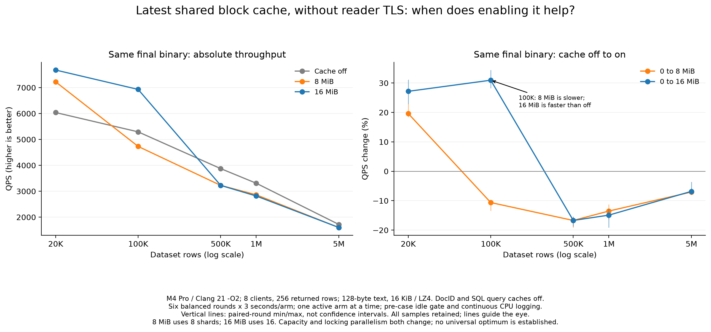
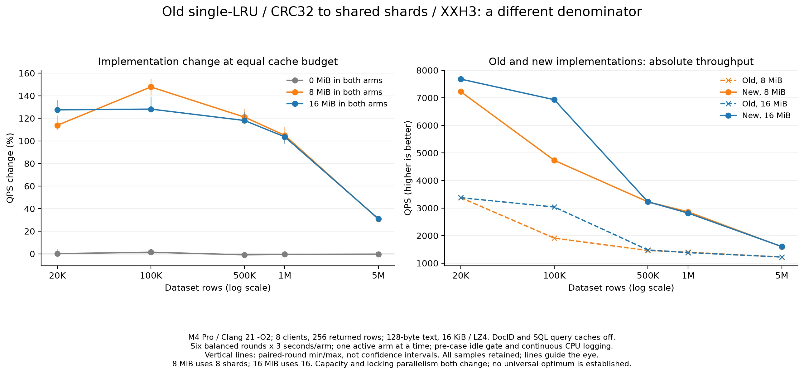
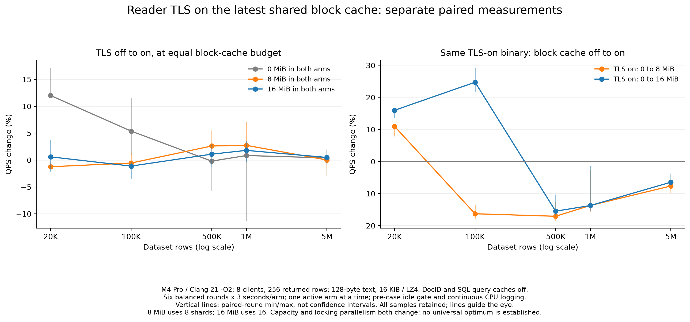

# Block-cache budgets, with and without reader TLS (2026-11-13)

This supplement adds **block cache OFF, 8 MiB and default 16 MiB** to PR #5042,
then measures the reader-TLS patch on the latest block cache at the same three
budgets. #5042 production remains TLS-free at `376fbf9`; #5045 remains TLS-only
at `019868e9`. Combined measurements are review evidence, not merged production
code or a dependency between the PRs. Native DocID caching is disabled in every
new arm, and its used bytes are checked as zero. SQL query-result caching is off.

## Why a large gain and a small gain can both be correct

Three comparisons have different denominators:

| Question | Before | After | What the percentage measures |
| --- | --- | --- | --- |
| Did the shared block-cache implementation improve? | Old single-LRU/CRC32 | New shared shards/XXH3, equal budget | #5042's block-cache change |
| Should this workload enable the block cache? | Cache off | Same final binary at 8 or 16 MiB | Capacity/locality benefit minus cache costs |
| Does reader TLS help on top? | Latest block cache, TLS off | Same block cache and budget, TLS on | #5045's incremental reader change |

For 20k rows at 16 MiB, the earlier no-TLS implementation comparison was
**+119.45%**, versus **+127.49%** in this new matrix. The earlier same-final-binary
off-to-16-MiB gain was **+26.66%**, versus **+27.17%** now. These are broadly
consistent comparisons. Neither number describes the incremental TLS benefit.
The preselected longer repeat gives +134.48% implementation change and +31.15%
off-to-16-MiB; it is reported separately rather than pooled with the matrix.

At 5M, old-to-new at 16 MiB improves **+31.06%**, yet enabling 16 MiB in the
new binary reduces QPS **6.82%** relative to cache off. The longer repeat gives
+31.81% and -5.68%, respectively. Fixing a costly cache implementation and
choosing whether to enable that cache are different decisions.

## Source contexts and method

The no-TLS pair reuses the previously validated 521-test binaries: baseline
`1514b3e` has the same native DocID code, CI/alignment repairs and tests, before
block-cache sharding/XXH3; candidate is `376fbf9988b2458ee196a5d92135c35a5121edc7`.
This isolates the shared block-cache change; it is not an upstream-to-full-PR
benchmark or a measurement of native DocID-cache benefit.

The TLS pair reuses the previously validated 529-test latest-context binaries:
`376fbf9` versus that source plus only
`git diff 047d2f9 019868e9 -- src/docstore.cpp`. Both contain the latest shared
block cache and common CI/alignment repairs. The exact reader-only patch and
binary/source hashes are archived. Test additions do not link into searchd.

Apple M4 Pro (12 cores, 24 GiB), macOS 26.6.2, Apple Clang 21,
`-O2 -DNDEBUG`. Stored text is 128 bytes/row, rowwise 16 KiB/LZ4. Eight server
workers and eight persistent-HTTP client processes return and validate 256
ID/text rows per query. Fixed seed 513 generates 20 random IN-list templates
per client across the full row range. Query-pool hashes and fixture metadata
match across these phases. The reader-buffer budget remains a separate 8 MiB;
it is not the varied decoded-block-cache budget.

| Rows | Logical stored-text MiB | Compressed .spds MiB | Disk chunks |
| ---: | ---: | ---: | ---: |
| 20,000 | 2.44 | 0.11 | 1 |
| 100,000 | 12.21 | 0.53 | 1 |
| 500,000 | 61.04 | 2.67 | 2 |
| 1,000,000 | 122.07 | 5.33 | 4 |
| 5,000,000 | 610.35 | 26.65 | 8 |

Logical text is an orientation value, not exact cache admission size: decoded
blocks also contain metadata. Compressed .spds bytes do not represent the
bytes charged to the decoded-block cache.

Each text/count group has six live daemons (old/new or TLS off/on, each at
0/8/16 MiB), but only one arm receives queries at a time. Six balanced Williams
rounds put each arm in every position once and after every other arm once.
Every arm runs three seconds per round. Server creation order rotates by group.
The no-TLS repeat was selected before results: 20k and 5M, six five-second rounds,
reversed case and arm-creation order, fresh servers. A/A has two identical-binary
8 MiB arms and alternating order. Warmup, plans and lifecycle checks are outside
timing. Every timed response and post-timing REPLACE/flush/DROP/recreate passed.

Before each group, a continuous 30-second CPU-idle gate requires mean >=90%
and every interval >=80%. One-second host/external-process CPU telemetry and
thermal/swap/VM snapshots are retained. No builds, tests or plot rendering from
this task ran during timing. A sample-average external CPU >10% of the machine
or an interval peak >20% is flagged, never excluded. External CPU covers surviving
process deltas outside the benchmark process tree; short-lived processes can be
missed. The gate does not guarantee isolation throughout a timed group.

QPS, server CPU/query, RSS and latency are arm medians. Percentages are ratios
of medians minus one; CPU is searchd user+system time. Ranges show paired-round
min/max, **not confidence intervals**. Phases remain separate, all completed
samples are retained, and no A/A subtraction is applied.

## Same final #5042 binary: should the block cache be enabled?

| Rows | Off QPS | 8 MiB QPS | 16 MiB QPS | Off to 8: QPS | Off to 16: QPS | Off to 8: CPU/query | Off to 16: CPU/query |
| --- | --- | --- | --- | --- | --- | --- | --- |
| 20,000 | 6,038.8 | 7,225.0 | 7,679.6 | +19.64% | +27.17% | -19.06% | -22.36% |
| 100,000 | 5,293.1 | 4,730.6 | 6,931.6 | -10.63% | +30.96% | +6.23% | -24.70% |
| 500,000 | 3,874.2 | 3,226.5 | 3,226.8 | -16.72% | -16.71% | +16.09% | +16.68% |
| 1,000,000 | 3,309.7 | 2,862.3 | 2,816.3 | -13.52% | -14.91% | +14.06% | +16.42% |
| 5,000,000 | 1,719.5 | 1,598.3 | 1,602.2 | -7.05% | -6.82% | +6.68% | +6.75% |

The largest sampled 16 MiB off/on gain is at 100k (+30.96%), while 8 MiB is
already slower than off there (-10.63%). At 500k/1M/5M both enabled budgets
reduce throughput. The best sampled setting depends on dataset size and memory
budget, not just on the percentage improvement over the old implementation.
No measurements between these sizes establish an exact crossover or optimum.

8 MiB selects eight shards, while 16 MiB selects sixteen. This sweep changes
both capacity and locking parallelism, so the difference cannot be attributed
solely to capacity. Hits avoid reads/decompression; misses still pay lookup,
insertion and eviction costs. These timings do not isolate hit/miss costs or
measure a cache hit rate. Row count and compressed `.spds` size alone do not
determine the decoded active working set.

## Should larger datasets use larger caches?

Usually the budget should grow with the **active decoded working set**, rather
than automatically with total row count or compressed file size. For orientation,
100k x 128-byte text is 12.21 MiB before block metadata; this matrix shows 8 MiB
slower than off and 16 MiB faster. That is consistent with capacity mattering,
but it is not an isolated capacity experiment: the shard count also changes.
At 500k/1M/5M, logical text grows to 61.04/122.07/610.35 MiB, so the tested
8/16 MiB budgets represent progressively smaller fractions of the dataset.
The finite query pool and block locality determine the actual active fraction.

There is already separate larger-budget evidence in the
[earlier no-TLS report](BLOCK_CACHE_2026-11-13.md): at 5M, the same final
implementation measured **1,689.6 QPS at 16 MiB versus 2,340.9 at 512 MiB**,
with RSS 130.5 versus 633.1 MiB. Those are earlier budget cells, not results
from the new six-arm matrix, and must not be combined with its cache-off QPS
to calculate a new off/on percentage. They support measuring larger budgets;
they do not establish that every increase pays off or that all larger datasets
benefit equally. Skew, shard capacity, metadata, eviction and contention remain
relevant alongside memory cost.

## #5042 implementation change at equal budgets, with no TLS

| Rows | Block MiB | Before QPS | After QPS | QPS change | CPU/query change | RSS MiB before/after | Paired QPS range |
| --- | --- | --- | --- | --- | --- | --- | --- |
| 20,000 | 0 | 6,028.2 | 6,038.8 | +0.18% | -0.40% | 28.6/28.2 | -2.84% to +4.17% |
| 20,000 | 8 | 3,378.7 | 7,225.0 | +113.84% | -50.55% | 29.8/32.7 | +109.85% to +122.65% |
| 20,000 | 16 | 3,375.8 | 7,679.6 | +127.49% | -52.42% | 29.9/33.4 | +125.70% to +136.34% |
| 100,000 | 0 | 5,219.3 | 5,293.1 | +1.41% | -1.64% | 28.8/28.8 | +0.48% to +3.30% |
| 100,000 | 8 | 1,909.2 | 4,730.6 | +147.78% | -58.62% | 40.1/54.3 | +140.45% to +154.73% |
| 100,000 | 16 | 3,037.9 | 6,931.6 | +128.17% | -52.28% | 44.2/46.8 | +125.95% to +139.35% |
| 500,000 | 0 | 3,909.2 | 3,874.2 | -0.90% | +0.80% | 34.3/34.5 | -1.88% to +1.17% |
| 500,000 | 8 | 1,459.4 | 3,226.5 | +121.08% | -51.49% | 55.9/60.0 | +114.97% to +128.69% |
| 500,000 | 16 | 1,479.7 | 3,226.8 | +118.08% | -50.72% | 68.3/86.9 | +116.90% to +125.58% |
| 1,000,000 | 0 | 3,325.5 | 3,309.7 | -0.47% | +0.18% | 43.2/43.2 | -1.16% to +2.78% |
| 1,000,000 | 8 | 1,397.0 | 2,862.3 | +104.88% | -46.37% | 63.0/68.0 | +98.78% to +112.35% |
| 1,000,000 | 16 | 1,383.2 | 2,816.3 | +103.61% | -45.66% | 76.4/86.1 | +97.25% to +105.81% |
| 5,000,000 | 0 | 1,724.4 | 1,719.5 | -0.29% | +0.37% | 100.2/101.3 | -2.60% to +0.03% |
| 5,000,000 | 8 | 1,222.9 | 1,598.3 | +30.70% | -17.16% | 116.4/119.0 | +28.74% to +31.51% |
| 5,000,000 | 16 | 1,222.5 | 1,602.2 | +31.06% | -17.24% | 130.5/128.5 | +29.82% to +33.31% |

Cache-off differences are small and change sign across sizes. Both cache-on
budgets greatly improve the old implementation in this workload, but those
gains do not imply that cache-on beats the same new binary with cache off.
The two charts deliberately keep these denominators separate.

## Preselected longer no-TLS repeats

Six rounds x five seconds/arm, reversed size and creation order. Both endpoints
were selected before matrix outcomes; these repeats are not chosen by sign.

| Rows | Block MiB | Before QPS | After QPS | QPS change | CPU/query change | RSS MiB before/after | Paired QPS range |
| --- | --- | --- | --- | --- | --- | --- | --- |
| 5,000,000 | 0 | 1,702.3 | 1,702.1 | -0.01% | +0.67% | 102.6/102.2 | -1.18% to +3.64% |
| 5,000,000 | 8 | 1,218.9 | 1,577.4 | +29.40% | -16.55% | 117.2/119.8 | +26.95% to +34.31% |
| 5,000,000 | 16 | 1,218.0 | 1,605.4 | +31.81% | -17.17% | 132.0/130.8 | +30.12% to +41.78% |
| 20,000 | 0 | 6,100.7 | 6,026.5 | -1.22% | +1.52% | 29.2/28.7 | -3.98% to +1.54% |
| 20,000 | 8 | 3,347.9 | 7,489.2 | +123.70% | -52.35% | 31.4/32.2 | +117.88% to +127.02% |
| 20,000 | 16 | 3,370.8 | 7,903.8 | +134.48% | -54.02% | 30.1/32.6 | +126.24% to +138.23% |

| Rows | Off QPS | 8 MiB QPS | 16 MiB QPS | Off to 8: QPS | Off to 16: QPS | Off to 8: CPU/query | Off to 16: CPU/query |
| --- | --- | --- | --- | --- | --- | --- | --- |
| 5,000,000 | 1,702.1 | 1,577.4 | 1,605.4 | -7.33% | -5.68% | +7.07% | +5.61% |
| 20,000 | 6,026.5 | 7,489.2 | 7,903.8 | +24.27% | +31.15% | -22.21% | -25.09% |

## Reader TLS on top of the latest block cache

Every before/after pair below holds the latest shared cache and budget constant
and changes only reader TLS. This is the incremental TLS effect, not the earlier
old-to-new shared-cache gain.

| Rows | Block MiB | Before QPS | After QPS | QPS change | CPU/query change | RSS MiB before/after | Paired QPS range |
| --- | --- | --- | --- | --- | --- | --- | --- |
| 20,000 | 0 | 5,928.6 | 6,640.5 | +12.01% | -9.81% | 28.4/29.1 | +11.56% to +17.14% |
| 20,000 | 8 | 7,462.4 | 7,369.7 | -1.24% | +1.24% | 32.2/32.5 | -1.35% to -0.41% |
| 20,000 | 16 | 7,655.4 | 7,701.3 | +0.60% | -0.50% | 33.1/32.9 | -2.14% to +3.76% |
| 100,000 | 0 | 5,242.7 | 5,525.0 | +5.38% | -3.23% | 29.3/29.5 | +0.96% to +11.53% |
| 100,000 | 8 | 4,650.6 | 4,624.9 | -0.55% | +0.97% | 54.8/56.5 | -1.48% to +1.24% |
| 100,000 | 16 | 6,969.2 | 6,891.2 | -1.12% | +1.46% | 46.6/46.6 | -3.55% to -0.28% |
| 500,000 | 0 | 3,933.7 | 3,925.9 | -0.20% | +0.54% | 34.6/34.4 | -5.69% to +1.20% |
| 500,000 | 8 | 3,172.7 | 3,255.7 | +2.61% | -2.20% | 60.1/61.3 | +1.30% to +5.52% |
| 500,000 | 16 | 3,281.9 | 3,317.9 | +1.10% | -0.88% | 79.0/76.1 | -1.17% to +3.01% |
| 1,000,000 | 0 | 3,293.8 | 3,321.6 | +0.84% | -0.55% | 43.9/44.6 | -11.28% to +2.29% |
| 1,000,000 | 8 | 2,789.9 | 2,866.3 | +2.74% | -2.34% | 67.6/68.8 | +0.55% to +7.17% |
| 1,000,000 | 16 | 2,814.7 | 2,865.5 | +1.80% | -1.40% | 88.5/84.7 | -0.36% to +3.62% |
| 5,000,000 | 0 | 1,736.5 | 1,743.4 | +0.40% | -0.30% | 101.2/100.3 | -2.96% to +2.11% |
| 5,000,000 | 8 | 1,610.2 | 1,610.4 | +0.01% | -0.02% | 119.4/120.1 | -2.78% to +1.91% |
| 5,000,000 | 16 | 1,623.1 | 1,631.0 | +0.49% | -0.25% | 132.4/130.1 | -0.78% to +1.91% |

At the default 16 MiB, incremental TLS QPS changes range from -1.12% to
+1.80% across the five sizes. At cache off, 20k and 100k show +12.01% and
+5.38%, while 500k/1M/5M are -0.20%/+0.84%/+0.40%. At 8 MiB the range is
-1.24% to +2.74%. These are not the large shared-cache implementation gains.

For these same TLS-on binaries, turning the block cache on gives:

| Rows | Off QPS | 8 MiB QPS | 16 MiB QPS | Off to 8: QPS | Off to 16: QPS | Off to 8: CPU/query | Off to 16: CPU/query |
| --- | --- | --- | --- | --- | --- | --- | --- |
| 20,000 | 6,640.5 | 7,369.7 | 7,701.3 | +10.98% | +15.98% | -13.87% | -16.13% |
| 100,000 | 5,525.0 | 4,624.9 | 6,891.2 | -16.29% | +24.73% | +11.35% | -22.30% |
| 500,000 | 3,925.9 | 3,255.7 | 3,317.9 | -17.07% | -15.49% | +16.67% | +15.13% |
| 1,000,000 | 3,321.6 | 2,866.3 | 2,865.5 | -13.71% | -13.73% | +14.03% | +14.76% |
| 5,000,000 | 1,743.4 | 1,610.4 | 1,631.0 | -7.63% | -6.45% | +7.40% | +6.42% |

Reader TLS can avoid repeated registry mutex/hash lookups when reads reach
the reader path. A small-block cache hit bypasses that path; reader creation,
deletion and global-generation updates can remain. TLS does not remove block
cache lookup/insertion/eviction work, so it cannot be assumed to make an
undersized block cache profitable. This is a code-path explanation, not a
measured decomposition of the gains. The 8 MiB TLS cells have no new longer
repeat; small differences are descriptive, not established universal benefits.

The [earlier TLS report](TLS_REVIEW_2026-11-13.md) retains two longer,
load-recorded default-cache passes and both original/latest-cache contexts.
The newer matrix supplements that evidence; it does not replace unfavorable
older samples. Do not add or multiply percentages across these source contexts
or independent measurement phases.

## Controls and recorded load

Count controls use the same IN lists at 1M, without fetching stored text:

### block-cache-budgets/matrix: count

| Rows | Block MiB | Before QPS | After QPS | QPS change | CPU/query change | RSS MiB before/after | Paired QPS range |
| --- | --- | --- | --- | --- | --- | --- | --- |
| 1,000,000 | 0 | 9,488.0 | 9,580.8 | +0.98% | -0.66% | 41.1/41.3 | -0.11% to +1.64% |
| 1,000,000 | 8 | 9,472.5 | 9,512.3 | +0.42% | -0.47% | 41.0/41.9 | -0.41% to +5.67% |
| 1,000,000 | 16 | 9,483.9 | 9,501.0 | +0.18% | -0.37% | 40.9/41.6 | -0.58% to +2.95% |

### tls-block-cache-budgets/matrix: count

| Rows | Block MiB | Before QPS | After QPS | QPS change | CPU/query change | RSS MiB before/after | Paired QPS range |
| --- | --- | --- | --- | --- | --- | --- | --- |
| 1,000,000 | 0 | 9,542.3 | 9,436.5 | -1.11% | +0.60% | 41.3/41.4 | -1.85% to +3.07% |
| 1,000,000 | 8 | 9,551.7 | 9,472.1 | -0.83% | +0.72% | 41.7/41.4 | -3.37% to -0.16% |
| 1,000,000 | 16 | 9,513.4 | 9,438.8 | -0.78% | +0.47% | 41.9/42.0 | -1.56% to +4.05% |

A/A runs the same candidate binary at 8 MiB in both labeled arms. The no-TLS
control uses #5042; the combined control uses the TLS-on binary.

### block-cache-budgets/matrix: A/A

| Rows | Block MiB | Before QPS | After QPS | QPS change | CPU/query change | RSS MiB before/after | Paired QPS range |
| --- | --- | --- | --- | --- | --- | --- | --- |
| 1,000,000 | 8 | 2,920.9 | 2,916.9 | -0.14% | +0.11% | 67.7/67.7 | -3.19% to +1.91% |

### tls-block-cache-budgets/matrix: A/A

| Rows | Block MiB | Before QPS | After QPS | QPS change | CPU/query change | RSS MiB before/after | Paired QPS range |
| --- | --- | --- | --- | --- | --- | --- | --- |
| 1,000,000 | 8 | 2,973.4 | 2,926.0 | -1.60% | +1.19% | 68.0/67.6 | -1.99% to +8.02% |

Across the three new phases: **72 derived comparisons,
528 timed arm samples, 7,691,431 validated timed queries**.
Minimum pre-group mean idle was 90.10%;
7/528 samples meet the recorded higher-load flag.
Telemetry covers 100.00% to
100.00% of every timed interval, including the last
interval. The new driver waits for a telemetry point beyond the final sample;
this fixes the previous logger's incomplete tail coverage. It does not remove
external activity or establish its causal effect.

All initial no-TLS matrix samples and all combined TLS text/count samples
are below the recorded load-flag thresholds. Six flagged samples belong to
the no-TLS 5M longer repeat; one belongs to the TLS A/A control. These thresholds
are descriptive monitoring rules, not a statistical noise model. A/A changes
are -0.14% without TLS and -1.60% with TLS; count changes range from +0.18% to
+0.98% in the first matrix and -1.11% to -0.78% in the TLS matrix. Small TLS
differences therefore require care even when no load threshold is crossed.

The table reports median sample-average external CPU as a percentage of the
whole machine, not one core. Raw per-sample means, peaks, flags and coverage are
in the machine-readable summary. Full process/thermal/VM logs remain in each
raw evidence directory.

| Phase | Case | Arm | External CPU median (%) | Flagged samples |
| --- | --- | --- | --- | --- |
| block-cache-budgets/matrix | rows20000 | baseline0 | 5.22 | 0/6 |
| block-cache-budgets/matrix | rows20000 | candidate0 | 5.40 | 0/6 |
| block-cache-budgets/matrix | rows20000 | baseline8 | 5.14 | 0/6 |
| block-cache-budgets/matrix | rows20000 | candidate8 | 5.57 | 0/6 |
| block-cache-budgets/matrix | rows20000 | baseline16 | 5.22 | 0/6 |
| block-cache-budgets/matrix | rows20000 | candidate16 | 5.46 | 0/6 |
| block-cache-budgets/matrix | rows100000 | candidate0 | 5.54 | 0/6 |
| block-cache-budgets/matrix | rows100000 | baseline8 | 5.47 | 0/6 |
| block-cache-budgets/matrix | rows100000 | candidate8 | 5.31 | 0/6 |
| block-cache-budgets/matrix | rows100000 | baseline16 | 5.50 | 0/6 |
| block-cache-budgets/matrix | rows100000 | candidate16 | 5.50 | 0/6 |
| block-cache-budgets/matrix | rows100000 | baseline0 | 5.33 | 0/6 |
| block-cache-budgets/matrix | rows500000 | baseline8 | 5.64 | 0/6 |
| block-cache-budgets/matrix | rows500000 | candidate8 | 5.70 | 0/6 |
| block-cache-budgets/matrix | rows500000 | baseline16 | 5.39 | 0/6 |
| block-cache-budgets/matrix | rows500000 | candidate16 | 6.05 | 0/6 |
| block-cache-budgets/matrix | rows500000 | baseline0 | 5.10 | 0/6 |
| block-cache-budgets/matrix | rows500000 | candidate0 | 5.13 | 0/6 |
| block-cache-budgets/matrix | rows1000000 | candidate8 | 5.77 | 0/6 |
| block-cache-budgets/matrix | rows1000000 | baseline16 | 5.71 | 0/6 |
| block-cache-budgets/matrix | rows1000000 | candidate16 | 5.84 | 0/6 |
| block-cache-budgets/matrix | rows1000000 | baseline0 | 5.52 | 0/6 |
| block-cache-budgets/matrix | rows1000000 | candidate0 | 5.57 | 0/6 |
| block-cache-budgets/matrix | rows1000000 | baseline8 | 5.56 | 0/6 |
| block-cache-budgets/matrix | rows5000000 | baseline16 | 5.79 | 0/6 |
| block-cache-budgets/matrix | rows5000000 | candidate16 | 6.20 | 0/6 |
| block-cache-budgets/matrix | rows5000000 | baseline0 | 5.56 | 0/6 |
| block-cache-budgets/matrix | rows5000000 | candidate0 | 5.77 | 0/6 |
| block-cache-budgets/matrix | rows5000000 | baseline8 | 5.93 | 0/6 |
| block-cache-budgets/matrix | rows5000000 | candidate8 | 5.64 | 0/6 |
| block-cache-budgets/matrix | count-1000000 | candidate16 | 5.33 | 0/6 |
| block-cache-budgets/matrix | count-1000000 | baseline0 | 5.21 | 0/6 |
| block-cache-budgets/matrix | count-1000000 | candidate0 | 5.00 | 0/6 |
| block-cache-budgets/matrix | count-1000000 | baseline8 | 5.31 | 0/6 |
| block-cache-budgets/matrix | count-1000000 | candidate8 | 4.95 | 0/6 |
| block-cache-budgets/matrix | count-1000000 | baseline16 | 5.30 | 0/6 |
| block-cache-budgets/matrix | aa-1000000-cache8 | aa0 | 6.01 | 0/6 |
| block-cache-budgets/matrix | aa-1000000-cache8 | aa1 | 5.65 | 0/6 |
| block-cache-budgets/repeat | rows5000000 | candidate16 | 6.36 | 1/6 |
| block-cache-budgets/repeat | rows5000000 | baseline16 | 9.64 | 2/6 |
| block-cache-budgets/repeat | rows5000000 | candidate8 | 6.51 | 1/6 |
| block-cache-budgets/repeat | rows5000000 | baseline8 | 6.69 | 0/6 |
| block-cache-budgets/repeat | rows5000000 | candidate0 | 6.03 | 0/6 |
| block-cache-budgets/repeat | rows5000000 | baseline0 | 8.59 | 2/6 |
| block-cache-budgets/repeat | rows20000 | baseline0 | 5.60 | 0/6 |
| block-cache-budgets/repeat | rows20000 | candidate16 | 5.36 | 0/6 |
| block-cache-budgets/repeat | rows20000 | baseline16 | 5.45 | 0/6 |
| block-cache-budgets/repeat | rows20000 | candidate8 | 5.43 | 0/6 |
| block-cache-budgets/repeat | rows20000 | baseline8 | 5.58 | 0/6 |
| block-cache-budgets/repeat | rows20000 | candidate0 | 5.17 | 0/6 |
| tls-block-cache-budgets/matrix | rows20000 | baseline0 | 4.89 | 0/6 |
| tls-block-cache-budgets/matrix | rows20000 | candidate0 | 4.93 | 0/6 |
| tls-block-cache-budgets/matrix | rows20000 | baseline8 | 5.05 | 0/6 |
| tls-block-cache-budgets/matrix | rows20000 | candidate8 | 4.86 | 0/6 |
| tls-block-cache-budgets/matrix | rows20000 | baseline16 | 4.88 | 0/6 |
| tls-block-cache-budgets/matrix | rows20000 | candidate16 | 4.99 | 0/6 |
| tls-block-cache-budgets/matrix | rows100000 | candidate0 | 5.41 | 0/6 |
| tls-block-cache-budgets/matrix | rows100000 | baseline8 | 5.95 | 0/6 |
| tls-block-cache-budgets/matrix | rows100000 | candidate8 | 6.82 | 0/6 |
| tls-block-cache-budgets/matrix | rows100000 | baseline16 | 5.83 | 0/6 |
| tls-block-cache-budgets/matrix | rows100000 | candidate16 | 5.84 | 0/6 |
| tls-block-cache-budgets/matrix | rows100000 | baseline0 | 5.78 | 0/6 |
| tls-block-cache-budgets/matrix | rows500000 | baseline8 | 6.54 | 0/6 |
| tls-block-cache-budgets/matrix | rows500000 | candidate8 | 5.74 | 0/6 |
| tls-block-cache-budgets/matrix | rows500000 | baseline16 | 5.87 | 0/6 |
| tls-block-cache-budgets/matrix | rows500000 | candidate16 | 5.85 | 0/6 |
| tls-block-cache-budgets/matrix | rows500000 | baseline0 | 5.56 | 0/6 |
| tls-block-cache-budgets/matrix | rows500000 | candidate0 | 5.74 | 0/6 |
| tls-block-cache-budgets/matrix | rows1000000 | candidate8 | 6.40 | 0/6 |
| tls-block-cache-budgets/matrix | rows1000000 | baseline16 | 6.41 | 0/6 |
| tls-block-cache-budgets/matrix | rows1000000 | candidate16 | 5.94 | 0/6 |
| tls-block-cache-budgets/matrix | rows1000000 | baseline0 | 5.73 | 0/6 |
| tls-block-cache-budgets/matrix | rows1000000 | candidate0 | 5.92 | 0/6 |
| tls-block-cache-budgets/matrix | rows1000000 | baseline8 | 7.25 | 0/6 |
| tls-block-cache-budgets/matrix | rows5000000 | baseline16 | 5.89 | 0/6 |
| tls-block-cache-budgets/matrix | rows5000000 | candidate16 | 5.73 | 0/6 |
| tls-block-cache-budgets/matrix | rows5000000 | baseline0 | 5.65 | 0/6 |
| tls-block-cache-budgets/matrix | rows5000000 | candidate0 | 5.84 | 0/6 |
| tls-block-cache-budgets/matrix | rows5000000 | baseline8 | 5.57 | 0/6 |
| tls-block-cache-budgets/matrix | rows5000000 | candidate8 | 5.80 | 0/6 |
| tls-block-cache-budgets/matrix | count-1000000 | candidate16 | 5.39 | 0/6 |
| tls-block-cache-budgets/matrix | count-1000000 | baseline0 | 5.49 | 0/6 |
| tls-block-cache-budgets/matrix | count-1000000 | candidate0 | 5.50 | 0/6 |
| tls-block-cache-budgets/matrix | count-1000000 | baseline8 | 5.21 | 0/6 |
| tls-block-cache-budgets/matrix | count-1000000 | candidate8 | 5.29 | 0/6 |
| tls-block-cache-budgets/matrix | count-1000000 | baseline16 | 5.56 | 0/6 |
| tls-block-cache-budgets/matrix | aa-1000000-cache8 | aa0 | 5.12 | 1/6 |
| tls-block-cache-budgets/matrix | aa-1000000-cache8 | aa1 | 5.35 | 0/6 |

## Validation, evidence and limits

These phases reuse the existing validated binaries; there are no production
source edits or rebuilds. The 521/529 test counts, focused sanitizers and local
Apple stack-calibration workaround retain their earlier scopes; no fresh full
suite or automatic calibration is claimed. New driver selfchecks cover balanced
scheduling and telemetry parsing; summary selfchecks cover interval overlap and
load flags. Every new sample and lifecycle check is validated during collection.
Archive driver hashes, query-pool hashes, source/binary manifests and summaries
are checked before publication.

PR #5042's CI repairs remain pushed. Upstream run
[43408089087](https://github.com/manticoresoftware/manticoresearch/actions/runs/43408089087)
is still `action_required`, with zero jobs, pending maintainer approval of fork
workflows. This is not a passing CI result.

This shared workstation has uncontrolled CPU placement/frequency and external
activity, finite hot query pools and highly compressible small text. Neither
cold-disk behavior, Linux throughput, production capacity, native DocID-cache
benefit nor SQL query-cache efficiency is measured here. No universally faster
cache-on setting or consistent default-cache TLS benefit is established.
Reader lifetime/reclamation caveats in the TLS report continue to apply.

- [No-TLS matrix](evidence/2026-11-13/block-cache-budgets/matrix.json) and
  [preselected repeat](evidence/2026-11-13/block-cache-budgets/repeat.json).
- [TLS budget matrix](evidence/2026-11-13/tls-block-cache-budgets/matrix.json).
- [Summary JSON](evidence/2026-11-13/cache-budgets-summary/summary.json) and
  [CSV](evidence/2026-11-13/cache-budgets-summary/summary.csv).
- [Reproduction](repro/2026-11-13/README.md) and
  [complete budget supplement ZIP](attachments/block-cache-budget-evidence.zip).
- [Earlier #5042 report](BLOCK_CACHE_2026-11-13.md) and
  [original/latest TLS report](TLS_REVIEW_2026-11-13.md) preserve earlier phases.

The no-TLS archive's `driver/` retains the exact pre-wrapper script used in its
two phases. The public script later gained optional TLS metadata plumbing;
the TLS archive retains that later exact version. Each run's script hashes
refer to its own archived driver, not a retroactively replaced source.
