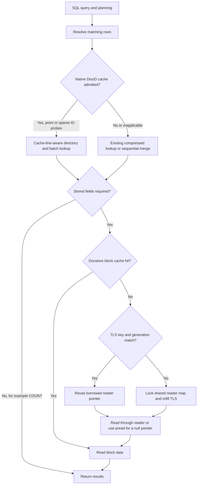

# Design boundaries of the two optimizations

The optimizations affect row resolution and stored-field retrieval respectively.
They can operate independently or execute sequentially within one query. COUNT
queries typically need only row resolution. Stored fields served by the block
cache bypass the reader map.

TLS comparisons hold the block-cache budget constant while comparing locked
map lookups with TLS reuse. Disabling the block cache keeps the reader-map path
active for diagnosis; it does not establish that production should disable it.

## DocID cache and directory

- Data is shared per disk chunk and immutable after publication. Keys occupy
  contiguous u64 arrays, with row IDs in separate u32 arrays. Each leaf holds
  64 keys; directory nodes store child maxima with implicit child positions.
- CPUs reporting 64 B cache lines use eight children per directory node;
  128/256 B reports use sixteen. The OS query runs once and its result is
  cached, with a 64 B fallback for unrecognized values. Allocation, keys and
  directory storage follow this layout, and all padding counts against budget.
- Scalar lookup uses fixed comparison counts to select directory children and
  leaf positions. Batch lookup interleaves 16 independent probes while
  preserving input/output positions. Cache data remains shared, and queries
  require no additional heap allocation for this scratch storage.
- Sparse SQL value filters and nonnegative ID updates reuse the cache at a
  threshold of 1/64 of the chunk's row count. Dense inputs retain sequential
  merging. Duplicate IDs prevent complete cache construction and retain the
  existing behavior.
- The planner bounds IN-list estimates only for a complete unique-ID cache and
  charges for every input probe, including misses. A zero-match estimate still
  has lookup cost. Explicit hints remain authoritative.
- The default budget is zero, so construction is disabled until enabled. The
  cache coexists with mapped data and adds memory and load-time construction
  cost. Disk format remains unchanged. There is no automatic hot-chunk
  admission or LRU; destruction/remapping reclaim storage, and admission
  failure retains the existing lookup path.

The N100 directory throughput changes include node width, depth, comparison
count and compiler code generation. Hardware counters have not isolated reduced
L1 misses as the sole cause. SQL QPS for this directory change on N100 remains
unmeasured. PERFORMANCE.md records allocation sizes and differences.

## TLS cache for the reader map

- The shared map continues to own `(session_id,index_id) → CSphReader*`, with
  the existing 8 MiB total reader-buffer budget. Each OS thread's TLS remembers
  one key, pointer and generation.
- TLS hits bypass GetReader's mutex and hash lookup; misses return to the
  existing map. Creation and cleanup still lock the registry, so the change
  removes repeated reader-lookup locking without making all docstore work
  lock-free.
- Successful creation, deletion and registry lifecycle changes update a
  process-wide generation. Creation invalidates negative entries too. The slow
  path records the generation under the lock, preventing an old pointer from
  being tagged with a later generation.
- Thread migration can miss/refill the TLS entry. Readers are neither copied
  nor transferred between OS threads. TLS retains no owning reference, so
  session/index cleanup still reclaims buffers immediately. Lifecycle tests
  cover ordered invalidation across threads.
- Generation checks provide invalidation, not hazard-pointer or RCU memory
  reclamation. A session/index must outlive active reader use, matching the
  original contract for using a raw pointer after unlocking. Concurrent use of
  the same mutable reader and registry shutdown with active callers remain
  outside the original API's safety contract.
- Alternating hot keys and rapid session creation/destruction reduce hit rate.
  Generation updates still access a shared atomic. Cold lookups add checks and
  TLS writes compared with the original path. The entry has no extra
  cache-line padding.

This independent candidate targets contention on a specific shared lookup.
Benefits after default block-cache warmup are not established. The performance
report retains negative samples and independent upstream measurements.
