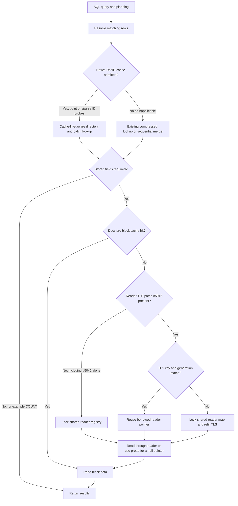

# Design boundaries: DocID, shared blocks and reader TLS

## Experimental adaptive cold-entry reclamation

A separate [opt-in experiment](ADAPTIVE_CACHE_2026-11-13.md) keeps
`docstore_cache_size` as the hard cached-entry ceiling. Both modes already
allocate on demand. Per-shard lookup epochs, updated under existing locks,
identify a stable smaller hot set and gradually delete cold unreferenced
entries. It uses XXH3, fixed shard mapping, no TLS and no global counter.
Idle shards do not advance epochs. The target floor is not a guarantee of
final occupancy or an RSS bound. Two memory passes reclaim entries but show
no process-RSS drop, so the prototype remains outside both production PRs.
Generic LRU node metadata changes even in manual mode; SkipCache performance
is unmeasured. See the report before treating this as a production extension.

PR #5042 covers row resolution and the shared docstore block cache. PR #5045
only covers reader-map TLS; the two PRs remain independently applicable.
The diagram shows the optional combined flow. #5042 alone always uses the
locked reader registry on a block-cache miss.
They can operate independently or execute sequentially within one query. COUNT
queries typically need only row resolution. Stored fields served by the block
cache bypass the reader map.

TLS comparisons hold the block-cache budget constant while comparing locked
map lookups with TLS reuse. Disabling the block cache keeps the reader-map path
active for diagnosis; it does not establish that production should disable it.

The [0/8/16 MiB budget supplement](BLOCK_CACHE_BUDGETS_2026-11-13.md)
measures this optional combination separately from the block-cache change.
Old-to-new cache implementation, same-binary cache off/on, and incremental TLS
have different denominators. 8 MiB selects eight shared shards; 16 MiB selects
sixteen, so capacity and locking parallelism change together. No TLS copy of
block data is introduced.

## DocID cache and directory

- Data is shared per disk chunk and immutable after publication. Keys occupy
  contiguous u64 arrays, with row IDs in separate u32 arrays. Each leaf holds
  64 keys; directory nodes store child maxima with implicit child positions.
- CPUs reporting 64 B cache lines use eight children per directory node;
  128/256 B reports use sixteen. The OS query runs once and its result is
  cached, with a 64 B fallback for unrecognized values. Allocation, keys and
  directory storage follow this layout, and all padding counts against budget.
- Scalar lookup uses fixed comparison counts to select directory children and
  leaf positions. Batch lookup interleaves 16 independent probes while
  preserving input/output positions. Cache data remains shared, and queries
  require no additional heap allocation for this scratch storage.
- Sparse SQL value filters and nonnegative ID updates reuse the cache at a
  threshold of 1/64 of the chunk's row count. Dense inputs retain sequential
  merging. Duplicate IDs prevent complete cache construction and retain the
  existing behavior.
- The planner bounds IN-list estimates only for a complete unique-ID cache and
  charges for every input probe, including misses. A zero-match estimate still
  has lookup cost. Explicit hints remain authoritative.
- The default budget is zero, so construction is disabled until enabled. The
  cache coexists with mapped data and adds memory and load-time construction
  cost. Disk format remains unchanged. There is no automatic hot-chunk
  admission or LRU; destruction/remapping reclaim storage, and admission
  failure retains the existing lookup path.

The N100 directory throughput changes include node width, depth, comparison
count and compiler code generation. Hardware counters have not isolated reduced
L1 misses as the sole cause. SQL QPS for this directory change on N100 remains
unmeasured. PERFORMANCE.md records allocation sizes and differences.

## Shared docstore blocks in #5042

- Up to 16 independently locked shared LRU shards, power-of-two count with
  roughly at least 1 MiB entry budget each. Budgets below 2 MiB retain one shard.
  Budgets sum exactly to `docstore_cache_size`; hash-table/mutex/allocator metadata
  are extra, and a block must fit its shard. Skew can leave capacity underused.
- Existing seeded XXH3-64 hashes the offset bytes with index ID as seed, then
  truncates to 32 bits. High four bits route shards; low bits select table
  buckets. Full key equality still checks index and offset.
- Find/Add/Release and LRU accounting remain locked per shard. This adds no TLS
  block pointers, reader TLS, generation counter or memory-reclamation protocol.
  Clear/drop/shutdown keep the existing lifecycle preconditions.
- The original global-budget/64 admission threshold is retained when a full
  shard needs space; available shard capacity still limits an individual block.
- Naturally aligned LRU-specific entries fix misaligned packed key/value
  references. Generic OpenHash's default layout remains unchanged. Packed numeric
  and UUID lookup values are read with memcpy to avoid misaligned references.

[Measurements, CI repairs and limitations](BLOCK_CACHE_2026-11-13.md).

## TLS cache for the reader map

- The shared map continues to own `(session_id,index_id) → CSphReader*`, with
  the existing 8 MiB total reader-buffer budget. Each OS thread's TLS remembers
  one key, pointer and generation.
- TLS hits bypass GetReader's mutex and hash lookup; misses return to the
  existing map. Creation and cleanup still lock the registry, so the change
  removes repeated reader-lookup locking without making all docstore work
  lock-free.
- Successful creation, deletion and registry lifecycle changes update a
  process-wide generation. Creation invalidates negative entries too. The slow
  path records the generation under the lock, preventing an old pointer from
  being tagged with a later generation.
- Thread migration can miss/refill the TLS entry. Readers are neither copied
  nor transferred between OS threads. TLS retains no owning reference, so
  session/index cleanup still reclaims buffers immediately. Lifecycle tests
  cover ordered invalidation across threads.
- Generation checks provide invalidation, not hazard-pointer or RCU memory
  reclamation. A session/index must outlive active reader use, matching the
  original contract for using a raw pointer after unlocking. Concurrent use of
  the same mutable reader and registry shutdown with active callers remain
  outside the original API's safety contract.
- Alternating hot keys and rapid session creation/destruction reduce hit rate.
  Generation updates still access a shared atomic. Cold lookups add checks and
  TLS writes compared with the original path. The entry has no extra
  cache-line padding.

This independent candidate targets contention on a specific shared lookup.
The effect depends on the block-cache implementation, budget, working set and
session churn. The [current TLS report](TLS_REVIEW_2026-11-13.md) presents
original-cache and latest-cache pairs separately, retaining negative samples
and all controls. The ownership and lifetime requirements are the same in both.
