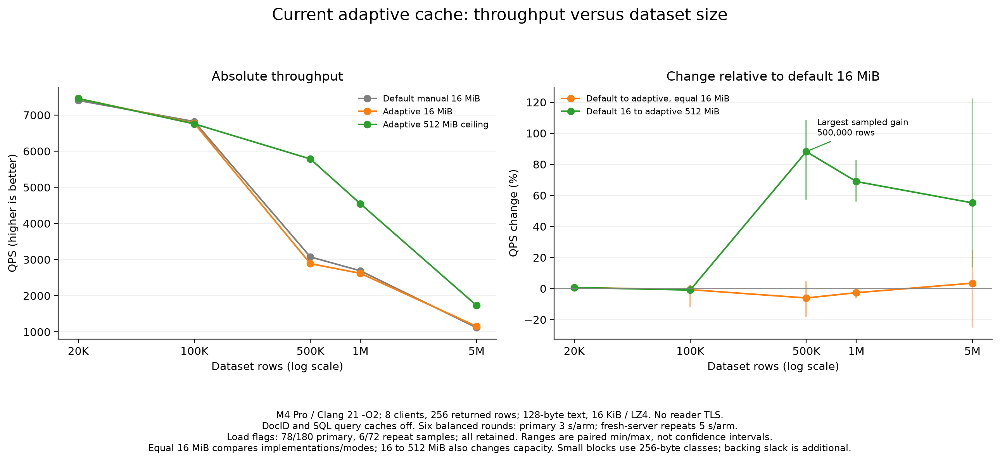
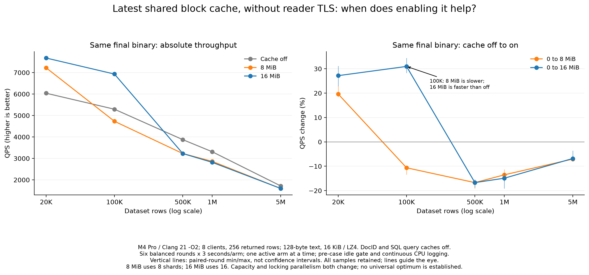
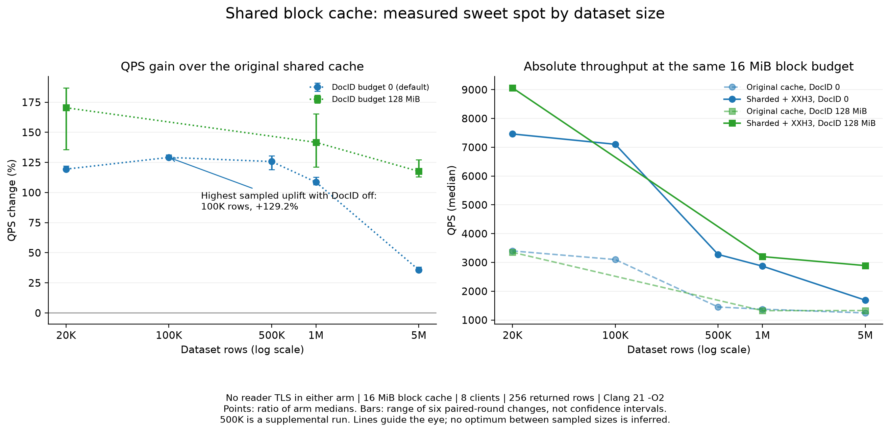
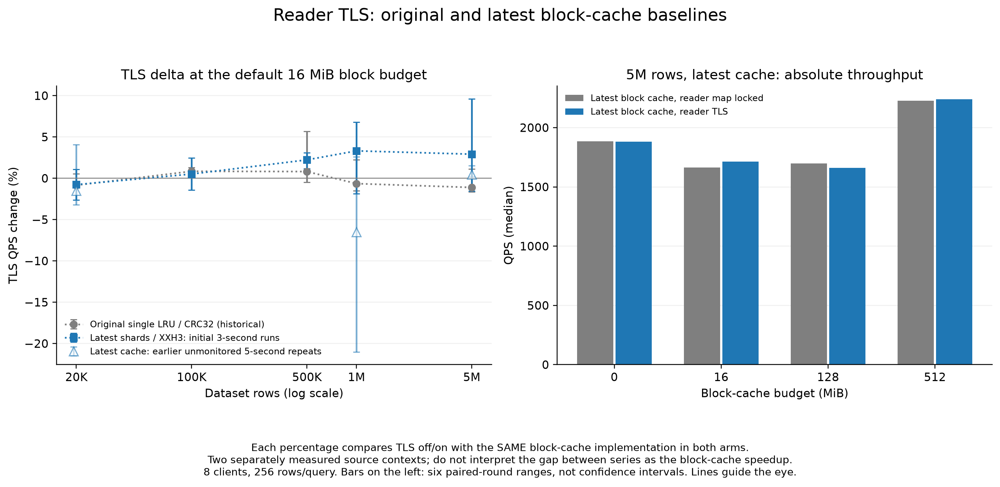

# Performance evidence and reporting boundaries

## Current adaptive cache: default comparison and process-memory return

The [opt-in adaptive experiment](ADAPTIVE_CACHE_2026-11-13.md) uses system-mapped
decoded payloads, packed small-block regions and release of fully empty regions
to the OS. It remains outside both production PRs, with unchanged manual
16 MiB defaults and an explicit 512 MiB experimental entry ceiling.

The report gives absolute QPS and CPU/query for default 16 MiB versus current
adaptive 16/512 MiB at five sizes. Equal-16 QPS changes range from
-6.03% to +3.48% in the primary run; this does not establish a
universal gain. The 512 MiB gain peaks at +88.18% for
500,000 rows among these samples; this comparison also changes capacity.
Fresh-server, longer repeats at 20k/500k were preselected. The finite warmed
query pools do not constitute a cold full-table scan.

Two broad/hot/broad passes on the same 5M table observe process RSS drops of
477.86 and 477.94 MiB from broad to hot. The report plots charged entries,
virtual mappings, RSS and physical footprint separately. Partial-region slack
and bounded empty spares remain; the entry ceiling is not an RSS cap. Idle
shards do not advance lookup-driven reclamation.

All 252 primary/repeat arm samples and 12 diagnostic stage samples remain,
including 84 primary/repeat external-load flags. No adaptive-plus-TLS result
exists. Exact absolute values, negative results, controls and load limits are
in the report and CSV.

Updated review (2026-11-13): [#5042 shared-block-cache results and CI fixes,
without TLS](BLOCK_CACHE_2026-11-13.md); [#5045 default-cache/large-data,
lifetime and churn answers](TLS_REVIEW_2026-11-13.md). The sections below retain
the dated original evidence; their patches/test counts are historical, not the
current expanded #5042 validation. New and old measurements are separate.

All percentages below identify their reference. Directory lookup throughput and
SQL QPS are different metrics. Improvements from the two patches must not be
added or multiplied; the affected query paths and baselines differ.

## Added budget matrix: three separate comparisons

The [budget supplement](BLOCK_CACHE_BUDGETS_2026-11-13.md) adds 0/8/16 MiB
across 20k/100k/500k/1M/5M rows, with native DocID and SQL query caches off.
It separates old-to-new block-cache implementation gains, same-binary cache
off/on gains, and incremental TLS on the latest cache. Large implementation
gains do not establish that enabling the cache is always faster.

| Rows | Cache off QPS | 8 MiB QPS | 16 MiB QPS | Off to 8 MiB | Off to 16 MiB |
| --- | --- | --- | --- | --- | --- |
| 20,000 | 6,038.8 | 7,225.0 | 7,679.6 | +19.64% | +27.17% |
| 100,000 | 5,293.1 | 4,730.6 | 6,931.6 | -10.63% | +30.96% |
| 500,000 | 3,874.2 | 3,226.5 | 3,226.8 | -16.72% | -16.71% |
| 1,000,000 | 3,309.7 | 2,862.3 | 2,816.3 | -13.52% | -14.91% |
| 5,000,000 | 1,719.5 | 1,598.3 | 1,602.2 | -7.05% | -6.82% |

At equal 16 MiB the new implementation gains +127.49%/+128.17%/+118.08%/
+103.61%/+31.06%, respectively. Longer no-TLS endpoint repeats remain separate.
Adding TLS at equal default budget gives +0.60%/-1.12%/+1.10%/+1.80%/+0.49%.
All CPU/query/RSS data, 528 timed arm samples and telemetry are retained in the
supplement. These changes have different references; do not add or multiply
percentages. The remaining sections preserve earlier phases, including their
negative and control outcomes.

## Earlier #5042 block-cache comparison (2026-11-13)

Both arms contain the same native DocID implementation and CI/alignment repairs,
with no reader TLS. At the default disabled DocID budget and default 16 MiB
block cache, QPS gains at 20k/100k/500k/1M/5M rows are
+119.45%/+129.18%/+125.74%/+108.62%/+35.68%, respectively. These are block-cache
implementation gains at eight clients/256 returned rows, not gains from the
DocID directory or from turning caching on. The sampled relative peak is 100k;
there is no universal optimum. Enabled-DocID and cache on/off phases are separate.

Point QPS is −1.42% initially and −0.76% in a longer repeat; all controls and
negative results remain. At 5M, 512 MiB has higher absolute QPS than 16 MiB,
with higher memory usage, even though the relative implementation gain is
smaller. See the [full tables/methods/limits](BLOCK_CACHE_2026-11-13.md).

## Reader TLS: original and latest block-cache datasets

The [current TLS report](TLS_REVIEW_2026-11-13.md) presents both datasets side by
side. In the original dataset both arms use the single-LRU/CRC32 block cache;
in the latest dataset both use #5042's shared sharded-LRU/XXH3 implementation
at `376fbf9`, with DocID caching disabled, and only the reader TLS patch differs.
Each percentage is controlled within its own pair. Source contexts and times
differ between datasets, so their absolute-QPS gap is not a TLS gain.

| Rows, block cache 16 MiB | TLS QPS change, original cache | TLS QPS change, latest cache |
| ---: | ---: | ---: |
| 20,000 | -0.84% | -0.77% |
| 100,000 | +0.85% | +0.51% |
| 500,000 | +0.81% | +2.23% |
| 1,000,000 | -0.65% | +3.32% |
| 5,000,000 | -1.11% | +2.92% |

Fresh load-recorded reruns use two independent six-round × five-second
passes, with a 60-second idle gate before each case and continuous CPU telemetry.

| Rows, default 16 MiB | Rerun 1 QPS change | Rerun 2 QPS change | Rerun 1 CPU/query change | Rerun 2 CPU/query change |
| ---: | ---: | ---: | ---: | ---: |
| 20,000 | +0.28% | -0.41% | +0.93% | +0.62% |
| 100,000 | -0.20% | +1.31% | +0.23% | -1.19% |
| 500,000 | -1.68% | -0.62% | -2.54% | +0.15% |
| 1,000,000 | -1.32% | +0.14% | +1.09% | +0.04% |
| 5,000,000 | +11.33% | +0.77% | -4.36% | -0.32% |

A/A: -2.64% / -0.83%. Every completed sample is retained. See the [TLS report](TLS_REVIEW_2026-11-13.md) for load measurements and limits.

The quieter second pass places all five default-cache QPS changes between
**−0.62% and +1.31%**; no default-cache sample in that pass meets the recorded
higher-load flag. Its A/A control is −0.83%. This is descriptive evidence of
small effects, not a formal noise band or confidence interval. At 1M, the fresh
passes give **−1.32% / +0.14%**, rather than the earlier unmonitored −6.53%.
The older regression remains in the record; its cause is not established.

At 5M, the first pass's **+11.33%** accompanies unequal external CPU medians
(**18.77% / 13.27%** of the machine for no TLS / TLS). It becomes **+0.77%** in
the second pass, where those CPU medians are **3.72% / 3.37%** and no sample
meets the higher-load flag. The large first-pass gain is not repeatable evidence.
By contrast, the 20k **cache-off** case gives **+6.65% / +9.07% QPS** and
**−8.70% / −6.96% CPU/query** across the two passes; the first pass is load-affected.
Cache-off gains must not be substituted for the default-cache result.

These runs do **not establish a consistent default-cache throughput benefit**.
They demonstrate real workstation-load interference and do not identify the
cause of every prior positive or negative result. No A/A subtraction is applied.

The original-cache results below remain historical evidence. Fresh source/binary
hashes, 529-test validation per arm, focused 11-test ×20 sanitizers and complete
latest matrix/repeats are in the current report and linked raw evidence.

## 1. DocID cache-line directory isolation

Reference: fixed-16-child native cache prototype with stack scratch. Candidate:
current adaptive native cache with the same scratch policy. This is a comparison
within the new cache, not against upstream compressed lookup and not SQL QPS.
Intel N100 / 64 B cache lines / GCC 11.4 `-O3`, 100k and 1M documents, five
rotated rounds with five thread-CPU samples/case. Batch API calls have 16 probes.

| Order | Documents | Batch gain: 0 / 50 / 100% misses | Scalar gain: 0 / 50 / 100% misses |
| --- | ---: | --- | --- |
| sorted | 100,000 | +22.22% / +24.39% / +25.74% | +27.64% / +29.60% / +30.21% |
| sorted | 1,000,000 | +18.82% / +19.85% / +19.56% | +40.64% / +35.53% / +31.65% |
| random | 100,000 | +25.08% / +20.76% / +27.17% | +20.44% / +27.29% / +25.73% |
| random | 1,000,000 | +12.58% / +11.05% / +14.96% | +53.60% / +55.55% / +43.30% |

The 128 B Apple M4 Pro keeps 16 children; no consistent improvement is established
there (batch samples span -4.93% to +3.60%). No current Linux/N100 SQL QPS
measurement exists for directory adaptation. The exact source hashes, compiler
manifests and full negative/control data are included in `evidence/stack-scratch-*`.
The raw historical three-arm run also contains temporary-array TLS; only the
fixed16+stack and adaptive+stack arms contribute to this directory comparison.

Memory at 1M documents:

| Host | Fixed16 prototype | Adaptive candidate | Difference |
| --- | ---: | ---: | ---: |
| N100 / 64 B | 12,133,887 B | 12,143,295 B | +9,408 B (+0.078%) |
| M4 Pro / 128 B | 12,134,015 B | 12,134,015 B | 0 |

These are requested allocation bytes, not RSS. The whole DocID cache is extra
memory beside existing mapped data (about 11.58 MiB per million entries on N100).
Its default budget is zero; budgets include handles and alignment slack. No
overall memory saving is claimed for alignment or for adding the native cache.

## 2. Historical TLS on upstream with the original block cache

Historical comparison: upstream `047d2f9` versus the same source plus patch 2.
The DocID prototype is absent from both binaries. Same copied 20k-row disk
snapshot, 128 B stored text, 16 KiB blocks, LZ4, `threads=8`, 1/8 persistent
HTTP connections, four alternating two-second rounds per arm. Every returned
field is checked. Both query plans and binary hashes are captured in the JSON.

**Within every row, both binaries use the same block-cache budget.** The QPS
ratio measures TLS at that budget; it does not compare disabling versus enabling
block caching. QPS change is `median(after)/median(before)-1`. CPU/query change
uses the analogous server CPU ratio.

| Block cache | Clients | Rows | Projection | Before QPS | TLS QPS | QPS change | CPU/query change |
| --- | ---: | ---: | --- | ---: | ---: | ---: | ---: |
| 0 | 1 | 1 | stored text | 8,380 | 8,697 | +3.78% | -1.81% |
| 0 | 1 | 64 | stored text | 2,920 | 2,971 | +1.74% | -1.21% |
| 0 | 1 | 256 | stored text | 1,026 | 1,036 | +0.99% | -1.09% |
| 0 | 1 | 256 | count | 3,607 | 3,537 | -1.94% | -0.86% |
| 0 | 8 | 1 | stored text | 27,849 | 29,801 | +7.01% | -2.80% |
| 0 | 8 | 64 | stored text | 11,543 | 11,603 | +0.52% | -4.03% |
| 0 | 8 | 256 | stored text | 4,049 | 4,336 | +7.09% | -5.20% |
| 0 | 8 | 256 | count | 14,818 | 14,918 | +0.67% | -2.96% |
| 16 MiB | 1 | 1 | stored text | 7,921 | 8,560 | +8.07% | -3.16% |
| 16 MiB | 1 | 64 | stored text | 3,778 | 3,758 | -0.54% | +0.62% |
| 16 MiB | 1 | 256 | stored text | 1,345 | 1,296 | -3.63% | +0.37% |
| 16 MiB | 1 | 256 | count | 3,551 | 3,357 | -5.47% | +1.96% |
| 16 MiB | 8 | 1 | stored text | 33,770 | 35,405 | +4.84% | -1.09% |
| 16 MiB | 8 | 64 | stored text | 10,661 | 10,585 | -0.71% | +0.53% |
| 16 MiB | 8 | 256 | stored text | 2,879 | 2,916 | +1.30% | +1.07% |
| 16 MiB | 8 | 256 | count | 18,136 | 18,660 | +2.89% | +0.75% |

### Targeted repeat and interpretation

The 8-client/256-row/cache-disabled case and count control were repeated with
six alternating three-second rounds per arm, after the main run and without
concurrent builds/tests.

| Projection | Before QPS | TLS QPS | QPS change | CPU/query change |
| --- | ---: | ---: | ---: | ---: |
| stored text | 4,568 | 5,217 | +14.20% | -8.48% |
| count | 16,514 | 16,450 | -0.39% | -0.49% |

The 256-row targeted workload shows a benefit in both runs, but magnitude varies.
The 64-row case is only +0.52% QPS in the primary run, so a stable gain there
is not established. Warm-block-cache and point/count controls vary too; in the
primary run the warm single-client point case is +8.07% and the warm count
case is -5.47%, despite bypassing reader lookups. Do not attribute such controls
to mutex savings or claim universal benefit. These short local samples do not
provide a production confidence interval or a zero-regression guarantee.

The earlier +8.02%–11.24% results came from paired builds with the DocID
prototype enabled at the same budget in both arms. They are retained under
`evidence/reader-tls-m4/` for traceability, but are not the primary independent
upstream claim. Different fixtures/builds/runs cannot quantify the separate
effect of DocID by subtraction.

A separate diagnostic run in that prior combined environment observed 98.59%
of reader lookups avoiding the mutex at eight clients/256 rows with block
caching disabled, and no additional reader lookups after full block-cache
warmup. Those counters were absent from timed binaries; this is a diagnostic
observation with its own scheduling, not an exact lock-hit prediction for the
fresh upstream run.

TLS costs 32 B per OS thread (256 B at eight threads) plus runtime metadata;
the shared generation adds 8 B. Reader ownership, immediate cleanup and the
existing 8 MiB reader-buffer budget remain intact. Cold lookups add checks/TLS
writes; mutation increments invalidate other sessions. No process-memory saving
is claimed. Cache-line padding of this TLS entry is not included.

The packaged raw JSON also records server/client CPU and memory snapshots.
These snapshots are not a controlled RSS study. Clients share the server host;
rates are fixed-concurrency throughput, not maximum sustainable capacity, p99
latency, cold-disk behavior or a production workload mix. Linux TLS SQL QPS and
full Linux engine/SQL tests remain unmeasured.
