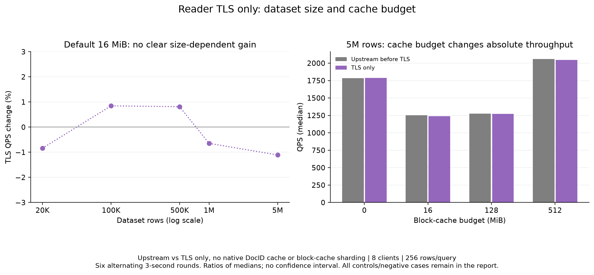

# Reader TLS follow-up: size, default cache and session churn (2026-11-13)

PR #5045 remains reader TLS only at `019868e9f79d1bb2bd1f96dafb88ef20acd45418`.
The new tests do **not** establish a general performance gain with the default
16 MiB docstore block cache. Across 20k–5M rows the fixed-query size matrix at
that budget measured −1.11% to +0.85% QPS. The larger earlier cache-off gains
therefore should not be the merge justification for typical cached workloads.
The independent shared-block-cache work is now in PR #5042 and is measured
[without reader TLS](BLOCK_CACHE_2026-11-13.md). Do not attribute those gains to TLS.

The default-cache curve stays close to zero. The budget panel shows absolute
QPS at 5M; it does not attribute cache-budget differences to TLS. Each pair
holds the budget constant. Full negative/control samples are retained below.

## Answers to the maintainer

1. **Default cache and larger data.** The tables below cover 20k, 100k, 500k,
   1M and 5M rows at 0/16/128 MiB, plus 512 MiB at 5M. Inside every TLS comparison
   both arms use the same cache budget. Small differences and signs reversing
   in longer repeats are retained. At 5M, even cache-off TLS is essentially flat.
2. **Deleting a returned reader.** A generation check invalidates subsequent
   lookups; it does not keep an already returned pointer alive. Arbitrary
   concurrent deletion while a reader is being used is unsafe. Both the old
   registry lookup and the proposed TLS path return a borrowed raw pointer;
   the registry mutex is released before I/O even in the old code. Safety still
   requires the existing session/index lifetime contract to protect active
   uses, and quiescent shutdown. Tests exercise retirement between uses and
   unrelated-session concurrency, not arbitrary deletion during an active read.
   The counter alone does not close the check/use race or prove that contract.
3. **Many short sessions.** Every successful reader creation/deletion increments
   the same process-wide counter. Unrelated sessions can invalidate an entry
   and create coherence traffic. Reusing an HTTP connection does not eliminate
   per-query docstore sessions. Separate diagnostic runs measured reader TLS
   hit rate 94.99% in the large bulk workload and 83.54% in a mix of four bulk
   and four hot-point clients. Mixed QPS was +0.76% initially and −0.72% in a
   longer repeat (repeat client p95 +4.89%). This measures the net workload;
   it does not isolate the counter's own CPU/coherence cost. High hit rate is
   not evidence of a meaningful net throughput gain.

## Method and interpretation

Apple M4 Pro, 12 cores, 24 GiB, macOS 26.6.2, Apple Clang 21, `-O2 -DNDEBUG`.
Baseline production is upstream `047d2f9`; candidate production differs only
by the #5045 reader patch. Both builds have the same eight reader tests, MCL
`88b5412`, build flags and optional dependency configuration. No native DocID
cache or shared-block-cache optimization is in either arm. SQL query cache is
always off; this experiment says nothing about its efficiency.

Text is 128 bytes/row, rowwise, 16 KiB/LZ4. Clients are separate processes on the
same host, with eight server query workers and an unchanged 8 MiB reader-buffer
budget. Every response is checked. The size matrix fixes 20 random 256-row
query templates/client, seed 513, across the full range. The broader matrix uses
64 templates/client for bulk and 4096 for point queries; those phases are
separate and their absolute QPS should not be compared as one experiment.
Logical text at 1M is 122.07 MiB although compressed .spds is only 5.33 MiB.
Decompressed working set, locality, concurrency and lock cost all affect the
appropriate cache size; row count alone does not determine a budget.

Each comparison has six alternating rounds, three seconds/arm, with warmup
outside timing. Longer repeats use fresh servers, reversed starting order and
five seconds/arm. QPS and server CPU/query changes are ratios of the two arm
medians; CPU is searchd user+system time. Client p95 includes HTTP/JSON and result
validation and is the median of round p95 values. This is fixed-concurrency
throughput with finite repeated query pools, not maximum sustainable capacity,
a confidence interval or production traffic. Diagnostic counters were collected
in separate instrumented runs including warmup/plan queries; they were absent
from timed binaries. Apple CPU time units were cross-checked against a child
process CPU clock (recorded ratio 1.00016).

## Fixed-query size/cache matrix: all 23 comparisons

Eight clients, 256 requested IDs; count and A/A are controls. `A/A` uses the
baseline binary for both arms. Each text comparison measures TLS **at that
same cache budget**, not cache on/off.

| Rows | Cache MiB | Projection/control | Before QPS | TLS QPS | QPS change | CPU/query change | RSS MiB before/TLS |
| ---: | ---: | --- | ---: | ---: | ---: | ---: | ---: |
| 20,000 | 0 | text | 6,190.0 | 6,930.7 | +11.97% | -9.18% | 28.2/29.1 |
| 20,000 | 0 | count | 24,066.3 | 24,303.4 | +0.99% | -0.45% | 29.8/30.1 |
| 20,000 | 16 | text | 3,419.3 | 3,390.6 | -0.84% | +0.77% | 31.2/31.5 |
| 20,000 | 128 | text | 3,387.8 | 3,450.7 | +1.86% | -1.59% | 30.8/30.8 |
| 100,000 | 16 | text | 3,034.3 | 3,060.0 | +0.85% | -0.84% | 44.2/44.3 |
| 100,000 | 128 | text | 3,110.7 | 3,100.0 | -0.35% | +0.25% | 44.1/44.4 |
| 100,000 | 0 | text | 5,271.9 | 5,455.8 | +3.49% | -2.44% | 29.5/29.7 |
| 100,000 | 0 | count | 19,499.0 | 19,494.3 | -0.02% | +0.16% | 30.6/30.7 |
| 500,000 | 128 | text | 2,788.7 | 2,747.1 | -1.49% | +0.63% | 115.9/115.2 |
| 500,000 | 0 | text | 4,170.9 | 4,241.0 | +1.68% | -1.40% | 34.5/34.7 |
| 500,000 | 0 | count | 15,326.9 | 15,233.0 | -0.61% | -0.01% | 35.5/35.6 |
| 500,000 | 16 | text | 1,452.7 | 1,464.5 | +0.81% | -0.10% | 77.1/70.2 |
| 1,000,000 | 0 | text | 3,512.6 | 3,587.2 | +2.12% | -1.53% | 43.2/43.9 |
| 1,000,000 | 0 | count | 10,056.1 | 10,043.6 | -0.12% | +0.20% | 43.7/44.5 |
| 1,000,000 | 16 | text | 1,387.3 | 1,378.4 | -0.65% | +0.66% | 79.2/78.2 |
| 1,000,000 | 16 | aa | 1,396.8 | 1,402.9 | +0.43% | +0.02% | 82.2/78.6 |
| 1,000,000 | 128 | text | 2,496.9 | 2,548.0 | +2.05% | -1.71% | 206.6/206.2 |
| 5,000,000 | 16 | text | 1,252.4 | 1,238.5 | -1.11% | +0.82% | 132.0/133.1 |
| 5,000,000 | 16 | aa | 1,234.4 | 1,238.4 | +0.32% | -0.26% | 132.2/129.5 |
| 5,000,000 | 128 | text | 1,275.5 | 1,273.6 | -0.15% | -0.20% | 301.0/307.2 |
| 5,000,000 | 0 | text | 1,783.4 | 1,789.5 | +0.34% | -0.56% | 101.3/100.7 |
| 5,000,000 | 0 | count | 2,841.1 | 2,865.4 | +0.86% | -0.69% | 102.0/102.3 |
| 5,000,000 | 512 | text | 2,061.1 | 2,046.5 | -0.71% | +0.53% | 633.2/632.1 |

The often-quoted **6,931 QPS** is TLS with the block cache **off**, versus
**6,190 QPS** before TLS (+11.97%) in that particular 20k/256-row comparison.
At 16 MiB the same size-matrix workload was 3,419 → 3,391 QPS (−0.84%).
These are separate cache configurations; 6,931 is not the default-cache result.
For 5M rows, TLS QPS at 0/16/128/512 MiB was 1,789/1,239/1,274/2,047.
This exposed the original shared block cache's CPU/lock cost under the measured
access pattern. It does not recommend disabling cache for all workloads.

## Broader workload matrix and all longer repeats

This phase has 20 scenarios plus seven independent repeats: 324 timed arm
samples and 12,025,004 checked timed queries. `R` denotes a six-round, five-second
repeat. Scenario labels are preserved verbatim to identify raw records. Cache,
projection, clients, offered-rate limits and paired changes are recorded in
[summary.json](evidence/2026-11-13/tls/summary.json).

| Phase | Scenario | Before QPS | TLS QPS | QPS change | CPU/query change | Client p95 change |
| --- | --- | ---: | ---: | ---: | ---: | ---: |
| matrix | resident-c8-b1 | 44,203.8 | 44,130.4 | -0.17% | +0.47% | +0.10% |
| matrix | resident-c8-b64 | 12,708.1 | 12,663.4 | -0.35% | +1.58% | -0.10% |
| matrix | resident-c8-b256 | 3,343.0 | 3,334.2 | -0.26% | +0.57% | -0.01% |
| matrix | resident-count | 23,552.8 | 23,475.9 | -0.33% | +0.88% | -0.02% |
| matrix | large-c1-b1 | 7,993.5 | 8,011.6 | +0.23% | -0.88% | +0.21% |
| matrix | large-c1-b64 | 1,226.8 | 1,244.5 | +1.44% | -0.84% | -1.69% |
| matrix | large-c1-b256 | 635.9 | 635.6 | -0.05% | -0.17% | -0.35% |
| matrix | large-c1-count | 2,489.6 | 2,506.4 | +0.68% | -0.53% | -0.39% |
| matrix | large-c8-b1 | 31,906.4 | 32,199.1 | +0.92% | -1.58% | -0.97% |
| matrix | large-c8-b64 | 4,811.4 | 4,940.5 | +2.68% | -1.59% | -3.50% |
| matrix | large-c8-b256 | 1,353.4 | 1,378.9 | +1.89% | -1.49% | -1.66% |
| matrix | large-c8-count | 9,612.5 | 9,607.6 | -0.05% | +0.09% | -0.66% |
| matrix | large-hot | 3,334.5 | 3,355.0 | +0.61% | -0.07% | -0.32% |
| matrix | large-mixed | 20,837.1 | 20,996.4 | +0.76% | -0.75% | +0.13% |
| remaining | large-reconnect | 399.0 | 399.3 | +0.07% | +1.47% | -0.77% |
| remaining | aa-large-b256 | 1,384.3 | 1,359.2 | -1.82% | +2.22% | +1.69% |
| remaining | nocache-c8-b1 | 31,834.5 | 31,745.7 | -0.28% | -0.60% | -0.26% |
| remaining | nocache-c8-b64 | 7,019.2 | 7,083.5 | +0.92% | -1.03% | -1.70% |
| remaining | nocache-c8-b256 | 3,307.2 | 3,350.5 | +1.31% | -1.03% | -0.33% |
| remaining | nocache-count | 9,474.1 | 9,585.5 | +1.18% | -0.57% | -1.75% |
| R | large-c8-b64 | 5,079.5 | 5,035.8 | -0.86% | +0.37% | +1.09% |
| R | large-c8-b256 | 1,337.6 | 1,353.2 | +1.16% | -0.90% | -0.40% |
| R | large-mixed | 20,588.3 | 20,441.0 | -0.72% | +1.04% | +4.89% |
| R | aa-large-b256 | 1,367.6 | 1,379.6 | +0.88% | -0.79% | -0.63% |
| R | nocache-c8-b256 | 3,373.4 | 3,431.5 | +1.72% | -1.39% | -1.25% |
| R | resident-c8-b64 | 12,849.0 | 12,940.6 | +0.71% | -0.41% | -1.34% |
| R | resident-count | 23,378.0 | 23,324.9 | -0.23% | +0.95% | -1.63% |

The capped reconnect case offers 400 QPS total; its small achieved-QPS change
is not a capacity gain. The uncapped reconnect attempt failed with a retained
connection error before the capped case was introduced. It is not counted as
a successful scenario. A/A changes of −1.82% / +0.88% and sign reversals in the
large/mixed repeats show why the small net changes cannot establish reliable
benefit. No samples or negative scenarios are removed from the raw files.

## Correctness, lifecycle and limits

The same eight public reader tests pass on upstream and TLS. The supplemental
three tests add unrelated-session churn, reader-budget refusal followed by
creation and cross-thread creation after cached-null. Both full GoogleTest
suites passed 499/499; focused ASan+UBSan and TSan passed eight tests ×20,
instrumenting docstore, file I/O and reader tests while reusing other libraries.
This is focused coverage, not an entire engine sanitizer build. The #5045 source
still contains its original five tests; the additional tests are a separate
[review patch](patches/reader-supplemental-tests.patch), not an unpublished
production change. The original five tests and older 496-test run remain in the
historical validation record.

REPLACE/flush and DROP/recreate checks run outside timing. All tests follow
valid session/index ownership. At scale, reader admissions/deletions match and
no reader-budget refusal was observed: each 16 KiB reader uses 64 KiB, so eight
clients × eight chunks is approximately 4 MiB, below the 8 MiB total budget.
This does not test higher concurrency or more chunks exceeding that budget.

This is a shared workstation without affinity/frequency control. Host snapshots
recorded existing swap usage; unchanged swap counters in the final observation
window do not establish absence of memory pressure throughout the run. Hot,
highly compressible text and finite query pools do not cover cold storage,
large fields, Linux SQL throughput or real traffic. A larger cache can reduce
capacity misses but cannot remove contention or hash cost by itself.

Raw [size data](evidence/2026-11-13/tls/scale-matrix.json),
[build manifest](evidence/2026-11-13/tls/build-manifest.json),
[reader diagnostics](evidence/2026-11-13/tls/diagnostic-counters.json),
[scale diagnostics](evidence/2026-11-13/tls/scale-diagnostic.json),
[ASan+UBSan](evidence/2026-11-13/tls/asan-ubsan.log),
[TSan](evidence/2026-11-13/tls/tsan.log),
[reproduction guide](repro/2026-11-13/README.md).
The [historical raw-data snapshot](attachments/2026-11-13-historical-evidence.zip)
retains all experimental phases, including the later block-cache prototype
with TLS present in both arms; those prototype numbers are not final #5042
no-TLS measurements. The published archive replaces earlier Chinese narratives with the current
English reports; its README identifies the source snapshot and preserved raw data.
