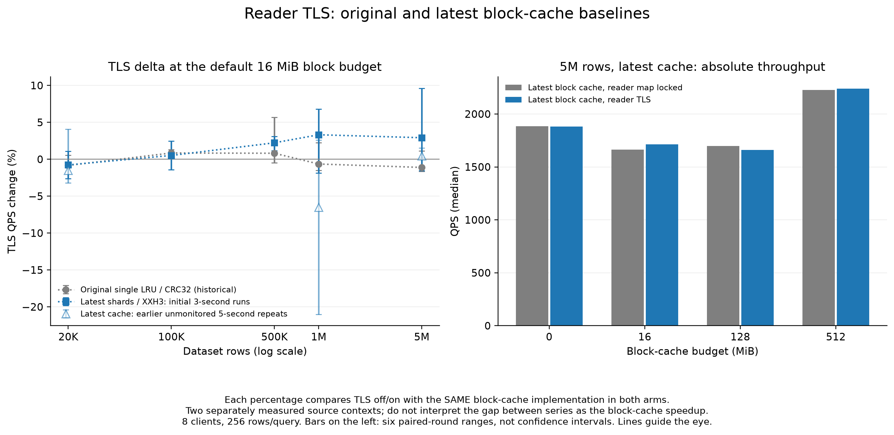
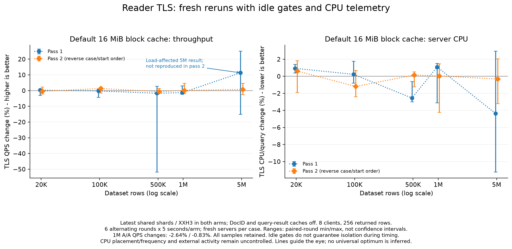

# Reader TLS with original and latest block-cache baselines (2026-11-13)

This report gives **two datasets** for PR #5045. Each dataset measures TLS off/on
with the **same block-cache implementation in both arms**. The latest dataset
uses the shared sharded-LRU/XXH3 implementation from final #5042 commit
`376fbf9988b2458ee196a5d92135c35a5121edc7` in both arms; the candidate adds only
the production reader TLS diff from `019868e9f79d1bb2bd1f96dafb88ef20acd45418`.
The original dataset uses the earlier single-LRU/CRC32 cache in both arms.

PR #5045 remains TLS-only. Its source head is unchanged at `019868e9`; this
benchmark context adds no block-cache or DocID production code to that PR.
#5042 still contains the shared block-cache change without reader TLS.

The fresh load-recorded second pass measures default-cache QPS changes of
**−0.62% to +1.31%** across 20k–5M rows, with A/A at −0.83%. The earlier −6.53%
1M regression is not reproduced in the new passes (−1.32% / +0.14%); its cause
remains unproven. Background spikes were recorded, particularly in the first
pass. The data does not establish a consistent default-cache benefit. All
historical, initial and fresh samples remain below; cache-off gains are separate.

## What is held constant

| Dataset | TLS-off baseline | TLS-on candidate | Block cache in both arms | Native DocID cache |
| --- | --- | --- | --- | --- |
| Original | Upstream 047d2f9 | Upstream plus #5045 (019868e9) | Original single locked LRU, chained CRC32 | Module absent |
| Latest | #5042 376fbf9 | Same source plus exactly the #5045 production reader diff | Up to 16 locked shared LRUs, seeded XXH3-64 | Module present but disabled; used bytes checked as zero |

CI/alignment repairs from #5042 are identical within the latest pair. Both latest
arms also contain the same eight public reader tests, which do not link into
searchd. No block-cache implementation gain is counted as a TLS gain. These
are separate measurement phases and source contexts: do not subtract absolute
QPS between datasets to attribute a causal effect, or add/multiply their gains.

## Default 16 MiB: the two datasets side by side

Eight clients, 256 returned rows. Each before →TLS rate belongs to that cache's
own paired comparison. The latest-cache repeat is an independent longer run.
All percentages are ratios of arm medians, not confidence intervals.

| Rows | Original cache: before →TLS QPS | TLS change | Latest cache: before →TLS QPS | TLS change | Latest CPU/query change | Latest longer-repeat QPS change |
| ---: | ---: | ---: | ---: | ---: | ---: | ---: |
| 20,000 | 3,419.3 →3,390.6 | -0.84% | 7,505.4 →7,447.7 | -0.77% | +0.81% | -1.49% |
| 100,000 | 3,034.3 →3,060.0 | +0.85% | 7,030.0 →7,066.1 | +0.51% | -0.58% | Not repeated |
| 500,000 | 1,452.7 →1,464.5 | +0.81% | 3,353.1 →3,427.8 | +2.23% | -2.06% | Not repeated |
| 1,000,000 | 1,387.3 →1,378.4 | -0.65% | 3,001.0 →3,100.5 | +3.32% | -2.70% | -6.53% |
| 5,000,000 | 1,252.4 →1,238.5 | -1.11% | 1,664.3 →1,712.9 | +2.92% | -1.58% | +0.46% |

The original-cache default-budget size sweep spans −1.11% to +0.85% QPS.
The latest-cache initial sweep spans **-0.77% to +3.32%**. The measured
TLS effect depends on budget and workload; the repeats and controls below
limit what can be called a repeatable benefit. This does not establish a
universal positive gain or a universal dataset-size optimum.

The longer repeats do not establish a consistent default-cache TLS benefit: at
1M rows the initial +3.32% becomes −6.53% (CPU/query +4.09%), and at 5M
+2.92% becomes +0.46%. The 20k repeat remains negative at −1.49%.
The latest A/A control is +0.65% initially and -0.71% in the
additional five-second run. These controls are reported, not subtracted from
the TLS results. The extra A/A was added after the 1M sign reversal.

The left chart compares TLS deltas from two separately measured source contexts.
Its vertical ranges are the six paired-round changes, not statistical confidence
intervals. Open triangles are the preselected latest-cache longer repeats.
The right chart contains only the latest cache, showing absolute QPS at 5M
across budgets. No block-cache implementation speedup is attributed to TLS.

## Fresh reruns with recorded machine load

After the earlier 1M sign reversal, the author requested new measurements to
check workstation-load variation. The archived plan was written before these
rerun outcomes. Two independent passes cover all five default-budget sizes,
the 20k cache-off text case, a 1M count control and a 1M A/A control. Each case
uses fresh daemons and six alternating five-second rounds/arm. Pass 2 reverses
case order and the starting arm. The binaries, fixtures and query pools match
the earlier latest-cache measurements.

Before every case, a continuous 60-second gate required average system CPU idle
of at least 90%, with every measured interval at least 80% idle. A one-second
logger records host CPU/load and external-process CPU deltas throughout warmup
and timing. Thermal, swap and VM snapshots bracket every case. No builds,
tests, sanitizers or plot rendering from this benchmark task run during timing;
external activity remains observable in the telemetry. No user
application is stopped. All completed samples remain, including samples whose
recorded external load rises after the gate.

| Pass | Case | No-TLS QPS | TLS QPS | QPS change | CPU/query change | External CPU, no TLS / TLS (% of machine) |
| --- | --- | ---: | ---: | ---: | ---: | ---: |
| load-controlled-1 | rows20000-cache0 | 5,693.3 | 6,071.8 | +6.65% | -8.70% | 27.89 / 27.64 |
| load-controlled-1 | rows20000-cache16777216 | 7,696.1 | 7,717.6 | +0.28% | +0.93% | 5.39 / 4.44 |
| load-controlled-1 | rows100000-cache16777216 | 6,828.2 | 6,814.3 | -0.20% | +0.23% | 5.60 / 5.92 |
| load-controlled-1 | rows500000-cache16777216 | 3,234.7 | 3,180.3 | -1.68% | -2.54% | 7.10 / 7.40 |
| load-controlled-1 | rows1000000-cache16777216 | 2,765.7 | 2,729.3 | -1.32% | +1.09% | 7.72 / 9.13 |
| load-controlled-1 | rows5000000-cache16777216 | 1,421.7 | 1,582.7 | +11.33% | -4.36% | 18.77 / 13.27 |
| load-controlled-1 | count-1000000 | 9,617.9 | 9,518.8 | -1.03% | +1.00% | 4.69 / 4.95 |
| load-controlled-1 | aa-1000000 | 2,807.7 | 2,733.5 | -2.64% | -0.37% | 5.42 / 9.54 |
| load-controlled-2 | aa-1000000 | 2,786.2 | 2,763.1 | -0.83% | +1.35% | 6.18 / 6.23 |
| load-controlled-2 | count-1000000 | 9,261.8 | 9,341.3 | +0.86% | -0.48% | 8.40 / 8.27 |
| load-controlled-2 | rows5000000-cache16777216 | 1,707.6 | 1,720.7 | +0.77% | -0.32% | 3.72 / 3.37 |
| load-controlled-2 | rows1000000-cache16777216 | 3,100.5 | 3,104.9 | +0.14% | +0.04% | 3.38 / 3.15 |
| load-controlled-2 | rows500000-cache16777216 | 3,541.2 | 3,519.3 | -0.62% | +0.15% | 3.26 / 3.25 |
| load-controlled-2 | rows100000-cache16777216 | 6,780.8 | 6,869.4 | +1.31% | -1.19% | 5.54 / 5.92 |
| load-controlled-2 | rows20000-cache16777216 | 7,470.6 | 7,440.2 | -0.41% | +0.62% | 5.42 / 5.61 |
| load-controlled-2 | rows20000-cache0 | 5,856.6 | 6,388.1 | +9.07% | -6.96% | 5.25 / 5.36 |

The quieter second pass places all five default-cache QPS changes between
**−0.62% and +1.31%**; no default-cache sample in that pass meets the recorded
higher-load flag. Its A/A control is −0.83%. This is descriptive evidence of
small effects, not a formal noise band or confidence interval. At 1M, the fresh
passes give **−1.32% / +0.14%**, rather than the earlier unmonitored −6.53%.
The older regression remains in the record; its cause is not established.

At 5M, the first pass's **+11.33%** accompanies unequal external CPU medians
(**18.77% / 13.27%** of the machine for no TLS / TLS). It becomes **+0.77%** in
the second pass, where those CPU medians are **3.72% / 3.37%** and no sample
meets the higher-load flag. The large first-pass gain is not repeatable evidence.
By contrast, the 20k **cache-off** case gives **+6.65% / +9.07% QPS** and
**−8.70% / −6.96% CPU/query** across the two passes; the first pass is load-affected.
Cache-off gains must not be substituted for the default-cache result.

These runs do **not establish a consistent default-cache throughput benefit**.
They demonstrate real workstation-load interference and do not identify the
cause of every prior positive or negative result. No A/A subtraction is applied.

A/A QPS changes are **-2.64% / -0.83%**;
count-control changes are -1.03% / +0.86%.
A/A runs the no-TLS binary in both labeled arms. The lowest pre-case mean idle
was 90.02%. Using the telemetry summary flag (sample-average
external CPU >10% of machine, or an interval >20%), 38/192 timed
samples are flagged; they remain in all results. External CPU means the median
of the six sample-average deltas for surviving processes outside the benchmark
process tree; short-lived external processes can be missed. These flags are
monitoring annotations, not exclusion criteria or proof of causation. The
one-second series covers 80.49–100% of each timed sample (the logger can stop
before the final partial interval); per-sample coverage is retained in the
summary, and unseen tails cannot be declared free of interference.
The first pass's 20k cache-off case experienced a Spotlight (`mds` /
`mdworker`) CPU spike after its idle gate. The contemporaneous process logs
retain that interference; it is not labeled as an isolated quiet measurement.

Normal `--nodetach` startup is retained. CPU placement/frequency and exclusive
machine access remain uncontrolled. The new telemetry can reveal coincident
load, but cannot retroactively identify the cause of the earlier unmonitored run.

The first driver's `uid_seed_note` and the pre-run plan contained an exploratory
assumption about startup-dependent shard routing. A later source-order audit
found that fixture-table preloading occurs **before** `SetUidShort`. Those raw
notes are superseded by the [source-order audit](evidence/2026-11-13/tls-latest-block/startup-hash-seed-path.json);
they do not establish differing runtime IDs or cache-shard routing. Runtime IDs
were not instrumented, and no shard-routing variability claim is made.

[Raw rerun 1](evidence/2026-11-13/tls-latest-block/load-controlled-1.json),
[raw rerun 2](evidence/2026-11-13/tls-latest-block/load-controlled-2.json),
[per-sample load summary](evidence/2026-11-13/tls-latest-block/load-controlled-summary.json),
[pre-run plan](evidence/2026-11-13/tls-latest-block/load-controlled-plan.json).

## All 16 matched size/cache text cells

Same fixture metadata and query-pool SHA256 in each original/latest cell.
The full source contexts and measurement phases still differ, as documented
above. `CPU` means change in server CPU/query; a negative value is lower CPU.

| Rows | Block MiB | Original before →TLS QPS | Original QPS change | Original CPU change | Latest before →TLS QPS | Latest QPS change | Latest CPU change |
| ---: | ---: | ---: | ---: | ---: | ---: | ---: | ---: |
| 20,000 | 0 | 6,190.0 →6,930.7 | +11.97% | -9.18% | 5,949.9 →6,473.2 | +8.79% | -6.82% |
| 20,000 | 16 | 3,419.3 →3,390.6 | -0.84% | +0.77% | 7,505.4 →7,447.7 | -0.77% | +0.81% |
| 20,000 | 128 | 3,387.8 →3,450.7 | +1.86% | -1.59% | 7,421.3 →7,456.8 | +0.48% | -0.15% |
| 100,000 | 0 | 5,271.9 →5,455.8 | +3.49% | -2.44% | 5,156.6 →5,409.6 | +4.91% | -2.44% |
| 100,000 | 16 | 3,034.3 →3,060.0 | +0.85% | -0.84% | 7,030.0 →7,066.1 | +0.51% | -0.58% |
| 100,000 | 128 | 3,110.7 →3,100.0 | -0.35% | +0.25% | 7,035.5 →7,079.8 | +0.63% | +0.12% |
| 500,000 | 0 | 4,170.9 →4,241.0 | +1.68% | -1.40% | 3,951.3 →4,172.5 | +5.60% | -4.78% |
| 500,000 | 16 | 1,452.7 →1,464.5 | +0.81% | -0.10% | 3,353.1 →3,427.8 | +2.23% | -2.06% |
| 500,000 | 128 | 2,788.7 →2,747.1 | -1.49% | +0.63% | 6,406.0 →6,422.6 | +0.26% | -0.24% |
| 1,000,000 | 0 | 3,512.6 →3,587.2 | +2.12% | -1.53% | 3,538.9 →3,479.0 | -1.69% | -0.45% |
| 1,000,000 | 16 | 1,387.3 →1,378.4 | -0.65% | +0.66% | 3,001.0 →3,100.5 | +3.32% | -2.70% |
| 1,000,000 | 128 | 2,496.9 →2,548.0 | +2.05% | -1.71% | 5,541.1 →5,501.2 | -0.72% | +0.86% |
| 5,000,000 | 0 | 1,783.4 →1,789.5 | +0.34% | -0.56% | 1,885.9 →1,882.0 | -0.20% | -0.33% |
| 5,000,000 | 16 | 1,252.4 →1,238.5 | -1.11% | +0.82% | 1,664.3 →1,712.9 | +2.92% | -1.58% |
| 5,000,000 | 128 | 1,275.5 →1,273.6 | -0.15% | -0.20% | 1,697.3 →1,661.2 | -2.13% | +0.73% |
| 5,000,000 | 512 | 2,061.1 →2,046.5 | -0.71% | +0.53% | 2,226.5 →2,238.4 | +0.53% | -0.33% |

## Latest-cache controls and all preselected repeats

Initial controls use six three-second rounds. Repeats use six five-second
rounds and reversed initial order. These phases are not pooled. A/A uses the
no-TLS binary twice. Point/count/mixed have different query pools from the
256-row fixed-template size matrix and are labeled explicitly.

| Phase | Case | Before QPS | TLS QPS | QPS change | CPU/query change | Client p95 change |
| --- | --- | ---: | ---: | ---: | ---: | ---: |
| matrix | count-20000 | 22,623.9 | 22,894.3 | +1.20% | -1.84% | -0.71% |
| matrix | point-20000 | 43,654.7 | 44,055.7 | +0.92% | -2.71% | -1.00% |
| matrix | count-1000000 | 9,537.9 | 9,770.8 | +2.44% | -0.86% | -2.80% |
| matrix | point-1000000 | 32,519.3 | 32,971.0 | +1.39% | -1.63% | -0.84% |
| matrix | aa-1000000 | 2,783.1 | 2,801.1 | +0.65% | -0.73% | -0.96% |
| matrix | mixed-1000000 | 18,247.4 | 18,616.5 | +2.02% | -0.19% | -2.02% |
| repeat-default | rows20000-cache16777216 | 7,591.8 | 7,478.4 | -1.49% | +1.93% | +3.49% |
| repeat-default | rows1000000-cache16777216 | 2,784.0 | 2,602.2 | -6.53% | +4.09% | +10.30% |
| repeat-default | rows5000000-cache16777216 | 1,697.0 | 1,704.7 | +0.46% | -0.58% | -0.61% |
| repeat-mixed | mixed-1000000 | 19,888.5 | 20,166.9 | +1.40% | -1.07% | -2.12% |
| repeat-aa | aa-1000000 | 2,883.3 | 2,862.9 | -0.71% | +0.81% | +0.59% |

The mixed workload combines four bulk clients with four hot-point clients.
Its total QPS can be dominated by point queries, so both group-throughput
changes are retained:

| Phase | Total QPS change | Bulk-group QPS change | Point-group QPS change |
| --- | ---: | ---: | ---: |
| matrix | +2.02% | +2.31% | +2.00% |
| repeat-mixed | +1.40% | +2.51% | +1.29% |

The latest context contains **43 comparisons, 516 timed
arm samples and 14,268,346 checked timed queries**.
Every sample and negative/control case remains. The original size/cache dataset
contains 23 comparisons; its broader historical workload/repeat matrix and
diagnostics remain in the original-cache report and are not relabeled as latest.

## Method

Apple M4 Pro, 12 cores, 24 GiB, Apple Clang 21, `-O2 -DNDEBUG`, MCL `88b5412`.
The latest arms use the same dependencies/configuration, 128-byte rowwise stored
text, 16 KiB/LZ4, eight server workers and separate client processes on the same
host. SQL query-result cache is off. The reader-buffer budget stays 8 MiB.
The latest DocID budget is explicitly zero, with status checked before lifecycle
mutations; this is separate from the default 16 MiB decoded-block cache budget.

The size/cache matrix uses the original fixture snapshots and fixed seed 513,
20 templates/client, eight clients and 256 returned rows. The report verifies
query-pool SHA256 matches between the original and latest text cells. Point
controls use 4096 templates/client; mixed uses four 256-row bulk clients and
four hot-point clients with their own deterministic pools. Those are separate
workloads, not the size matrix. Every returned ID/text/count is checked.

Initial measurements use six alternating rounds × three seconds/arm. Warmup,
query-plan probes and REPLACE/flush/DROP/recreate checks are outside timing.
Before initial results, longer repeats were selected for 20k/1M/5M default-cache
bulk and the mixed workload. They use fresh servers, six rounds × five seconds,
and reverse each selected case's original starting arm. An additional five-second
A/A control was added after the 1M repeat reversed sign; it is labeled separately.
After the initial longer repeats, two new passes were planned at the author's
request to check machine-load variation. Their idle gates, telemetry and all
results are reported separately above. Every sample and
negative/control result is retained; no run is selected solely for a positive sign.

QPS and server CPU/query changes are ratios of the two arm medians minus one.
CPU is searchd user+system time. RSS is median round-end resident memory.
Client p95 includes HTTP/JSON/result validation and is a median of round p95
values. Vertical chart ranges are the six paired-round changes, not confidence
intervals. All timings exclude compilation, sanitizer runs, plot rendering and
diagnostic counters. No new instrumented reader-hit-rate claim is made here.

A block-cache hit bypasses the reader lookup, while registry creation/deletion
and TLS-generation mutation work can remain. With fewer block misses there is
less repeated reader-lookup work to save. This explains the relevant code paths;
the timings do not isolate the cost of each component or attribute cross-phase
QPS differences solely to the block-cache implementation.

## Maintainer question: deleting a cached reader

Generation is invalidation, not memory reclamation. It does not protect a reader
already returned or close the check/use race. Arbitrary concurrent deletion
while another thread uses that reader is unsafe. Both the old registry lookup
and the TLS path return a borrowed raw pointer; the mutex is released before
I/O in the old path too. Safety still requires the existing session/index
lifetime contract to protect active use and quiescent shutdown. The tests follow
those preconditions and do not prove arbitrary concurrent deletion safe.

## Maintainer question: short sessions and the global generation

Each successful reader creation/deletion advances the same process-wide atomic.
Unrelated sessions can invalidate another thread's entry and add coherence work.
HTTP keepalive does not remove per-query docstore sessions. The fresh mixed
workload and its preselected repeat quantify net behavior on the latest block
cache; they do not isolate the counter's own cost or measure TLS hit rate.
Old diagnostic hit rates belong to the original-cache dataset and are not
reused as measurements of the latest implementation. Per-thread TLS still
costs 32 bytes payload on 64-bit builds plus runtime metadata; registry ownership
and the total 8 MiB reader-buffer budget are unchanged.

## Validation and limits

Both latest-context arms passed **529/529 GoogleTests**. Focused ASan+UBSan and
TSan each passed **11 tests ×20**, covering all eight reader tests plus three
block-cache tests, instrumenting docstore/fileio/test sources and reusing the
remaining engine archives. Alignment checking is enabled and sanitizer errors
are fail-fast. This is focused coverage, not a whole-engine sanitizer build.
The original-cache dataset's 499-test/eight-reader-test results remain separate.

The added public tests cover ordered retirement/recreation, cached null followed
by creation, unrelated-session churn, budget refusal and migration, plus block
clear/index-key reuse, concurrent eviction pressure and large/tiny-cache cases.
All use valid ownership/lifetime boundaries. The PR source still contains its
original five reader tests; supplemental tests are review fixtures.

Both fresh arms use the same supported MANTICORE_* stack overrides inherited
from an earlier upstream/Clang 21 build. No new automatic calibration was
attempted and no freshly measured calibration is claimed. The provenance,
commands and values are archived. No production workaround was introduced.

These are finite hot-query pools on a shared workstation, without controlled
CPU frequency/affinity or a formal confidence interval. They do not establish
Linux/x86-64 SQL performance, cold-storage behavior, production capacity,
universal benefit or safety outside the existing lifetime contract. The two
source contexts also differ by disabled DocID code and common CI/alignment
repairs; only the TLS on/off effect is controlled within each pair. Query-cache
efficiency is not tested. #5042 platform CI remains a separate upstream gate.

## Evidence and reproduction

- [Latest raw matrix](evidence/2026-11-13/tls-latest-block/matrix.json),
  [preselected repeats](evidence/2026-11-13/tls-latest-block/repeat-default.json),
  [mixed repeat](evidence/2026-11-13/tls-latest-block/repeat-mixed.json).
- [Idle-gated rerun plan](evidence/2026-11-13/tls-latest-block/load-controlled-plan.json),
  [first pass](evidence/2026-11-13/tls-latest-block/load-controlled-1.json),
  [second pass](evidence/2026-11-13/tls-latest-block/load-controlled-2.json),
  [per-sample CPU summary](evidence/2026-11-13/tls-latest-block/load-controlled-summary.json).
- [Latest build/source/binary manifest](evidence/2026-11-13/tls-latest-block/build-manifest.json),
  [summary and comparisons](evidence/2026-11-13/tls-latest-block/summary.json),
  [CSV](evidence/2026-11-13/tls-latest-block/summary.csv).
- [Original-cache report](TLS_ORIGINAL_CACHE_2026-11-13.md) and
  [original raw size/cache matrix](evidence/2026-11-13/tls/scale-matrix.json).
- [Reproduction guide](repro/2026-11-13/README.md),
  [latest TLS evidence ZIP](attachments/reader-tls-latest-block-cache-evidence.zip).

MANIFEST.json records each published file hash. Historical archives are retained
as dated snapshots; the new ZIP identifies the latest context explicitly.
