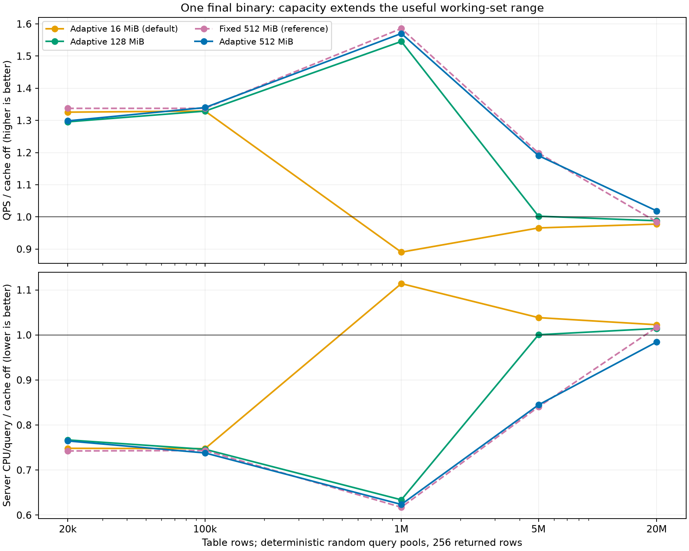
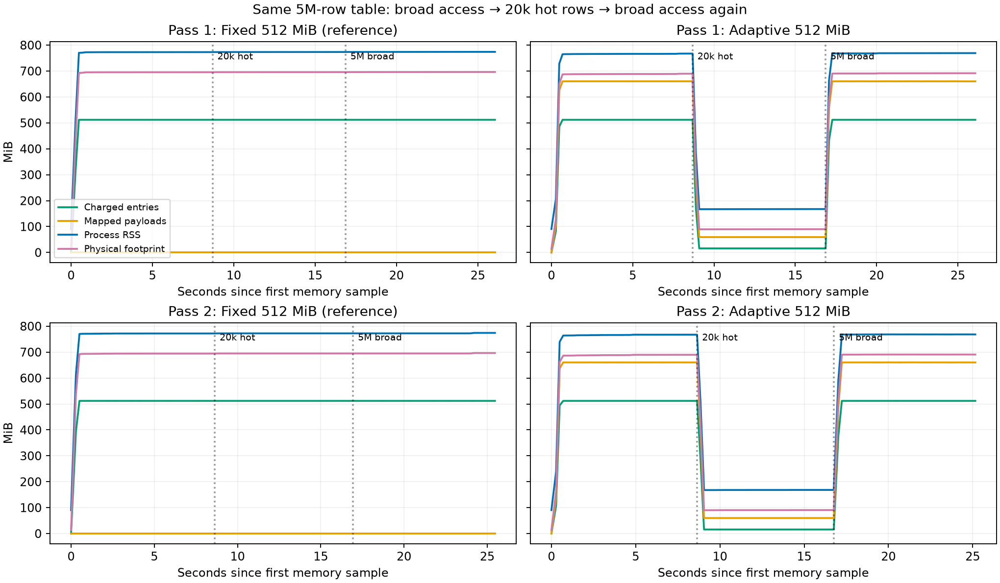

# Adaptive docstore cache: capacity, oversized working sets and memory return

**The latest docstore cache implementation is adaptive whenever enabled.** `docstore_cache = 1` enables it (the default), and `docstore_cache = 0` disables it. `docstore_cache_size` sets its capacity ceiling, defaulting to 16 MiB; a zero ceiling also disables caching. Fixed-policy results below are benchmark reference controls, not a selectable mode in the latest server.

The PR also retains its original, independent native DocID → RowID cache for numeric ID lookup. That cache remains opt-in and is disabled in all block-cache benchmarks below. Reader TLS remains independent in [#5045](https://github.com/manticoresoftware/manticoresearch/pull/5045).

| Cache | Setting | Default | Behavior |
| --- | --- | --- | --- |
| Native DocID → RowID | `docid_lookup_cache_size` | `0` | Immutable per-disk-chunk lookup caches; compressed fallback when refused or inapplicable |
| Adaptive docstore enable switch | `docstore_cache` | `1` | `1`: adaptive cache enabled; `0`: block cache disabled |
| Decoded-block capacity ceiling | `docstore_cache_size` | `16m` | Shared LRU partitions, XXH3-64, second-touch admission and mapped-memory reclamation |

The native DocID cache retains the existing disk format and costs about 11.58 MiB per million entries on the tested hosts; allocation/alignment padding count against its own budget. Chunk remap/destruction releases it. The two cache budgets are independent and server-wide.

The block cache has up to 16 independently locked partitions. A successful lookup/insertion pins the payload; releasing that pin is an atomic decrement, avoiding a second hash lookup and mutex acquisition per returned row. LRU membership and eviction remain locked. Adaptive misses use one fixed 256 KiB atomic fingerprint history: the first visit decodes temporarily, and a repeated fingerprint visit becomes eligible for insertion. Full-key checks preserve correctness despite fingerprint collisions. This reduces first-visit insertion/eviction work without a separate global bypass state.

## 1. Larger budgets extend the useful working-set range

Every performance column below uses **the same measured binary, `8fec92b`**, with native DocID caching and SQL query caching disabled and **no reader TLS**. The latest head `d89cebc` enables those same adaptive algorithms by default through the simplified enable switch; the fixed 512 MiB column is a reference control from the recorded matrix. These are configuration comparisons, not full-PR speedups over upstream.

Apple M4 Pro / Clang 21, `-O2 -DNDEBUG`; eight clients and eight workers; 256 returned rows/query, 128-byte stored text, 16 KiB/LZ4. Random queries reuse 64 deterministic templates per client; each sample warms the complete pool. Six balanced rounds × five seconds/arm; reported QPS and server CPU/query are per-arm medians. All nonzero capacities in this matrix use 16 partitions.

**Multiplier = enabled-cache QPS / cache-off QPS in the same case.** 1.30× means 30% more throughput; 0.90× means 10% less. Lower server CPU/query is better.

QPS (multiplier versus cache off):

| Rows | Off | Adaptive 16 MiB (default) | Adaptive 128 MiB | Fixed 512 MiB (reference) | Adaptive 512 MiB |
| ---: | ---: | ---: | ---: | ---: | ---: |
| 20,000 | 6,203.8 (1.00×) | 8,224.6 (1.33×) | 8,038.2 (1.30×) | 8,297.8 (1.34×) | 8,056.4 (1.30×) |
| 100,000 | 5,441.6 (1.00×) | 7,232.9 (1.33×) | 7,231.5 (1.33×) | 7,278.6 (1.34×) | 7,291.8 (1.34×) |
| 1,000,000 | 3,397.0 (1.00×) | 3,024.9 (0.89×) | 5,250.3 (1.55×) | 5,386.9 (1.59×) | 5,334.3 (1.57×) |
| 5,000,000 | 1,759.0 (1.00×) | 1,698.8 (0.97×) | 1,763.0 (1.00×) | 2,108.2 (1.20×) | 2,094.2 (1.19×) |
| 20,000,000 | 742.7 (1.00×) | 726.2 (0.98×) | 733.8 (0.99×) | 731.3 (0.98×) | 756.5 (1.02×) |

Server CPU milliseconds/query:

| Rows | Off | Adaptive 16 MiB (default) | Adaptive 128 MiB | Fixed 512 MiB (reference) | Adaptive 512 MiB |
| ---: | ---: | ---: | ---: | ---: | ---: |
| 20,000 | 1.0896 | 0.8154 | 0.8357 | 0.8090 | 0.8332 |
| 100,000 | 1.2683 | 0.9482 | 0.9463 | 0.9429 | 0.9360 |
| 1,000,000 | 2.1540 | 2.3996 | 1.3655 | 1.3300 | 1.3434 |
| 5,000,000 | 4.3439 | 4.5111 | 4.3461 | 3.6503 | 3.6697 |
| 20,000,000 | 10.5099 | 10.7482 | 10.6609 | 10.6904 | 10.3466 |



At 20k–100k rows, 16 MiB already covers most reused blocks; allocating a higher ceiling adds little. At 1M, adaptive 16 MiB gives **0.89×**, while 128/512 MiB give **1.55× / 1.57×**. At 5M, adaptive 512 MiB gives **1.19×** and **-15.52% CPU/query** versus off. The sampled benefit is not monotonic in total rows: capacity should follow the active **decoded, reused** working set, rather than compressed table size. The plot shows sampled configurations, not an exact crossover or universal optimum. Raising the ceiling and changing admission policy are separate comparisons; fixed/adaptive controls at the same 512 MiB ceiling keep that distinction visible.

## 2. Beyond capacity: reduce churn, retain the remaining losses

At 20M random rows, adaptive 512 MiB achieves **1.019×** cache-off throughput (+1.87%), with **-1.55% CPU/query**. The same-ceiling fixed reference result is **0.985×**. Admission filters first visits; it does not eliminate cache lookup, synchronization, temporary decoding or repeated-visit costs.

| 20M advancing scan | QPS | QPS / off | Server CPU ms/query | CPU vs off |
| --- | ---: | ---: | ---: | ---: |
| Off | 5,154.4 | 1.000× | 1.1556 | +0.00% |
| Fixed 512 MiB (reference) | 7,521.9 | 1.459× | 0.7569 | -34.50% |
| Adaptive 512 MiB | 7,545.7 | 1.464× | 0.7566 | -34.53% |

The advancing scan generates new contiguous 256-ID ranges rather than cycling the random query pool. Its results are a separate locality control. Adaptive mode does **not** guarantee cache-off parity: at 1M random rows with only 16 MiB, throughput is still **-10.95%** versus off. A bigger cache can help when it covers reuse; a low-reuse workload can still favor cache off. There is no automatic low-hit-rate switch to cache off.

## 3. A smaller active set releases process memory

Two diagnostic passes retain the same 5M-row table and change only the query access range: **5M broad → 20k hot → 5M broad again**. Each phase runs for eight seconds after warmup. Fixed/adaptive order is reversed on the second pass. Values below are medians of the two phase-end snapshots, in MiB; each individual pass and continuous trace is retained.

| Access phase (same 5M-row table) | Fixed 512 MiB RSS (reference) | Adaptive 512 MiB RSS | Adaptive footprint | Adaptive entries / mapped |
| --- | ---: | ---: | ---: | ---: |
| 5M broad | 772.5 | 767.2 | 689.6 | 511.8 / 660.2 |
| 20k hot | 772.9 | 167.9 | 90.3 | 15.8 / 59.7 |
| 5M broad again | 774.0 | 768.7 | 691.1 | 511.8 / 660.1 |



Both modes allocate on demand; a 512 MiB ceiling never means an eager 512 MiB reservation. Adaptive mode additionally trims cold, unpinned entries after a stable smaller hot set is observed. Decoded payloads use per-partition OS mappings: small blocks are packed into 64 KiB regions, and empty regions are unmapped; larger blocks use dedicated mappings. Up to one empty 64 KiB region is retained per partition (at most 1 MiB total).

Reclamation advances on lookups, not an idle timer. Pinned blocks and partially occupied regions can retain memory. `docstore_cache_size` caps **charged payload allocation classes plus cached entries**, not total mapped bytes or process RSS. Metadata, fingerprint history, reader/result buffers, temporary first-visit decodes and mapping slack are additional; mapping-failure/oversized fallbacks use the process heap. `docstore_cache_used_bytes`, `docstore_cache_mapped_bytes` and `docstore_cache_spare_bytes` expose the separate quantities.

## Configuration and validation

The default is **adaptive docstore caching enabled, with a 16 MiB ceiling**; native DocID caching remains off. To use a larger ceiling:

```ini
searchd {
    docstore_cache_size = 512m
    docstore_cache = 1
}
```

Set `docstore_cache = 0` to disable the block cache independently of its ceiling. There is no separate adaptive-policy option.

The latest head passes 548 native gtests, API smoke, DocID lifecycle checks at 0/1 KiB/16 MiB, and six real-server enable-switch cases covering default/explicit enable, explicit disable and zero-sized budgets. The adaptive algorithm previously passed 30 focused cache/pool/admission/reclamation tests ×20 under both ASan+UBSan and TSan (600 tests per sanitizer); the enable-switch change leaves those algorithms unchanged. Instrumentation covers docstore, file I/O and the focused test translation unit; other engine archives are reused uninstrumented. ASan leak detection is disabled on macOS. Previously pushed CI repairs remain included: Windows output types, GoogleTest compatibility, smoke/metric expectations, alignment-safe access and upstream test-registration conflicts.

Upstream [CI](https://github.com/manticoresoftware/manticoresearch/pull/5042/checks) remains subject to maintainer approval for the fork; local passes are reported separately. Linux/Windows CI and production endurance are not established by this macOS measurement. Cache clear/shutdown retain their existing quiescent-reader preconditions.

## Evidence and reproduction

- [All configuration medians](summary.csv), [all timed samples](all-samples.csv), [memory stage endpoints](memory-stages.csv), and [full tables including controls](TABLES.md).
- `raw/measurement/` preserves the original five-size matrix, two memory passes per mode and telemetry; `raw/confirm-*/` retains complete independent confirmations. `raw/controls/` contains the A/A and advancing scan. No raw round is dropped.
- Source and binary identities are in `source-isolation.json`, `raw/measurement/plan.json` and `summary.json`. The binary SHA-256 is `bd0f089935634ef752e799403b960244071c89277f2d39f82054afd4f0e801e6`. `source.patch` is the integration over the preceding published PR commit; `full-pr.patch` is the full source change over the PR base.
- Run `python3 run_final.py --selfcheck`, then `python3 run_final.py`; run `python3 run_controls.py` separately, after the matrix. Fixtures are generated by the archived standard-library driver. The benchmark binary is built separately from the recorded source and must be placed beside the drivers. Large immutable table fixtures and executable binaries are omitted from the archive.
- The pre-recorded repeat rule retains all samples and schedules a complete confirmation when mean external CPU exceeds 10% of machine or a peak exceeds 20%; it never selects individual rounds by performance. Selected cases: `{"random-100000": "confirm-100000", "random-1000000": "measurement", "random-20000": "measurement", "random-20000000": "measurement", "random-5000000": "measurement"}`. The retained throughput series has 264 samples and 6,515,205 response-checked timed queries; 2 samples cross the recorded rule, including originals retained alongside confirmations. Selected random matrix flags: 0. Memory diagnostics have their own status sampler and are not pooled into throughput results.
- The independent cache-off A/A control gives QPS `744.9` / `747.9` (+0.41%) and CPU/query `10.5086` / `10.4572` ms. Sub-percent differences in individual configuration columns should be treated as approximately flat, not established wins.

The finite random pools, structured compressible text and sampled scan locate capacity/locality tradeoffs. They do not establish universal no-regression behavior, automatic optimal sizing, mixed-write throughput, long-duration endurance or adaptive-plus-reader-TLS performance. Native DocID lookup-kernel measurements and historical TLS results are independent evidence; their gains must not be multiplied into these configuration comparisons.
