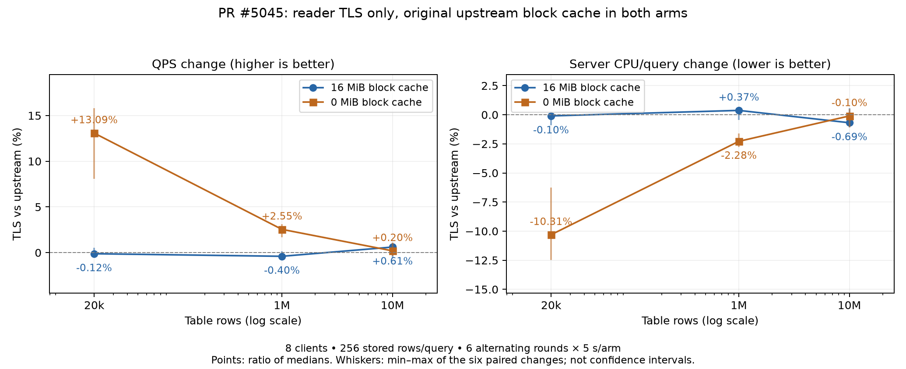

# PR #5045: independent reader TLS benchmark — 2026-11-14

This experiment measures **only the reader TLS change in PR #5045**. Both arms use the original upstream single-lock, CRC32-based docstore block cache. No #5042 shared-cache sharding, XXH3 change, native DocID cache, adaptive admission, private block pinning or mapped-allocation experiment is included.

For the 256-row workload, the default 16 MiB cache produces TLS QPS changes from **-0.40% to +0.61%** across 20k, 1M and 10M rows. With the block cache disabled, the corresponding range is **+0.20% to +13.09%**. At 20k rows, cache-off TLS changes QPS by **+13.09%** and server CPU/query by **-10.31%**; the default-cache changes are **-0.12%** and **-0.10%**. These results do not establish a general default-cache throughput improvement or a gain that increases monotonically with table size.

## Source and build isolation

| Arm | Production source |
| --- | --- |
| Upstream | `047d2f99522d78e0aa1de7e7dc945a9abe1b673a` |
| TLS | The same source plus the exact `src/docstore.cpp` diff from `019868e9f79d1bb2bd1f96dafb88ef20acd45418` |

The five PR reader tests and their CMake registration were added identically to both arms. Both builds used the same worktree revision and generated version headers. **Only `src/CMakeFiles/lmanticore.dir/docstore.cpp.o` changed out of 299 object files**; the complete before/after SHA-256 lists and unchanged LRU source hashes are included in the evidence. The production patch is 27 changed lines in one source file. MCL was configured API-only in both builds; the workloads use the rowwise engine.

Binary SHA-256:

```text
upstream f8be256143e096f8962a4e6d66337fe57bbb5433d326bd8651c20ce71f42fb00
TLS      c5936369df1a4bbfe9b53404db95af7027f8a5bd7c8a0c6223377ed86de6e7b6
```

## Method

- Apple M4 Pro, 12 CPU cores, 24 GiB RAM, ARM64 macOS, Apple Clang 21.0.0; `-O2 -DNDEBUG`, identical compiler and link options.
- 20,000, 1,000,000 and 10,000,000 rows. One deterministic 128-byte stored-only text field; 16 KiB docstore blocks, LZ4 compression, flushed disk chunks. This is stored-field retrieval, not full-text search.
- Eight concurrent clients and eight server threads over loopback HTTP keep-alive. Deterministic random IDs, exact response validation on every query, SQL query-result cache disabled. Native DocID caching is absent from this upstream source; no DocID-cache configuration was injected.
- Same original block-cache implementation and capacity within each pair: either default 16 MiB or explicitly 0. The reader buffer budget remains 8 MiB in both arms.
- Six rounds per case, five timed seconds per arm, balanced alternating AB/BA order. Only one arm receives benchmark traffic at a time. Each worker warms its complete fixed query pool before each timed interval; pool sizes and query hashes are in the raw results. OS file pages are warm; this is not a cold-storage benchmark.
- A 30-second pre-case idle gate and continuous one-second telemetry are retained. All **204 timed samples / 13,243,439 completed, validated timed queries** are included. Telemetry flags: **1**. No rounds were selected or removed by their QPS.
- QPS is completed queries divided by elapsed wall time. CPU/query uses the server process user+system CPU delta divided by completed queries, excluding clients and warm-up. Values in the tables are per-arm medians; percentages compare those medians. Negative CPU change means less CPU per query. Mixed-workload aggregate QPS depends on the work mix; its two groups are also reported.

HTTP keep-alive does not retain a docstore session across queries: stored-field materialization uses query-scoped `DocstoreSession_c` instances. Point and mixed cases therefore exercise session creation/cleanup and cross-thread generation invalidation, while bulk cases offer more reader reuse inside a session.

## Scale comparison: 256 stored rows per query

| Rows | Workload | Cache | Upstream QPS | TLS QPS | QPS change | CPU/query: upstream → TLS (ms) | CPU change |
| ---: | --- | ---: | ---: | ---: | ---: | ---: | ---: |
| 20,000 | Random, 256 stored rows | 16 MiB | 3,430 | 3,426 | -0.12% | 1.8116 → 1.8098 | -0.10% |
| 20,000 | Random, 256 stored rows | 0 MiB | 6,655 | 7,526 | +13.09% | 1.0457 → 0.9378 | -10.31% |
| 1,000,000 | Random, 256 stored rows | 16 MiB | 1,491 | 1,485 | -0.40% | 4.4205 → 4.4370 | +0.37% |
| 1,000,000 | Random, 256 stored rows | 0 MiB | 3,691 | 3,785 | +2.55% | 2.0162 → 1.9701 | -2.28% |
| 10,000,000 | Random, 256 stored rows | 16 MiB | 1,090 | 1,096 | +0.61% | 6.9958 → 6.9477 | -0.69% |
| 10,000,000 | Random, 256 stored rows | 0 MiB | 1,248 | 1,251 | +0.20% | 6.2592 → 6.2527 | -0.10% |



The plot samples three table sizes; it does not locate a universal optimum between those points. Whiskers show the six paired percentage changes, not a confidence interval. Raw decompressed payload sizes are approximately 2.44 MiB, 122.07 MiB and 1.19 GiB, respectively, before docstore metadata. Compressed `.spds` sizes are recorded separately in the evidence. Total rows, compressed file bytes, decoded cache capacity and active working set are different quantities.

## Smaller results, session churn and controls

| Rows | Workload | Cache | Upstream QPS | TLS QPS | QPS change | CPU/query: upstream → TLS (ms) | CPU change |
| ---: | --- | ---: | ---: | ---: | ---: | ---: | ---: |
| 20,000 | Random, 64 stored rows | 16 MiB | 13,413 | 13,392 | -0.16% | 0.4302 → 0.4311 | +0.22% |
| 20,000 | Random, 64 stored rows | 0 MiB | 17,971 | 18,864 | +4.97% | 0.3303 → 0.3141 | -4.90% |
| 1,000,000 | Random, 64 stored rows | 16 MiB | 5,551 | 5,549 | -0.04% | 1.2320 → 1.2333 | +0.11% |
| 1,000,000 | Random, 64 stored rows | 0 MiB | 7,784 | 7,834 | +0.65% | 0.9492 → 0.9431 | -0.64% |
| 20,000 | Random, 1 stored row | 16 MiB | 47,752 | 47,944 | +0.40% | 0.0943 → 0.0938 | -0.62% |
| 1,000,000 | 4 bulk clients + 4 hot point clients | 16 MiB | 22,043 | 22,177 | +0.60% | 0.2780 → 0.2758 | -0.79% |
| 20,000 | Random, 1 stored row | 0 MiB | 45,805 | 45,669 | -0.30% | 0.1010 → 0.1015 | +0.49% |
| 1,000,000 | 4 bulk clients + 4 hot point clients | 0 MiB | 21,467 | 21,481 | +0.07% | 0.3035 → 0.3033 | -0.07% |
| 1,000,000 | Count only, 256 IDs | 16 MiB | 10,405 | 10,437 | +0.31% | 0.7184 → 0.7173 | -0.15% |
| 20,000 | A/A, 256 rows (same upstream binary) | 16 MiB | 3,461 | 3,473 | +0.37% | 1.7917 → 1.7866 | -0.29% |
| 20,000 | A/A, 256 rows (same upstream binary) | 0 MiB | 6,467 | 6,425 | -0.64% | 1.0745 → 1.0818 | +0.68% |

In the A/A cases, both labels execute the **same upstream binary**, so their differences estimate run-to-run variation rather than a TLS effect. The count-only case does not retrieve stored text. Small percentage differences should be read alongside these controls and the six paired samples; a positive sign alone is not evidence of a reliable improvement.

### Mixed workload groups

Four clients retrieve 256 random stored rows; four retrieve one stored row from the first 4,096 IDs. Group QPS is reported because a change in the relative completion rate can alter aggregate QPS and CPU/query.

| Block cache | Bulk QPS: upstream → TLS | Bulk change | Point QPS: upstream → TLS | Point change |
| ---: | ---: | ---: | ---: | ---: |
| 16 MiB | 1,070 → 1,053 | -1.62% | 20,978 → 21,122 | +0.69% |
| 0 MiB | 1,801 → 1,849 | +2.70% | 19,649 → 19,632 | -0.09% |

### Complete verification repeat

The predeclared telemetry rule triggered a complete repeat of the 20k-row, cache-off, 64-row query comparison. The original six rounds remain in the main table and evidence. No individual round was removed or substituted. The additional six-round pair has **0** telemetry flags and **1,120,594** validated timed queries. It measured QPS **+4.31%** and CPU/query **-4.24%**, using the same binary hashes and identical query-pool hash. The evidence includes both preregistered plans and all **216** timed samples across the main matrix and repeat.

| Rows | Workload | Cache | Upstream QPS | TLS QPS | QPS change | CPU/query: upstream → TLS (ms) | CPU change |
| ---: | --- | ---: | ---: | ---: | ---: | ---: | ---: |
| 20,000 | Random, 64 stored rows | 0 MiB | 18,237 | 19,023 | +4.31% | 0.3259 → 0.3121 | -4.24% |


## Why the effect changes

`ReadDocFromSmallBlock()` first looks up an already decoded block. On a block-cache hit, it skips `UncompressSmallBlock()` and `ReadFromFile()`, so it never reaches the reader lookup optimized by this PR. On a miss, `ReadFromFile()` calls `DocstoreReaders_c::GetReader()`; TLS can avoid its registry mutex for repeated access to the same session/index while the generation stays unchanged. Cache-off bulk retrieval exposes this path much more frequently.

Larger tables do not automatically create a larger TLS benefit. Reader lookup is only one part of a query; ID resolution, parsing, response serialization, decompression and the original shared block-cache mutex still cost time. Concurrent session creation/deletion increments the global generation, which can invalidate a thread's one-entry TLS cache. This experiment measures their combined end-to-end effect rather than attributing every percentage change to a particular hardware bottleneck. No TLS hit counters or profiler instrumentation were added to the timed binaries.

Increasing the block-cache capacity changes the experiment and may improve the hit rate for a particular workload. A higher hit rate also skips more reader lookups, which can reduce the incremental TLS benefit. These tables compare TLS at equal cache capacity; cache-on versus cache-off absolute QPS must not be relabeled as a TLS gain or combined with #5042 gains.

## Correctness and limits

- Both arms passed all 496 native gtests in isolated working directories.
- All five reader lifetime/invalidation/concurrency tests passed a further 20 repetitions in each arm (100 test executions per arm).
- Existing fixtures were smoke-checked at all three sizes in both binaries, including row counts and exact first/middle/last stored values.
- Every measured case passed REPLACE, FLUSH and DROP/recreate checks after timing, in both arms.
- TLS retains a borrowed reader pointer, not ownership. The generation detects invalidation; it does not make concurrent destruction during active pointer use safe. Existing session/index lifetime rules and quiescent registry shutdown remain required. The tests respect those rules.
- This is one Apple ARM64 host with eight clients, short warm runs and one synthetic text layout. No fresh Linux/x86 run, cold-disk benchmark, >8-client saturation study or sanitizer build was performed for this measurement. The full paired samples and A/A controls are retained; these results are not a guarantee for every workload.

## Reproduction and evidence

The evidence archive contains the exact TLS production patch; common reader tests; build configuration and compile commands; object and binary hashes; native-test logs; benchmark/report drivers; the preregistered case plan; complete result JSON; per-sample journals; load telemetry; and CSV exports. The fixtures are deterministic and can be rebuilt with `benchmark.make_fixture()` before running the driver.

```sh
python3 driver/run_tls.py --selfcheck
python3 driver/run_tls.py --fixtures /path/to/fixtures --output measurement --rounds 6 --duration 5
python3 driver/run_tls.py --fixtures /path/to/fixtures --output repeat64 --cases random64-20000-0m --rounds 6 --duration 5
python3 driver/make_report.py measurement report --repeat repeat64
```

`run_tls.py` expects `searchd-baseline`, `searchd-tls` and `calibration.json` beside its `driver` directory. Build commands and base/source identities are preserved with the evidence. Plot regeneration requires Matplotlib; the benchmark itself uses the Python standard library only.
