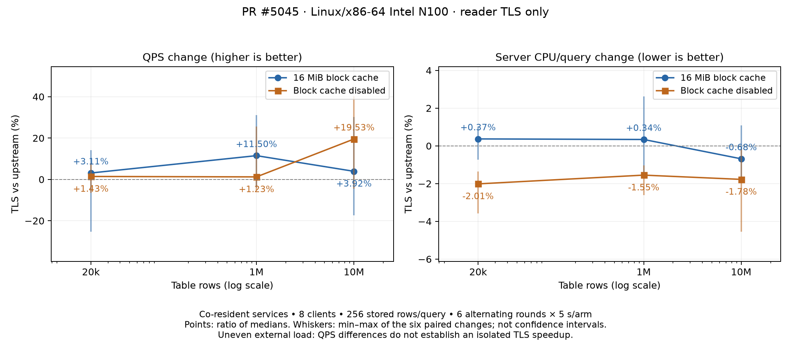

# PR #5045: independent Linux/x86-64 reader TLS benchmark

This tests **reader TLS only**, independently of PR #5042. Both arms retain the original upstream single-mutex, CRC32 docstore block cache. No adaptive cache, cache sharding, XXH3 block-cache change or native DocID lookup cache is included.

With 8 clients returning 256 stored rows/query, observed server CPU/query changes are **-0.68% to +0.37%** at the default 16 MiB cache, and **-2.01% to -1.55%** with it disabled. This Linux run does not reproduce the larger M4 cache-off CPU saving. Host services remain active and their load is uneven between some paired arms, so wall-time QPS differences require the load audit and controls below; these QPS figures do not establish an isolated TLS speedup.

## Comparable source and build

- Upstream base: `047d2f99522d78e0aa1de7e7dc945a9abe1b673a`.
- TLS arm: the same base plus the exact `src/docstore.cpp` patch from #5045 head `019868e9f79d1bb2bd1f96dafb88ef20acd45418`.
- Same five reader tests installed before either build. Same worktree revision, generated version headers, dependencies and build directory. Exactly one of 332 object files changed: `src/CMakeFiles/lmanticore.dir/docstore.cpp.o`. The complete object manifests are retained.
- Ubuntu Clang 18.1.3, `-O2 -DNDEBUG`, no `-march=native`. MCL API-only; rowwise workloads. ICU uses the same system library in both arms. Full configuration and package versions are retained.
- Binary SHA-256: upstream `0fceb502694c975e53d2b432edefd7a13b83ba5b5fb9f342d0957a5ef489ca97`; TLS `12441ce3bcfb257a308db876a4fa7b54d4bab811bf60a359ef9d52ccb5fe1163`.

## Method

- Intel N100, 4 cores / 4 hardware threads, 16 GB nominal RAM (15 GiB Linux usable), x86-64 ZimaOS 1.8.1-alpha2 / Linux 6.18.9. Isolated Ubuntu 24.04 container on native Linux, SSD fixture storage; no CPU quota or affinity changes. Existing CPU governor retained.
- Identical deterministic fixtures to the Apple M4 comparison: 20k / 1M / 10M rows; one 128-byte stored-only text field, 16 KiB blocks, LZ4 compression, flushed disk chunks. Fixture hashes and imported table-registry path rewrites are recorded. Every response validates exact IDs/text; fixture counts and first/middle/last rows are checked in both binaries before timing.
- Loopback clients share the same four-core host and CPU budget as the server. 8 server worker threads throughout. Primary cases have 8 clients; additional point/session-churn cases have 1 and 32 clients, and mixed cases have 8 and 32. HTTP loopback keep-alive; original CPython writes for 1/8 clients, matched single-write request framing for all 32-client primary cases (see diagnostics); SQL result cache disabled; upstream default 8 MiB reader-buffer budget. A query-scoped docstore session is created/cleaned up for stored-field materialization, even with HTTP keep-alive.
- 6 balanced AB/BA rounds × 5 seconds/arm. Each worker warms its full fixed query pool before each timed interval. Only one arm receives benchmark traffic at a time. All **276 timed samples / 2,918,369 validated timed queries** are retained.
- QPS = completed queries / wall time. Server CPU/query = process user+system CPU delta from `/proc/PID/stat` / completed queries, excluding clients and warmup; Linux process CPU tick resolution is 10 ms (100 Hz); low-CPU single-client percentage differences have limited precision. Per-arm medians are shown. **QPS multiplier = TLS/upstream (higher is better); CPU multiplier = TLS/upstream (lower is better).** Percentages compare those medians, not the median of per-round percentages.
- Existing host services are retained: this is a co-resident-service comparison. Warm OS file pages; no cold-storage claim. 30-second idle gate: mean ≥60%, minimum ≥30%. Continuous 1-second host CPU telemetry subtracts benchmark descendants to estimate external CPU. Predeclared flags: external mean >45% of the machine or any overlapping interval >70%. Flags: **1**. These thresholds detect high absolute external usage; they do not test load balance between paired arms. The separate load audit reports that balance for every case. All samples remain available; no rounds are selected by QPS.
- Before any timed sample, an initial idle preflight failed the stricter 85%/70% gate. Its telemetry is retained separately; the co-resident-service criteria above were fixed before starting timing. The same Linux runtime defaults are used in both arms. No macOS stack-calibration environment is imported.

## Data scale: 256 stored rows/query

| Rows | Clients / workload | Block cache | Upstream QPS | TLS QPS | TLS / upstream QPS | CPU ms/query: upstream → TLS | TLS / upstream CPU |
| ---: | --- | ---: | ---: | ---: | ---: | ---: | ---: |
| 20,000 | 8: Random, 256 stored rows | 16 MiB | 1,105.7 | 1,140.1 | 1.031× (+3.11%) | 1.6622 → 1.6684 | 1.004× (+0.37%) |
| 20,000 | 8: Random, 256 stored rows | 0 MiB | 1,039.0 | 1,053.8 | 1.014× (+1.43%) | 1.9665 → 1.9269 | 0.980× (-2.01%) |
| 1,000,000 | 8: Random, 256 stored rows | 16 MiB | 491.5 | 548.0 | 1.115× (+11.50%) | 5.5123 → 5.5310 | 1.003× (+0.34%) |
| 1,000,000 | 8: Random, 256 stored rows | 0 MiB | 661.8 | 669.9 | 1.012× (+1.23%) | 4.7124 → 4.6394 | 0.985× (-1.55%) |
| 10,000,000 | 8: Random, 256 stored rows | 16 MiB | 160.2 | 166.4 | 1.039× (+3.92%) | 15.8026 → 15.6944 | 0.993× (-0.68%) |
| 10,000,000 | 8: Random, 256 stored rows | 0 MiB | 173.9 | 207.9 | 1.195× (+19.53%) | 15.1184 → 14.8500 | 0.982× (-1.78%) |



Points compare per-arm medians; whiskers show min/max of the 6 paired changes, **not confidence intervals**. Three sizes do not locate a universal optimum. The plot retains negative results. Cache-on/cache-off absolute performance is a separate comparison and must not be labeled as a TLS speedup.

## Smaller results, mixed workload and controls

| Rows | Clients / workload | Block cache | Upstream QPS | TLS QPS | TLS / upstream QPS | CPU ms/query: upstream → TLS | TLS / upstream CPU |
| ---: | --- | ---: | ---: | ---: | ---: | ---: | ---: |
| 20,000 | 8: Random, 64 stored rows | 16 MiB | 2,534.0 | 2,548.2 | 1.006× (+0.56%) | 0.6041 → 0.6059 | 1.003× (+0.30%) |
| 20,000 | 8: Random, 64 stored rows | 0 MiB | 2,422.5 | 2,430.1 | 1.003× (+0.31%) | 0.6804 → 0.6739 | 0.990× (-0.95%) |
| 1,000,000 | 8: Random, 64 stored rows | 16 MiB | 1,045.1 | 1,000.3 | 0.957× (-4.29%) | 2.4959 → 2.4873 | 0.997× (-0.34%) |
| 1,000,000 | 8: Random, 64 stored rows | 0 MiB | 1,274.8 | 1,331.9 | 1.045× (+4.48%) | 2.3121 → 2.2877 | 0.989× (-1.06%) |
| 20,000 | 8: Random, 1 stored row | 16 MiB | 4,848.0 | 4,963.3 | 1.024× (+2.38%) | 0.2382 → 0.2414 | 1.013× (+1.32%) |
| 1,000,000 | 8: 4 bulk + 4 hot point clients | 16 MiB | 1,789.3 | 1,820.7 | 1.018× (+1.75%) | 1.0562 → 1.0535 | 0.998× (-0.25%) |
| 20,000 | 8: Random, 1 stored row | 0 MiB | 6,118.1 | 6,882.2 | 1.125× (+12.49%) | 0.2425 → 0.2366 | 0.976× (-2.43%) |
| 1,000,000 | 8: 4 bulk + 4 hot point clients | 0 MiB | 2,158.6 | 2,142.4 | 0.992× (-0.75%) | 1.2288 → 1.2325 | 1.003× (+0.30%) |
| 1,000,000 | 8: Count only, 256 IDs | 16 MiB | 1,154.8 | 1,184.6 | 1.026× (+2.58%) | 1.8784 → 1.8858 | 1.004× (+0.39%) |
| 20,000 | 8: A/A: same upstream binary, 256 rows | 16 MiB | 1,159.9 | 1,164.3 | 1.004× (+0.38%) | 1.6972 → 1.6953 | 0.999× (-0.11%) |
| 20,000 | 8: A/A: same upstream binary, 256 rows | 0 MiB | 1,266.0 | 1,315.8 | 1.039× (+3.94%) | 1.9664 → 1.9648 | 0.999× (-0.08%) |

A/A uses the same upstream binary under both labels. Count-only queries do not retrieve stored fields. Small changes must be interpreted alongside these controls and the paired samples.

## More short-lived sessions

| Rows | Clients / workload | Block cache | Upstream QPS | TLS QPS | TLS / upstream QPS | CPU ms/query: upstream → TLS | TLS / upstream CPU |
| ---: | --- | ---: | ---: | ---: | ---: | ---: | ---: |
| 20,000 | 1: Random, 1 stored row | 16 MiB | 3,035.2 | 3,059.0 | 1.008× (+0.78%) | 0.2102 → 0.2076 | 0.988× (-1.24%) |
| 20,000 | 1: Random, 1 stored row | 0 MiB | 1,878.6 | 1,800.4 | 0.958× (-4.17%) | 0.3125 → 0.3381 | 1.082× (+8.22%) |
| 20,000 | 32: Random, 1 stored row | 16 MiB | 5,619.0 | 5,330.3 | 0.949× (-5.14%) | 0.2173 → 0.2164 | 0.996× (-0.42%) |
| 1,000,000 | 32: 16 bulk + 16 hot point clients | 16 MiB | 1,186.1 | 1,042.3 | 0.879× (-12.12%) | 1.9083 → 2.0248 | 1.061× (+6.10%) |
| 20,000 | 32: Random, 1 stored row | 0 MiB | 5,354.3 | 5,440.1 | 1.016× (+1.60%) | 0.2322 → 0.2307 | 0.993× (-0.67%) |
| 1,000,000 | 32: 16 bulk + 16 hot point clients | 0 MiB | 1,491.1 | 1,492.6 | 1.001× (+0.10%) | 1.5546 → 1.6278 | 1.047× (+4.71%) |

Aggregate CPU/query in mixed cases also depends on the achieved work mix; interpret it alongside both group throughputs. These are end-to-end session-churn measurements, including generation updates, cross-thread invalidation, locking on misses, query handling and response transport. They do not isolate the atomic counter's cost or establish a universal maximum-concurrency result. On a four-core host, client and server CPU share the same CPU budget; client CPU and latency are retained per sample. No TCP reconnect workload is conflated with docstore-session lifetime.

### Mixed-workload groups

| Clients | Cache | Bulk QPS: upstream → TLS | Bulk change | Hot point QPS: upstream → TLS | Point change |
| ---: | ---: | ---: | ---: | ---: | ---: |
| 8 | 16 MiB | 242.7 → 244.5 | +0.73% | 1,546.6 → 1,576.1 | +1.91% |
| 8 | 0 MiB | 432.1 → 438.1 | +1.39% | 1,726.5 → 1,703.2 | -1.35% |
| 32 | 16 MiB | 358.7 → 370.4 | +3.26% | 827.4 → 674.5 | -18.48% |
| 32 | 0 MiB | 407.7 → 433.5 | +6.33% | 1,028.8 → 1,017.6 | -1.09% |

## Complete verification repeats

The flagged comparisons were repeated in full, with the original query and binary hashes. Original rounds are retained above; none were substituted. Additional timed queries: **347,614**; repeat flags: **0**.

| Rows | Clients / workload | Block cache | Upstream QPS | TLS QPS | TLS / upstream QPS | CPU ms/query: upstream → TLS | TLS / upstream CPU |
| ---: | --- | ---: | ---: | ---: | ---: | ---: | ---: |
| 20,000 | 32: Random, 1 stored row | 0 MiB | 5,289.3 | 5,445.8 | 1.030× (+2.96%) | 0.2293 → 0.2295 | 1.001× (+0.10%) |

## High-concurrency transport diagnostics

The initial 32-client/default-cache attempt ended in a readiness timeout during the TLS arm's final warmup, after 11 recorded timed samples. The first driver waited for a token before checking asynchronous worker errors, so the underlying worker exception was not captured. Warmup error propagation and server-log retention were added and selfchecked. A subsequent 32-client/cache-off attempt captured `ConnectionResetError`, with server logs reporting HTTP receive errors / `EAGAIN`. The 32-client A/A diagnostic is retained; it did not capture a connection reset in its completed intervals. The first generic timeout's specific cause remains unconfirmed.

All four 32-client comparisons in the primary tables were then measured using a matched client-only variant: **exactly the same HTTP bytes, coalesced into one send call per request**, in both arms. The client selfcheck asserts byte equality with the original CPython HTTP client. There are no request retries or ignored errors. Engine binaries and query pools are unchanged; every response is still validated. Original 1/8-client comparisons retain their original client. Consequently, concurrency counts here describe individual paired experiments and must not be interpreted as a single transport-identical scaling curve.

The original 19 complete comparisons were retained intact. All earlier completed and incomplete high-concurrency/A/A diagnostic intervals remain in their source directories, `diagnostics.json`, and `samples.csv`: **68 additional recorded samples / 1,604,520 validated queries in recorded intervals**. Failed intervals with incomplete aggregate results are documented by traceback/logs and are not turned into throughput samples. Their quality annotations were not completed when a case failed. No round was selected by QPS. Both original and diagnostic driver versions, the client transport variant and its protocol manifest are archived. The failures remain unresolved: successful runs with the modified client do not establish that the original failures are unrelated to TLS. They also do not prove arbitrary concurrent reader reclamation safe.

## Wall-time load audit

The host retains its existing services. This descriptive audit reports load balance and paired QPS dispersion for every case. It does not filter or replace any samples. A throughput difference accompanied by unequal external load does not establish an isolated TLS speedup. CPU/query and the same-binary controls remain essential.

| Case | External CPU, machine %: upstream → TLS | Median paired QPS change | Paired QPS min…max |
| --- | ---: | ---: | ---: |
| random256-20000-16m | 35.2 → 33.6 | +3.15% | -25.25% … +14.18% |
| random256-20000-0m | 30.5 → 30.5 | +2.81% | -6.44% … +7.89% |
| random256-1000000-16m | 19.7 → 10.9 | +0.79% | -3.94% … +31.12% |
| random256-1000000-0m | 10.8 → 10.1 | +5.80% | -5.23% … +25.57% |
| random256-10000000-16m | 32.7 → 31.2 | +6.23% | -17.30% … +30.21% |
| random256-10000000-0m | 30.7 → 20.0 | +11.12% | -4.46% … +40.22% |
| random64-20000-16m | 34.4 → 31.8 | +2.44% | -10.48% … +14.55% |
| random64-20000-0m | 32.2 → 34.1 | +1.09% | -8.52% … +11.72% |
| random64-1000000-16m | 20.4 → 22.9 | -2.29% | -13.91% … +13.02% |
| random64-1000000-0m | 11.2 → 9.0 | +3.32% | -4.35% … +27.84% |
| point-20000-16m | 35.6 → 34.0 | +4.01% | -10.04% … +10.80% |
| mixed-1000000-16m | 31.9 → 31.4 | +4.16% | -17.04% … +8.94% |
| point-20000-0m | 19.4 → 10.2 | +8.00% | -7.72% … +28.16% |
| mixed-1000000-0m | 8.4 → 8.7 | +0.81% | -13.94% … +19.05% |
| count-1000000-16m | 34.3 → 32.1 | +3.55% | -11.37% … +7.16% |
| aa-20000-16m | 30.3 → 29.7 | +1.96% | -13.16% … +10.87% |
| aa-20000-0m | 15.1 → 11.8 | +2.44% | -9.43% … +9.51% |
| churn-c1-20000-16m | 9.5 → 9.9 | -0.55% | -29.12% … +5.27% |
| churn-c1-20000-0m | 40.2 → 39.9 | -3.90% | -29.78% … +0.90% |
| churn-c32-20000-16m | 32.0 → 34.3 | -2.85% | -24.11% … +5.88% |
| mixed-c32-1000000-16m | 30.4 → 32.5 | -8.17% | -15.22% … +15.47% |
| churn-c32-20000-0m | 33.5 → 31.2 | -0.56% | -12.73% … +11.34% |
| mixed-c32-1000000-0m | 31.8 → 31.8 | -0.83% | -24.30% … +20.93% |

## Interpretation and lifetime safety

A decoded block-cache hit skips `ReadFromFile()` and therefore skips the reader lookup optimized by this PR. Cache-off batched reads expose that lookup more often. Other query costs grow with the workload, and frequent reader insertion/removal advances the process-wide generation, invalidating TLS entries on other workers. Neither larger tables nor higher concurrency guarantees a larger benefit.

The one-entry TLS cache holds a **borrowed pointer**. Acquire/release generation checks invalidate it; they do not reclaim memory or close a check/use race. The existing contract must keep the same reader/session and index alive during a read, serialize use of the same mutable reader, and make shutdown quiescent. The upstream locked path also releases the registry lock before reader use. Arbitrary deletion of the same reader during an active read is not made safe by this patch.

Both arms passed all 497 native tests and five reader tests ×20; logs retain the actual test totals. Each measured comparison also runs ordered REPLACE/FLUSH/DROP/recreate checks in both arms. These checks respect the lifetime contract; they are not a new sanitizer proof of concurrent reclamation.

This is one four-core x86-64 host, one compiler and a synthetic stored-text workload. Small changes within control variation should not be described as reliable gains or regressions. Hardware, worker count, selectivity, block hit rate and the proportion of reader-lookup work can change the outcome.

## Reproduce and audit

See `BUILD.md`, the exact production/common-test patches, package and compile-command manifests, object hashes, test logs, preregistered plans, complete JSON results, per-round journals and CPU telemetry. `summary.csv` and `samples.csv` include every measured case. The separate Apple M4 report remains unchanged. Hardware, compiler and dependency versions differ between the two hosts, so this is not an isolated comparison of operating systems.

```sh
python3 driver/run_tls.py --selfcheck
python3 driver/coalesced_http.py
python3 reproduce.py --selfcheck
# Fresh benchmark workspace only; see BUILD.md for binaries and fixtures:
python3 reproduce.py
# Regenerate this saved report without running a benchmark:
python3 driver/make_linux_report.py merged report --repeat repeat
```

`run_tls.py` expects `searchd-baseline` and `searchd-tls` beside its `driver` directory. Benchmarks use only the Python standard library; plot regeneration additionally requires Matplotlib.
