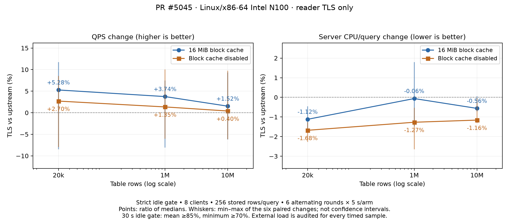

# PR #5045: independent Linux reader TLS retest with a strict idle gate

This fresh experiment tests **reader TLS (thread-local storage) only**, independently of #5042. It uses the same upstream/TLS binaries, deterministic fixtures and query pools as the [earlier Linux run](https://github.com/orca-zhang/manticoresearch/blob/b3b5122cbaa1bbb33fe0eb68e4df3d5a7a87af09/review/docid-tls/independent-tls-linux-2026-11-14/REPORT.md). Measured on November 15, 2026 (Asia/Shanghai), after temporarily stopping `zimaos-search.service` and `zimaos-photos.service` with user authorization. Both services are restored after the benchmark by a host-side exit handler. The full matrix uses a stricter idle gate and external-load thresholds. Earlier measurements remain available; no earlier rounds are substituted into this retest.

At eight clients and 256 stored rows/query, observed server CPU/query changes are **-1.12% to -0.06% with the default 16 MiB block cache**, and **-1.68% to -1.16% with the block cache disabled**. The tables include negative observations, same-binary controls and per-pair dispersion. These are measurements on one four-core host, not a universal speedup or no-regression guarantee.

## Scope, source and method

- Intel N100, 4 cores / 4 hardware threads, nominal 16 GB RAM, x86-64 Linux 6.18.9 / ZimaOS 1.8.1-alpha2; isolated Ubuntu 24.04 container, SSD storage. Clang 18.1.3, `-O2 -DNDEBUG`, no `-march=native`. No governor, CPU affinity or quota changes. Other host services remain enabled; the external-load audit describes the observed environment.
- Upstream base `047d2f99522d78e0aa1de7e7dc945a9abe1b673a`; TLS arm adds only the production patch from #5045 head `019868e9f79d1bb2bd1f96dafb88ef20acd45418`. Both retain the original upstream single-lock CRC32 block cache. No adaptive cache, sharding, XXH3 block-cache change or native DocID cache is included.
- Binary SHA-256: upstream `0fceb502694c975e53d2b432edefd7a13b83ba5b5fb9f342d0957a5ef489ca97`; TLS `12441ce3bcfb257a308db876a4fa7b54d4bab811bf60a359ef9d52ccb5fe1163`. Both were validated by the earlier 497-test native suites and five reader tests ×20 per arm; binaries were reused without rebuilding. Exactly one of 332 build objects differed (`docstore.cpp.o`); original build/test manifests are linked above.
- 20k / 1M / 10M rows; 128-byte stored-only text; 16 KiB/LZ4 blocks; flushed rowwise disk chunks; warm OS file pages. Fixture files are rehashed against the original manifest before this run. Every response validates exact IDs/text. Each complete case also validates ordered REPLACE/FLUSH/DROP/recreate behavior in both arms.
- Eight server workers throughout; 1/8/32 loopback clients share the host CPU budget with the server. SQL result cache off; original upstream 8 MiB reader-buffer budget. Stored-field queries create query-scoped docstore sessions even with HTTP keep-alive.
- Six balanced alternating AB/BA rounds ×5 seconds/arm. Full query-pool warmup before each interval; only one arm receives timed traffic at a time. Main matrix: **23 comparisons / 276 timed samples / 3,823,878 validated timed queries**.
- Before every case: 30 seconds with mean idle ≥85%, minimum idle ≥70%. All 23 primary gates passed; observed gate means span 87.4%–90.2%, with the lowest one-second idle observation 70.4%. A one-second host monitor estimates external CPU by subtracting observed benchmark descendants. Newly started or already-exited descendants can inflate the residual estimate; load flags are conservative diagnostics, not proof of unrelated load.
- Policy fixed before timing: flag a timed interval if external mean exceeds 15% of machine capacity or any overlapping one-second peak exceeds 30%. Flagged main intervals: **7**. Repeat every affected complete primary comparison once in full; preserve all original rounds and repeats. Absolute-load thresholds do not establish perfect paired load balance; the audit below shows that balance without filtering samples.
- QPS = completed queries / wall time. CPU/query = server process user+system CPU delta / completed queries; clients and warmup excluded from the numerator. Linux `/proc/PID/stat` uses 10 ms CPU ticks (100 Hz). Tables compare per-arm medians; QPS and CPU ratios are TLS/upstream. **Higher QPS is better; lower CPU/query is better.** Small low-CPU differences have limited resolution.
- Primary 1/8-client cases use the original CPython HTTP client. Primary 32-client cases use the same client-only single-write framing in both arms as the earlier Linux comparison: identical request bytes, no request retries, no ignored errors, unchanged engine binaries. The separate original-transport diagnostics below test the earlier failure path. These counts are not one transport-identical scaling curve.

## Data scale: 256 stored rows/query

| Rows | Clients / workload | Block cache | Upstream QPS | TLS QPS | QPS ratio / change | CPU ms/query: upstream → TLS | CPU ratio / change |
| ---: | --- | --- | ---: | ---: | ---: | ---: | ---: |
| 20,000 | 8: 256 stored rows | 16 MiB | 1,580.8 | 1,664.3 | 1.053× (+5.28%) | 1.5925 → 1.5747 | 0.989× (-1.12%) |
| 20,000 | 8: 256 stored rows | Disabled | 1,444.9 | 1,483.9 | 1.027× (+2.70%) | 1.8540 → 1.8229 | 0.983× (-1.68%) |
| 1,000,000 | 8: 256 stored rows | 16 MiB | 563.1 | 584.2 | 1.037× (+3.74%) | 5.4643 → 5.4610 | 0.999× (-0.06%) |
| 1,000,000 | 8: 256 stored rows | Disabled | 703.6 | 713.0 | 1.013× (+1.35%) | 4.5962 → 4.5379 | 0.987× (-1.27%) |
| 10,000,000 | 8: 256 stored rows | 16 MiB | 226.9 | 230.4 | 1.015× (+1.52%) | 15.4588 → 15.3719 | 0.994× (-0.56%) |
| 10,000,000 | 8: 256 stored rows | Disabled | 243.2 | 244.2 | 1.004× (+0.40%) | 14.7676 → 14.5965 | 0.988× (-1.16%) |



Whiskers show the minimum/maximum of six paired changes, not confidence intervals. Points compare per-arm medians. Three sizes do not identify a universal optimum, and cache-on/cache-off absolute performance is a different comparison from the TLS effect.

## Smaller results, mixed workload and controls

| Rows | Clients / workload | Block cache | Upstream QPS | TLS QPS | QPS ratio / change | CPU ms/query: upstream → TLS | CPU ratio / change |
| ---: | --- | --- | ---: | ---: | ---: | ---: | ---: |
| 20,000 | 8: 64 stored rows | 16 MiB | 3,737.9 | 3,601.9 | 0.964× (-3.64%) | 0.5657 → 0.5670 | 1.002× (+0.23%) |
| 20,000 | 8: 64 stored rows | Disabled | 3,462.8 | 3,375.8 | 0.975× (-2.51%) | 0.6341 → 0.6280 | 0.990× (-0.96%) |
| 1,000,000 | 8: 64 stored rows | 16 MiB | 1,195.6 | 1,249.2 | 1.045× (+4.48%) | 2.4518 → 2.4281 | 0.990× (-0.97%) |
| 1,000,000 | 8: 64 stored rows | Disabled | 1,345.5 | 1,355.6 | 1.007× (+0.75%) | 2.2747 → 2.2568 | 0.992× (-0.79%) |
| 20,000 | 8: 1 stored row | 16 MiB | 7,653.1 | 7,420.8 | 0.970× (-3.03%) | 0.2198 → 0.2201 | 1.001× (+0.12%) |
| 1,000,000 | 8: 4 bulk + 4 hot point | 16 MiB | 2,508.6 | 2,472.3 | 0.986× (-1.45%) | 0.9908 → 0.9996 | 1.009× (+0.89%) |
| 20,000 | 8: 1 stored row | Disabled | 7,213.2 | 7,208.1 | 0.999× (-0.07%) | 0.2322 → 0.2329 | 1.003× (+0.31%) |
| 1,000,000 | 8: 4 bulk + 4 hot point | Disabled | 2,231.1 | 2,145.8 | 0.962× (-3.82%) | 1.2334 → 1.2406 | 1.006× (+0.58%) |
| 1,000,000 | 8: Count only, 256 IDs | 16 MiB | 1,684.5 | 1,715.8 | 1.019× (+1.86%) | 1.8132 → 1.8069 | 0.997× (-0.35%) |
| 20,000 | 8: A/A, 256 rows | 16 MiB | 1,544.6 | 1,571.0 | 1.017× (+1.71%) | 1.6554 → 1.6571 | 1.001× (+0.10%) |
| 20,000 | 8: A/A, 256 rows | Disabled | 1,420.9 | 1,406.7 | 0.990× (-1.00%) | 1.9255 → 1.9298 | 1.002× (+0.22%) |

A/A uses the exact same upstream binary under both labels. Count-only queries do not retrieve stored fields. Interpret small changes alongside these controls and paired dispersion.

## Short-lived sessions and concurrency

| Rows | Clients / workload | Block cache | Upstream QPS | TLS QPS | QPS ratio / change | CPU ms/query: upstream → TLS | CPU ratio / change |
| ---: | --- | --- | ---: | ---: | ---: | ---: | ---: |
| 20,000 | 1: 1 stored row | 16 MiB | 2,958.8 | 2,981.2 | 1.008× (+0.76%) | 0.2146 → 0.2138 | 0.996× (-0.41%) |
| 20,000 | 1: 1 stored row | Disabled | 2,831.3 | 2,845.6 | 1.005× (+0.50%) | 0.2267 → 0.2274 | 1.003× (+0.29%) |
| 20,000 | 32: 1 stored row | 16 MiB | 8,257.8 | 8,195.4 | 0.992× (-0.75%) | 0.1988 → 0.2003 | 1.008× (+0.75%) |
| 1,000,000 | 32: 16 bulk + 16 hot point | 16 MiB | 1,389.0 | 1,447.1 | 1.042× (+4.18%) | 2.1596 → 1.9930 | 0.923× (-7.71%) |
| 20,000 | 32: 1 stored row | Disabled | 7,718.5 | 7,730.6 | 1.002× (+0.16%) | 0.2127 → 0.2140 | 1.006× (+0.60%) |
| 1,000,000 | 32: 16 bulk + 16 hot point | Disabled | 1,914.8 | 1,851.8 | 0.967× (-3.29%) | 1.5806 → 1.5977 | 1.011× (+1.08%) |

The generation counter is loaded on lookup and advanced on successful reader insertions/removals (and initialization/destruction), not once per returned row. Unrelated sessions can invalidate another worker's TLS entry. End-to-end session churn includes counter updates, invalidation, miss locking, query work and transport; it does not isolate the atomic counter's cost. Mixed aggregate CPU/query also depends on the achieved bulk/point completion ratio.

| Clients | Cache | Bulk QPS: upstream → TLS | Bulk change | Hot point QPS: upstream → TLS | Point change |
| ---: | --- | ---: | ---: | ---: | ---: |
| 8 | 16 MiB | 327.7 → 329.8 | +0.63% | 2,180.9 → 2,140.8 | -1.84% |
| 8 | Disabled | 451.4 → 444.4 | -1.55% | 1,777.8 → 1,699.4 | -4.41% |
| 32 | 16 MiB | 506.5 → 493.2 | -2.62% | 884.9 → 957.3 | +8.17% |
| 32 | Disabled | 596.6 → 595.5 | -0.18% | 1,310.1 → 1,244.7 | -4.99% |

## Verification repeats

| Rows | Clients / workload | Block cache | Upstream QPS | TLS QPS | QPS ratio / change | CPU ms/query: upstream → TLS | CPU ratio / change |
| ---: | --- | --- | ---: | ---: | ---: | ---: | ---: |
| 20,000 | 8: 256 stored rows | 16 MiB | 1,577.4 | 1,584.4 | 1.004× (+0.44%) | 1.6555 → 1.6458 | 0.994× (-0.58%) |
| 10,000,000 | 8: 256 stored rows | Disabled | 241.8 | 243.0 | 1.005× (+0.50%) | 14.7811 → 14.6425 | 0.991× (-0.94%) |
| 20,000 | 8: 64 stored rows | 16 MiB | 3,657.0 | 3,633.3 | 0.994× (-0.65%) | 0.5695 → 0.5666 | 0.995× (-0.51%) |
| 20,000 | 8: 64 stored rows | Disabled | 3,397.5 | 3,506.4 | 1.032× (+3.20%) | 0.6401 → 0.6316 | 0.987× (-1.33%) |
| 20,000 | 8: 1 stored row | 16 MiB | 7,704.7 | 7,381.5 | 0.958× (-4.19%) | 0.2203 → 0.2220 | 1.008× (+0.77%) |
| 20,000 | 8: 1 stored row | Disabled | 7,294.3 | 7,157.2 | 0.981× (-1.88%) | 0.2321 → 0.2332 | 1.004× (+0.45%) |
| 20,000 | 32: 1 stored row | Disabled | 7,950.6 | 7,752.7 | 0.975× (-2.49%) | 0.2134 → 0.2136 | 1.001× (+0.07%) |

Original rounds remain above; none are replaced. Full repeated comparisons: 7; flagged repeat intervals: 9. Repeat quality annotations are retained even if a flag recurs.

The eight-client/default-cache point case records QPS -3.03% in the primary comparison and -4.19% in its complete repeat (repeat CPU/query +0.77%). This is a retained negative throughput observation even though CPU/query is close to flat; a universal no-regression claim is not supported.

## Original-transport 32-client diagnostics

The earlier Linux run encountered an unconfirmed warmup error and a later connection reset with the original HTTP client. This retest preserves that history and tests original framing separately from the matched single-write primary cases. Each diagnostic is one six-round attempt; a failure retains every completed interval and its logs, with no request retries. A successful attempt does not prove the earlier failures unrelated to TLS.

| Diagnostic | Actual binaries | Completed | Recorded timed samples | QPS B/A change | CPU/query B/A change |
| --- | --- | --- | ---: | ---: | ---: |
| original32-16m | Upstream / TLS | No; see logs | 8 | Incomplete | Incomplete |
| aa32-16m | Upstream / upstream (A/A) | Yes | 12 | +0.53% | +0.11% |
| original32-0m | Upstream / TLS | Yes | 12 | +1.31% | +0.66% |
| aa32-0m | Upstream / upstream (A/A) | Yes | 12 | -0.99% | +0.08% |

The recorded journal prefix and warmup traceback place the connection reset in `original32-16m` at the unmodified upstream arm, round 5 (zero-based round 4), before that interval was recorded. This arm attribution is an inference from the fixed AB/BA plan and validated completed-prefix order; see `diagnostic-failure-provenance.json`. The symptom therefore is not exclusive to the TLS binary. Its root cause remains unconfirmed, and this observation is not a proof of arbitrary concurrent reader reclamation safety.

## Paired load and dispersion audit

Every comparison is retained. External CPU percentages describe machine capacity. Paired changes show the six round-wise TLS/upstream ratios; they differ from ratios of per-arm medians.

| Case | External CPU median: upstream → TLS | External peak, either arm | Paired QPS min…max | Paired CPU/query min…max |
| --- | ---: | ---: | ---: | ---: |
| random256-20000-16m | 10.1% → 8.4% | 47.7% | -8.47% … +11.75% | -1.78% … -0.46% |
| random256-20000-0m | 9.1% → 8.4% | 28.7% | -7.95% … +8.52% | -2.27% … -1.26% |
| random256-1000000-16m | 8.9% → 6.8% | 28.9% | -8.08% … +7.47% | -1.47% … +1.80% |
| random256-1000000-0m | 8.5% → 8.7% | 27.0% | -6.05% … +10.03% | -2.64% … -0.53% |
| random256-10000000-16m | 8.0% → 7.1% | 23.8% | -6.22% … +9.33% | -0.72% … +0.05% |
| random256-10000000-0m | 6.7% → 6.8% | 30.2% | -6.17% … +9.76% | -1.30% … -0.05% |
| random64-20000-16m | 8.5% → 9.4% | 34.0% | -8.78% … +8.22% | -0.97% … +0.88% |
| random64-20000-0m | 8.8% → 9.6% | 47.2% | -7.85% … +10.33% | -2.60% … -0.26% |
| random64-1000000-16m | 9.4% → 8.7% | 26.0% | -5.77% … +9.75% | -1.50% … +0.07% |
| random64-1000000-0m | 7.8% → 9.1% | 24.8% | -5.58% … +8.49% | -2.45% … -0.29% |
| point-20000-16m | 6.2% → 8.8% | 36.6% | -11.48% … +9.19% | -0.63% … +0.72% |
| mixed-1000000-16m | 9.1% → 9.6% | 25.6% | -8.23% … +7.16% | -0.67% … +2.52% |
| point-20000-0m | 9.5% → 9.9% | 46.2% | -7.27% … +8.86% | -0.16% … +0.69% |
| mixed-1000000-0m | 6.5% → 9.3% | 25.2% | -8.96% … +6.61% | -1.18% … +4.02% |
| count-1000000-16m | 9.0% → 7.8% | 28.2% | -6.02% … +5.88% | -1.68% … +0.73% |
| aa-20000-16m | 9.2% → 8.9% | 27.1% | -6.47% … +11.17% | -1.16% … +0.23% |
| aa-20000-0m | 7.2% → 8.2% | 24.9% | -7.70% … +7.44% | -0.34% … +1.56% |
| churn-c1-20000-16m | 9.6% → 10.3% | 26.2% | -6.15% … +8.83% | -6.96% … +3.57% |
| churn-c1-20000-0m | 11.2% → 8.7% | 25.3% | -5.70% … +7.63% | -7.09% … +4.40% |
| churn-c32-20000-16m | 8.0% → 7.7% | 26.0% | -9.41% … +6.87% | -0.53% … +2.31% |
| mixed-c32-1000000-16m | 7.9% → 9.6% | 28.2% | -18.39% … +11.88% | -13.78% … +32.49% |
| churn-c32-20000-0m | 8.5% → 9.5% | 31.7% | -6.01% … +7.70% | -1.25% … +1.60% |
| mixed-c32-1000000-0m | 6.9% → 8.3% | 28.2% | -9.07% … +1.94% | -1.68% … +8.11% |

## Interpretation and reader lifetime

A decoded block-cache hit skips `ReadFromFile()` and the reader lookup optimized by this patch. Cache-off batches expose lookup overhead more often; other query costs and session churn can reduce reuse. Neither larger data nor greater concurrency guarantees a larger benefit. Hardware/compiler/dependency differences prevent attributing the difference from Apple M4 solely to Linux.

The TLS entry is a borrowed reader pointer. Acquire/release generation checks invalidate entries across ordered changes; they are not memory reclamation and do not close a check/use race. The session/reader and index must outlive the read, the same mutable reader must be used serially, and shutdown must be quiescent. The upstream lookup also unlocks before using the pointer. Arbitrary concurrent destruction of the same reader is not made safe by this patch. Ordered lifecycle tests and successful benchmarks are not a sanitizer proof of concurrent reclamation.

## Reproduce and audit

`protocol.json` records the fixed idle/quality policy, binary/fixture identities and driver hashes. `prepare_idle.py` changes only the load gate, external-load thresholds and metadata from the earlier driver; it asserts the query-pool and timed measurement regions are byte-identical. `run_idle.py` runs the matrix and diagnostics. The source/build/test provenance is retained in the earlier immutable Linux evidence; this retest reuses those exact binaries. No rebuild is needed to reproduce using the retained task workspace on host 89.

For report regeneration, extract the evidence archive, install Matplotlib, then run:

```sh
python3 driver/make_idle_report.py . report
```

`summary.csv` includes every complete main/repeat/diagnostic comparison. `samples.csv` includes all recorded main/repeat/diagnostic intervals; failed intervals with no completed aggregate are represented by logs, not fabricated throughput samples. Full JSON journals, telemetry, lifecycle results and both client implementations are retained.
