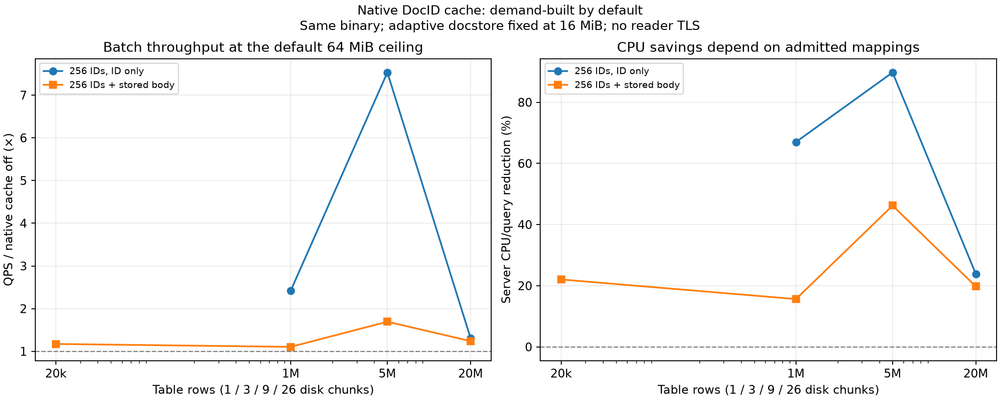

# Native DocID lookup: default demand admission

## Requirement and implementation

Repeated sparse numeric ID batches can spend substantial CPU decoding the compressed disk lookup. A native immutable mapping provides contiguous keys, a cache-line directory and 16 interleaved probes. A complete mapping also lets the planner bound sparse results by the number of input IDs, including the lookup cost of misses.

`docid_lookup_cache_size` remains the sole setting: default `64m`, with `0` disabling it. It is a process-wide allocation ceiling, with whole-chunk admission. Loading chunks, scalar lookups, dense lists and full-count queries do not construct mappings. The first eligible batch records demand; subsequent eligible planning/update calls decode at most 16,384 entries each. Eligibility requires at least 16 numeric IDs and at most 1/64 of chunk rows. The final call also seals the directory.

One builder advances through an atomic state transition; overlapping callers use the compressed path without waiting. Only a sealed unique-ID mapping is published through an acquire/release pointer. Scalar `Find` retains the compressed path without a cache-pointer branch. Allocation failure, exhausted budget, duplicates and interruption preserve the original lookup. Both incomplete and completed allocations are charged to the ceiling and released on chunk remap/destruction. Refused chunks wait until remap before retrying; allocations have no idle shrinking or hot-entry eviction. No reader TLS is used.

## Isolated latest-binary comparison

Source: `503cb2bb9a6a793a5013bd57eee4b6756370d123`. Binary SHA-256: `21d69340e3a0eac12fedad0487b9f8a36547c06f8de5b5a440c501d3b576a749`. The maintained PR head was merged before measuring. Both arms use this same binary; only native DocID configuration changes: explicit `0` versus omitted setting (default 64 MiB). Both keep adaptive docstore at 16 MiB, SQL query cache at zero, and reader TLS absent. These are configuration comparisons, not full-PR speedups over upstream.

Apple M4 Pro / Clang 21, `-O2 -DNDEBUG`; eight clients and eight server workers. Each client cycles 64 deterministic query templates, with full warmup before every timed sample. Six balanced AB/BA rounds × five seconds per arm. Every timed response is checked. Batch queries return 256 rows; stored bodies have 128 bytes, with 16 KiB/LZ4 blocks. Single-ID queries use `id IN (<one>)` and return ID only. Full count has no ID filter. Every case starts fresh servers, so point/count controls have no mapping left from an earlier batch test. A 512-request serial cold pass completes admitted construction before steady-state timing.

The 20k/1M/5M/20M fixtures contain 1/3/9/26 disk chunks respectively; the per-chunk row counts are preserved in `docid-fixture-manifest.json`. No OPTIMIZE was forced to merge them into one chunk. Eligibility and construction apply per chunk. The 16K decoding limit is per eligible build call; a query visiting several chunks can advance several builders. Scale comparisons include the changing chunk layout.

QPS and server CPU/query below are per-arm medians; ratio = default QPS / off QPS. Lower CPU/query is better.

| Rows | Workload | QPS off → default | QPS ratio | CPU ms/query off → default | CPU change | Native MiB |
| ---: | --- | ---: | ---: | ---: | ---: | ---: |
| 20,000 | 256 IDs + stored body | 8,090.9 → 9,485.1 | 1.172× | 0.8295 → 0.6466 | -22.05% | 0.23 |
| 1,000,000 | Single ID | 37,028.3 → 37,204.4 | 1.005× | 0.1480 → 0.1483 | +0.22% | 0.00 |
| 1,000,000 | 256 IDs, ID only | 8,582.0 → 20,790.6 | 2.423× | 0.8452 → 0.2789 | -67.00% | 11.57 |
| 1,000,000 | 256 IDs + stored body | 3,025.0 → 3,341.1 | 1.105× | 2.3975 → 2.0226 | -15.64% | 11.57 |
| 1,000,000 | Full count (no ID filter) | 48,037.2 → 46,935.7 | 0.977× | 0.0886 → 0.0910 | +2.71% | 0.00 |
| 5,000,000 | 256 IDs, ID only | 2,709.6 → 20,407.1 | 7.531× | 2.8781 → 0.2948 | -89.76% | 57.86 |
| 5,000,000 | 256 IDs + stored body | 1,677.3 → 2,840.8 | 1.694× | 4.5662 → 2.4564 | -46.21% | 57.86 |
| 20,000,000 | 256 IDs, ID only | 876.2 → 1,147.2 | 1.309× | 8.9996 → 6.8510 | -23.87% | 59.78 |
| 20,000,000 | 256 IDs + stored body | 715.2 → 886.4 | 1.239× | 10.9279 → 8.7686 | -19.76% | 59.78 |

At 20M rows, all chunk mappings together exceed the default 64 MiB budget. Some chunks are admitted and the others retain compressed lookup. This tests partial admission and fallback under the default ceiling; it does not measure a larger native budget. Native allocations are additional to the independent docstore cache. Construction and startup are excluded from the steady-state table.

Paired-round ratio ranges describe variation, not confidence intervals:

| Rows | Workload | Minimum → maximum QPS ratio |
| ---: | --- | ---: |
| 20,000 | 256 IDs + stored body | 1.161× → 1.195× |
| 1,000,000 | Single ID | 0.988× → 1.018× |
| 1,000,000 | 256 IDs, ID only | 2.371× → 2.533× |
| 1,000,000 | 256 IDs + stored body | 1.085× → 1.130× |
| 1,000,000 | Full count (no ID filter) | 0.969× → 0.996× |
| 5,000,000 | 256 IDs, ID only | 7.394× → 7.762× |
| 5,000,000 | 256 IDs + stored body | 1.622× → 1.733× |
| 20,000,000 | 256 IDs, ID only | 1.298× → 1.327× |
| 20,000,000 | 256 IDs + stored body | 1.226× → 1.282× |

## Fresh-process count confirmation

The primary full-count control showed a negative point estimate despite both arms allocating zero native cache bytes. A separate confirmation starts fresh servers in reversed order (default first, then off), and adds an explicit `64m` arm to distinguish the omitted default from an explicit budget. All six permutations of the three timed arms are used once. The same eight clients, five-second samples, query pool and idle/quality gates apply. No primary result is replaced.

| Native setting | QPS | QPS / off | Server CPU ms/query | CPU vs off |
| --- | ---: | ---: | ---: | ---: |
| default | 46,725.6 | 0.981× | 0.0922 | +3.40% |
| off | 47,644.5 | 1.000× | 0.0892 | +0.00% |
| explicit64 | 47,509.1 | 0.997× | 0.0893 | +0.12% |

Every confirmation sample allocated zero native cache bytes. Quality flags: 0. Small differences in this control do not establish a universal speedup or a causal cache cost; the count query does not build a mapping. Raw samples and configurations are retained.

## Cold construction diagnostic

Each arm executes the same 512 requests serially before parallel timing. All individual latencies and server CPU totals are preserved in `results.json`. This is one diagnostic pass per arm, with no paired repetition; it is not a production tail-latency estimate or a hard latency bound. Decoded work is limited per builder call, while allocation/page faults and final directory sealing can still add latency.

| Rows | ID-only arm | 512-request wall time ms | Server CPU ms | p50 ms | p95 ms | Maximum ms |
| ---: | --- | ---: | ---: | ---: | ---: | ---: |
| 1,000,000 | off | 257.2 | 747.5 | 0.474 | 0.652 | 1.990 |
| 1,000,000 | default | 142.7 | 168.4 | 0.244 | 0.500 | 2.966 |
| 5,000,000 | off | 375.1 | 1561.7 | 0.667 | 0.980 | 4.339 |
| 5,000,000 | default | 162.3 | 325.4 | 0.273 | 0.750 | 0.956 |

## Validation and evidence

The merged production code passed 577 native tests, with 17 additional tests skipped for platform/feature conditions, API smoke, four native lifecycle configurations (default, zero, refused, admitted), and all six docstore switch cases. The final test-only scheduling correction passed focused tests and 23 native cache/lookup tests ×20 under ASan+UBSan and TSan (460 per sanitizer). Instrumentation covers the cache, lookup and their two test translation units; other engine libraries are reused without instrumentation. ASan leak detection is disabled on macOS. The first sanitizer attempt exposed an overly strict test completion assumption; its log is retained. Nonblocking calls can skip construction while another caller builds, so the test now finishes remaining steps serially before asserting readiness.

Main matrix: 108 timed samples, 7,652,064 checked timed queries, 0 load-quality flags. Count confirmation adds 18 samples and 4,271,514 checked queries, with zero flags. The idle gate requires 30 seconds with mean system idle ≥90% and minimum ≥80%. Mean external CPU >10% machine or peak >20% flags a sample. All samples and telemetry are retained; flags require complete-case confirmation.

The published follow-up `a1dd0db409e2365cf372a13c18cdc1cb72a6b029` changes documentation only; its production sources match the measured commit. Its upstream CI workflows require maintainer approval (`action_required`). The preceding merged head built successfully on its tested platforms but failed one CLT columnar REPLACE timing-ratio assertion: 13 against an allowed maximum of 12. That public job log is archived; the threshold is unchanged here. These local passes do not establish an all-green upstream CI run.

Files: original plans/results (including configs, SQL plans, cold traces and raw timing), per-case JSONL journals and load telemetry, combined `results.json`, `summary.csv`, and the exact benchmark/render scripts. The primary driver completed seven cases, then stopped before 20M timing because its assertion incorrectly assumed one oversized chunk. A separate continuation corrects only that multi-chunk admission expectation and measures the two remaining cases using the same binary/protocol. The seven completed cases are preserved without rerunning or selecting rounds. Historical pre-optimization measurements and the interrupted pre-upstream attempt are archived separately; neither is substituted for the table above.

These are warm synthetic ID-filter workloads on macOS. Linux/Windows performance, production endurance, sparse updates and full-text combinations are not established by this throughput matrix. Correctness checks cover updates and planner behavior separately. Cache remap/destruction retains the owning chunk’s quiescent-reader lifetime requirement.
